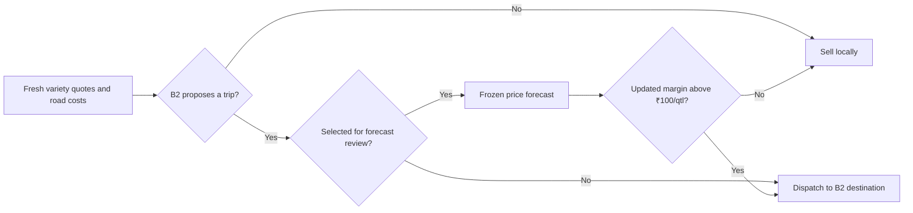

# When should a dispatch policy consult a price forecast?

## Research decision

Preserve the Stage I hypotheses and the corrected Stage II results. Evaluate a separate architecture that gives the strong fresh-road rule (B2) a second opinion. B2 still proposes the destination. A router can send that proposal to the existing 2024 price model; the model can confirm dispatch or veto it in favor of a local sale. This separates three questions: which trip looks risky, which trip merits a model inference, and whether the resulting advice improves the decision. Local model inference was executed. A buyer call and its effectiveness were not observed.

## Decision flow



## Executable agent and controls

For a proposed route let p be today's reported destination price and m be its baseline margin after road costs, fees and the local alternative. B2 requires m > ₹100/qtl. A forecast of proportional price change r gives an updated margin m + pr. Veto when this falls to ₹100 or below. For the budgeted rule, review the smallest (m−100)/p first; this is the fractional price decline required to reverse the decision. Each day allows floor(number of proposed trips / 10) reviews. The full-review arm has no quota. Review-only changes cannot introduce a new destination or recover opportunities B2 rejected.

Batches use the day's proposals jointly. A scored row counts as one forecast evaluation even when multiple rows share a vectorized model invocation. No service tariff, latency budget, or value of a farmer's time was measured. The fixed margin rule needs no additional model fitting. The forecast uses historical price and reporting features, with no decision-weather inputs.

| Cohort and policy | Forecast rows | Vetoes | Modeled mean ₹/qtl per episode | Loss among dispatched trips | Worst-decile payoff ₹/qtl per episode |
|---|---:|---:|---:|---:|---:|
| Six states, B2 | 0 | 0 | 446.66 | 18.11% | −436.69 |
| Six states, margin priority | 4,175 | 1,893 | 449.42 | 16.64% | −393.42 |
| Six states, full review | 43,183 | 3,635 | 453.45 | 14.74% | −317.30 |
| Graded apples, B2 | 0 | 0 | 1,150.83 | 28.43% | −2,069.03 |
| Graded apples, margin priority | 22 | 6 | 1,149.88 | 28.38% | −2,062.62 |
| Graded apples, full review | 517 | 19 | 1,176.96 | 26.71% | −1,789.01 |

The paired six-state gain over B2 was ₹2.77 under the quota (95% percentile interval ₹1.61 to ₹4.17) and ₹6.79 with full review (₹3.86 to ₹10.30). Against a uniform random allocation with the same daily capacity, the margin queue gained ₹2.11 (₹1.14 to ₹3.33). Against blindly refusing its entire selected queue, forecasting added ₹2.21 (₹1.14 to ₹3.30). The comparison uses the exact expected random gain computed from per-day inclusion probabilities. The table also includes a reproducible single random draw in the detailed CSV.

On apples the budgeted difference was −₹0.96 (−₹4.96 to +₹1.66). Full review gained ₹26.13 (+₹0.48 to +₹68.68) and that interval touched zero with four-week blocks. Only 22 of 76 apple proposal-days provided even one quota slot. Six-state mean differences for margin and full review were positive in every reported state and crop; these descriptive subgroups overlap. Intervals resample origins and calendar blocks, omit architecture-selection uncertainty and do not establish independent confirmation.

The full-review mean is below the archived Stage II mean in six states (₹453.45 versus ₹479.17) and above it in graded apples (₹1,176.96 versus ₹812.08). The original v1 means were ₹452.79 and ₹605.06 respectively. Model rankings depend on the cohort and objective. [Episode metrics](budgeted-forecast.csv) · [Paired comparator contrasts](forecast-direct-contrasts.csv) · [Block lengths](forecast-block-sensitivity.csv) · [Subgroups](forecast-subgroups.csv)

## How dependent is the gain on unquoted trips?

Each full-review veto changes the payoff from a modeled B2 dispatch to zero. In six states only 272 of its 3,635 vetoed proposals lacked an exact quote over three days. If every such unquoted dispatch's fallback payoff is increased by the same amount a, the difference against B2 declines by 272a/69,526. Break-even occurs at +₹1,736.48/qtl. This single-parameter sensitivity identifies an assumption that could change the comparison. It does not bound heterogeneity across routes, transport-cost errors, missing lots or the realizability of prices.

## Learned routing and negative controls

A shallow payoff tree trained on settled 2024 B2 dispatches learned eight positive leaf means. It took exactly B2's actions on both panels. Increasing model capacity after seeing this result would change the experiment. [Tree and decision audit](STAGE3_SELECTOR.md)

A contextual router trained to predict the magnitude of avoidable loss concentrated six-state losses more strongly than uniform random review. If checking were free and could reveal every selected trip's eventual modeled payoff perfectly, the gains would be ₹18.05 versus ₹4.25 per episode. Under identical assumptions on apples, learned routing yielded ₹7.77 versus ₹9.37. These are ceilings for the respective selected sets; the router itself cannot observe the future payoff. [Oracle assumptions and matched controls](CONTEXTUAL_VERIFICATION.md)

## Connecting the learned router to an actual tool

The loss-severity router scored all 43,183 six-state proposals, passed 4,175 to the frozen price model, and vetoed 782. Of those, 506 would have lost money and 276 would have made money under the simulator. Its mean was ₹450.84, or +₹4.18 versus B2. The same-budget margin rule gained ₹2.77. Their direct difference was +₹1.41. Resampling both origin markets and 14-day blocks gave a 95% interval from −₹0.39 to +₹3.56. Resampling time blocks alone gave +₹0.17 to +₹2.79. Superiority over the cheap margin router is sensitive to the dependence assumption. The crossed-cluster interval for learned routing versus B2 was +₹1.92 to +₹6.94. The learned agent had a higher losing-trip rate than margin priority, 17.25% versus 16.64%, and a better worst-decile payoff, −₹377.89 versus −₹393.42. These quantities need not rank policies in the same order: a small number of large losses matters more to the tail than to the loss count.

On graded apples, the learned agent averaged ₹1,150.47, −₹0.36 versus B2, after 22 forecast evaluations. Full review reached ₹1,176.96. Calendar-day rounding, the small apple sample and a different payoff distribution all limit transfer. The extra router scores every proposal to save price-model evaluations; wall-clock savings require timing the whole system. [Actual learned-agent payoff, call and veto counts](learned-forecast.csv)

As an additional exploratory comparison, a separate shallow tree learned the signed benefit of running the price tool from 26,566 January–May 2025 proposals settled by the end of calibration. Its training label is zero when the tool would confirm B2, and minus the B2 payoff when the tool would veto. It runs the same price tool on selected proposals. It earned +₹2.33 versus B2 on the main panel, −₹0.44 versus margin priority (paired interval −₹2.39 to +₹1.50), and −₹0.98 versus B2 on apples. Its features, training window and learner differ from the loss-severity router; these results cannot isolate an effect of training target alone. This variant was added after preliminary analyses and provides no basis for increasing architecture complexity. [Signed-value results](tool-value-router.csv) · [Direct contrasts](tool-value-router-contrasts.csv)

| Actual decision, relative to B2 | Six states, ₹/qtl/episode | HP graded apples, ₹/qtl/episode |
|---|---:|---:|
| Shallow tree chooses B2 or local sale | 0.00 | 0.00 |
| Same-budget uniform review (expected) | +0.66 | +0.50 |
| Smallest margin first, then forecast | +2.77 | −0.96 |
| Predicted loss severity first, then forecast | +4.18 | −0.36 |
| Predicted signed tool value first, then forecast | +2.33 | −0.98 |
| Forecast every proposed trip | +6.79 | +26.13 |

The unbudgeted model veto was the strongest of these additions on mean gain across both panels. With a fixed daily budget, learning where losses concentrate gave the highest six-state mean among the tested executable routers and fell slightly below B2 on apples. These are comparisons on the declared panels and measures, not a global optimum. The historical Stage II mean remains stronger on the main panel.

## Reproduce

On a full checkout with the rebuilt six-state candidate file, follow the pinned environment instructions in [the correction record](CORRECTIONS.md). From the root run:

```sh
export PYTHONPATH=. OMP_NUM_THREADS=1 OPENBLAS_NUM_THREADS=1
python -m scripts.audit_budgeted_forecast
python -m scripts.audit_contextual_verification
python -m scripts.audit_learned_forecast
python -m scripts.stage3_policy_selector
python -m scripts.tool_value_router
python -m pytest -q tests
```

## Novelty and limits

Cost-sensitive feature acquisition, selective deferral and policy learning are established. The defensible contribution is an application-level comparison on the same dispatch decisions: measure how much loss a review queue contains, how much an available forecast can actually prevent, and how those two quantities differ under a fixed budget. A language model is unnecessary for the numerical decision; no LLM reliability or field-income claim follows from this experiment. [Nearest prior work](STAGE3_PRIOR_ART.md)

Both panels were inspected before architecture development. Price issue timestamps, actual transactions, farmer adoption and independent temporal replication remain open. Confirmatory evaluation would require freezing the proposal rule, ranking, forecast artifact, daily/online capacity convention, payoff assumptions and primary comparator before collecting new outcomes.

## Decision for a new season

If scoring the local forecast is cheap enough to run on every B2 proposal, full review is the simplest candidate for a prospective test. An additional priority model serves a different use case: only a limited number of proposals can receive a more expensive check. The crossed-cluster comparison does not establish that its extra inference beats the normalized-margin queue. A genuine budget should be measured before deployment. For a prospective evaluation:

1. Before collecting outcomes, freeze the B2 rule, model hashes, review budget, queue timing and fallback for small batches. Record the rule for unanswered checks.
2. Timestamp the proposals, the actual information each check returns, and the resulting decisions. Record service time, failed calls and marginal cost.
3. Designate the same-budget margin queue as the primary routing comparator and B2 as the no-review reference. Use a common episode denominator and specify how missing outcomes will be handled before analysis.
4. Verify lot grade, offered quantity, available local alternatives, receipts and operating costs. Quote agreement alone cannot identify a farmer income effect.

The novelty claim suitable for the thesis today is the empirical evaluation of which mandi dispatches warrant model review and how much of the potential loss avoidance an imperfect tool delivers. The architecture is an example of conditional computation and selective prediction. These experiments do not establish invention of agent routing or priority over all related work.

All five experimental entry points were rerun locally. All nine result CSVs matched their [SHA-256 digests](stage3-results.sha256), and the full suite passed 33 tests. The costs reported here are counts of predictions, excluding model fitting and unmeasured system overhead.

The [independent architecture review](STAGE3_REVIEW.md) reproduced the learned and margin queues. The shallow signed-value tree tied at the daily cutoff on 300 of 311 six-state review days and 20 of 22 apple review days. Its episode-ID tie-break materially defines that policy.
