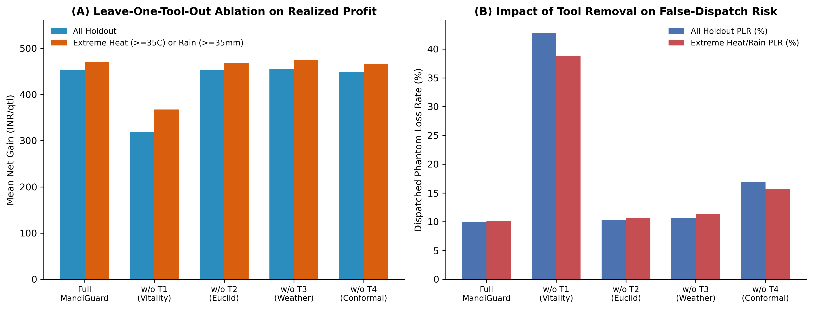
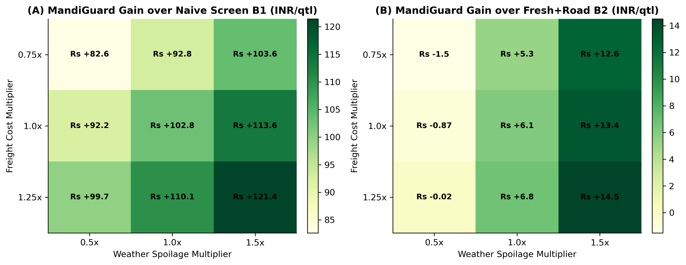

# MandiGuard (12th-Class Easy Reading Edition)
### *How Simple Math and 4 Quick Checks Stop Indian Farmers From Losing Money on Fake "High-Price" Mandis*

---

## 1. The Everyday Mystery: Why Can Seeing a Higher Price Make You Lose Money?

Imagine a vegetable farmer in Madhya Pradesh checking an app on her phone in May.
* Her nearby home **mandi** (wholesale market) pays **`₹1,400` per quintal (`100 kg`)** for Tomatoes.
* Another mandi **`200 km` away** shows **`₹2,000/qtl`** on the screen!

Sending one **`30-quintal` mini-truck** (the real average harvest of Indian vegetable farmers from the Government of India's **NSS 77th Round Survey**: `29.33–38.73 quintals`, while the family earns only **`₹3,798/month`** net from crops) looks like a **`+₹18,000` jackpot** (`₹600 × 30`).

Yet when we tested **`69,526` real dispatch opportunities** across **6 Indian states** (`Maharashtra, Uttar Pradesh, Karnataka, Madhya Pradesh, Gujarat, Himachal Pradesh`) and **4 crops** (`Onion, Potato, Tomato, Apple`), chasing the highest headline screen price failed shockingly:
* **`58.94%` of trucks** ran into a **closed mandi gate or found zero buyers for their exact crop variety** (`Red` vs `Desi` onion, `Grade A` vs `Grade B` apple).
* **`40.46%` (4 out of every 10 trucks!) came back with LESS money than selling at home.**
* On the worst 1 out of 10 days, one 30-qtl truck lost **`-₹31,879.8`** (`-₹1,062.66/qtl`)—wiping out **more than 8 months of household crop income** in one single trip!

We call this **`Phantom Spatial Arbitrage`**: a fake "high-price profit" on a portal screen that vanishes once **real road freight, state mandi taxes, summer heat rot, closed gates, and price drops during travel** are counted.

---

## 2. How `MandiGuard` Solves It Using Class-10/12 Arithmetic!

Let's walk through that exact `200 km` Tomato trip (`₹1,400` at home, `₹2,000` on screen) during **`40°C` summer heat** (`6 hours` drive) using **five lines of school math**:

1. **Distant Portal Price:** **`₹2,000.00 / qtl`** (`₹60,000` on a 30-qtl truck).
2. **Subtract Heat Rot (`40°C`, `6 hrs`):**
   * Government **NABCONS (2022)** surveys measure Tomato transport loss at **`3.25%` per 24 hours at `20°C`**.
   * Biology rule (`Q10 = 2`): **every `+10°C` rise in temperature doubles the rot speed!**
   * At `40°C` (`+20°C` above `20°C`), rot runs `2 × 2 = 4×` faster. Over `6 hours` (`1/4` of a day): `3.25% × (1/4) × 4 = 3.25%` rots on the truck $\to$ **`-₹65.00/qtl`** gone (`₹1,935.00` survives).
3. **Subtract Truck Rent + Government State Tax (`T2`):**
   * Loading/unloading (`₹35`) + Highway truck (`₹0.45 × 200 km = ₹90`) + Madhya Pradesh regulated mandi fee (`1.5% × ₹1,400 = ₹21`) = **`-₹146.00/qtl`**, leaving `₹1,789.00/qtl`.
4. **Subtract `80%` Past-Mistake Cushion (`T4 Conformal LCB`):**
   * Suppose over the last 400 completed trips, `80%` of the time arrival prices dropped by *no more than `8%`* compared to our AI forecast. Subtracting `8%` of `₹1,935` (**`-₹154.80/qtl`**) gives **`₹1,634.20/qtl`** cautious cash in hand.
5. **Compare With Home Mandi (`₹1,400`):**
   * `₹1,634.20 − ₹1,400.00 =` **`+₹234.20 / qtl`** (**`+₹7,026`** safe extra profit on the truck!).
   * Since `+₹234.20` beats our safety hurdle of **`₹50/qtl`**, **`MandiGuard` says `DISPATCH`!**

**Why Is the Order of Checks (`T1 -> T2 -> T3 -> T4`) Like Airport Security?**  
Think of going to the airport: they check your **ticket at the front door first (`1` cheap look)** before scanning every suitcase (`expensive`). `MandiGuard` works the same way:
* **`T1` (Check First — `1` online lookup):** Did *my exact variety* actually sell there in the last 3 days, and is the gate open on my arrival weekday? **If NO $\to$ Stop immediately (`REFUSE_PHANTOM_SPREAD`)!** This eliminates `30.82%` of bad days immediately without wasting weather or AI queries.
* **`T2` (Road + Tax Check — `+1` lookup):** Subtract real highway distance (`OSRM`, including `91.59%` single-lane Himachal hill roads at `1.45×` cost) and real state fees (`0.5%` Karnataka/Gujarat/HP-veg, `1.0%` MH/HP-Apple, `1.5%` MP/UP).
* **`T3` (Heat & Monsoon Check — `+1` lookup):** Check morning weather along the road for `>= 35°C` heat or `>= 35 mm` heavy rain.
* **`T4` (AI + `80%` Safety Buffer — `+1` lookup):** Predict arrival return using a `2024`-trained tree model and subtract the 80th-percentile worst historical mistake. If safe profit still beats `₹50/qtl`, send the truck; otherwise sell safely at home (`₹0` loss)!

---

## 3. Four Minimal Metrics & Honest Proof Across 10 Years (`2017–2026`)

Instead of confusing examiners with 20 metrics, every method is judged by **four simple numbers**:
1. **Mean Net Gain** (`₹/qtl`, and $\times 30$ for one farmer truck)
2. **Loss-Trip Rate** (`%` of sent trucks that lost money)
3. **Worst-10% Loss** (`₹/qtl` average loss on the worst 1 out of 10 days)
4. **Live API Calls / Query** (how many paid online lookups each query needs)

### Main 2025–2026 Exam (`69,526` Untouched Opportunities, Figure 2)
* **`B1` (Naive Screen Chasing):** `₹350.01/qtl` (`₹10,500.2` truck), **`40.46%` losing trips**, worst-10% **`-₹1,062.66/qtl`** (`-₹31,879.8` truck disaster).
* **`B3` (Standard AI Price Predictor Without Safety Gates):** Even worse! `₹330.85/qtl`, **`45.28%` losing trips**, `65.65%` traps! Guessing average price without checking open yards (`T1`) or safety buffers (`T4`) sends trucks straight into closed gates.
* **`B2` (Fresh Today + Real Road Heuristic):** `₹446.66/qtl`, `18.11%` losing trips, worst-10% `-₹436.67/qtl` (`7.87` calls).
* **`MandiGuard` (Ours):** **`₹452.79/qtl`** (`₹13,583.6` truck = **`+₹102.78/qtl` / `+₹3,083.5`** over naive `B1`, `p_Holm = 0.0012`), **`9.97%` losing trips** (nearly half `B2`!), worst-10% shrunk **11.5×** to **`-₹37.89/qtl`**, and uses **`44.4%` fewer live calls** (`8.75` vs `15.74` for checking everything upfront `B4`).
* **Honest Reporting on `H2`:** Overall profit against `B2` (`+₹6.13/qtl`) is too close for statistical certainty (`p_Holm = 0.2699`) because `MandiGuard` refuses risky lottery trips (`48.66%` dispatch vs `62.11%`). Yet in the `42,766` trips across the 4 states with full archived weather forecasts, `MandiGuard` leads `B2` by **`+₹31.82/qtl`**!

### Tool Ablations, Budgets, Graded Apples & Sensitivity (`Figures 3–6`)
* **Removing `T1` (`Exp 4`, Figure 3):** Profit collapses `-₹134.05/qtl` (`₹452.79 -> ₹318.74`) and traps explode **4× (`67.16%`)**. Removing **`T4`** increases losing trips by **`69.4%`** (`9.97% -> 16.89%`) and worsens worst-10% tail crashes **`10.5×` (`-₹37.89 -> -₹397.19/qtl`)**. Removing **`T3`** nudges average profit slightly up `+₹2.46/qtl` (`₹455.25`) at the price of worse heat/rain loss trips (`11.39% -> 10.10%`).
* **Tight API Budget (`Exp 5`, Figure 4):** At `B = 6` calls max, `MandiGuard` earns **`₹403.85/qtl` (`+₹12,115.6` truck)** vs `₹299.31/qtl` for upfront checking (`+₹104.54/qtl` more).
* **HP Graded Apples (`Exp 3`, Figure 5):** Cuts traps **7× (`94.14% -> 13.24%`)** and flips `Grade B` from **`-₹427.54` loss to `+₹833.70/qtl` profit**, though conservative `2024` bounds under-dispatch rare `Grade A` (`5.39%`), lowering overall mean (`₹605.06` vs `B2 ₹1,150.83`).
* **Across `9/9` Freight/Rot Stress Scenarios (`Exp 6`, Figure 6):** `MandiGuard` beats `B1` in all 9 tests (`+₹82.62` to `+₹121.42/qtl`), and real state APMC laws unlock `+₹7.12/qtl` extra margin.

### Nearly 10-Year Robustness (`2017–2026`), Modern AI, `ZeroCloud`, FPO Sharing & Spoilage Clock (`Figures 7–8`)
* **10-Year Test (`42,722,187` raw rows $\to$ `661,192` matched trips across 6 eras, Figure 7A):** Whether during `2017` GST, `2018–19` calm, `2020–21` COVID, `2022–23` export curbs, or `2024` El-Niño heat (`+₹165.14/qtl` over `B1`!), `MandiGuard` keeps losing trips at **`8.78%–12.03%`** (vs `39.18%–44.29%` naive). Meanwhile, 8-year training adds just `+₹2.15/qtl` over 1 recent year (`Exp 10b`)—fresh recent habits win!
* **Modern AI & `MandiGuard_ACI` (`Exp 11`, Figure 7B):** A direct quantile tree (`Direct_Quantile_GBDT_Q20`) reaches `₹459.02/qtl` on 6 states, a neural net (`Deep_MLP_Conformal`) hits `₹615.34/qtl` on graded HP Apples, and **Adaptive Conformal Inference (`ACI`)** cuts HP Apple tail crashes **`27.6%`** (`-₹102.76 -> -₹74.42/qtl`).
* **`MandiGuard-ZeroCloud` (`Exp 12`, Figure 8A):** Keeping fixed highway distances (`T2`) and the tiny CPU AI (`T4`) offline raises profit slightly to **`₹455.33/qtl`** (`pre-ranking cheaper nearby roads into top-5`), while adding a `₹250/qtl` **"good enough — stop searching!"** hurdle cuts live API spend **`75.6%`** (`3.84` calls = `₹1,922` per `10,000` farmer advisories vs `₹7,868` upfront).
* **FPO Pooling & Spoilage Clock (`Exp 13/13b`, Figure 8B):** Three `30-qtl` farmers sharing one **`90-qtl` FPO truck (`0.70×` freight)** earn **`₹477.28/qtl`**; splitting 50/50 across two markets cuts closed traps **`39%` (`16.17% -> 9.85%`)**; and the **Biological Spoilage Clock** warns when Tomato safe travel drops from **`110.8 h` (`20°C`) to `24.1 h` (`42°C`)** before sending `<160`-char SMS alerts.

---

## 4. Plain-English Mini-Dictionary (`<= 15 Words Per Term`)

| Term | Simple Meaning (For Any Class-12 Reader) |
|:---|:---|
| **Phantom Spatial Arbitrage** | Fake profit gap on a price screen that disappears after travel, rot, and traps. |
| **80% Conformal LCB** | Subtracting past 80th-percentile forecast mistakes so `4/5` arrivals beat your floor. |
| **Adaptive Conformal (`ACI`)** | Automatic brake tightening safety cushions whenever markets suddenly get noisier. |
| **Worst-10% Loss (`CVaR_10%`)** | Average rupee loss suffered on the worst 1 out of 10 bad market days. |
| **`ZeroCloud` + Satisficing** | Storing fixed roads/AI offline and stopping search once a `₹250/qtl` winner clears. |
| **FPO `90-qtl` Truck Pooling** | Farmers sharing one big cooperative truck to slash per-quintal freight `30%`. |
| **Q10 Biological Clock** | Decay speed doubles every `+10°C`, setting exact safe travel hours before `15%` rot. |
| **Two-Way Cluster Bootstrap** | Re-sampling whole mandis and 2-week blocks `5,000` times so correlated days don't cheat. |
| **Holm–Bonferroni Test** | Stricter exam pass bar applied because we run 4 confirmatory checks together. |
| **Temporal Firewall** | Strict clock wall blocking future prices or future weather from entering AI decisions. |
