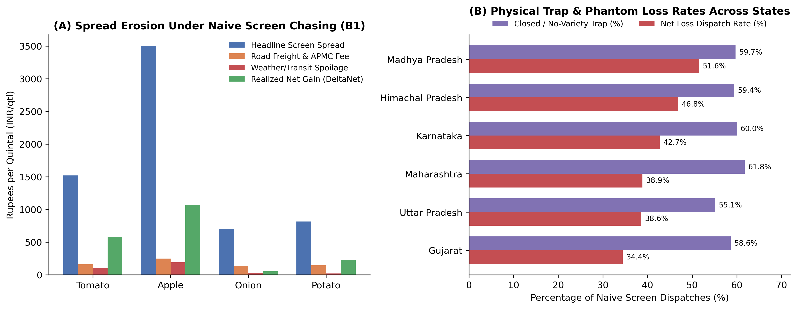
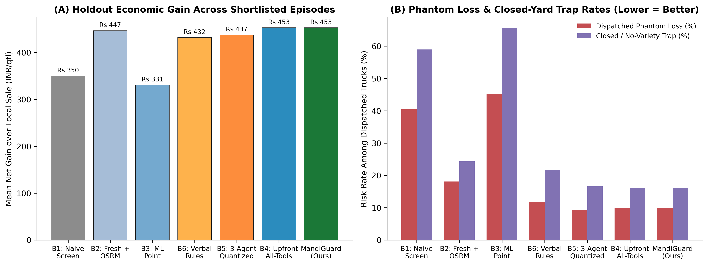
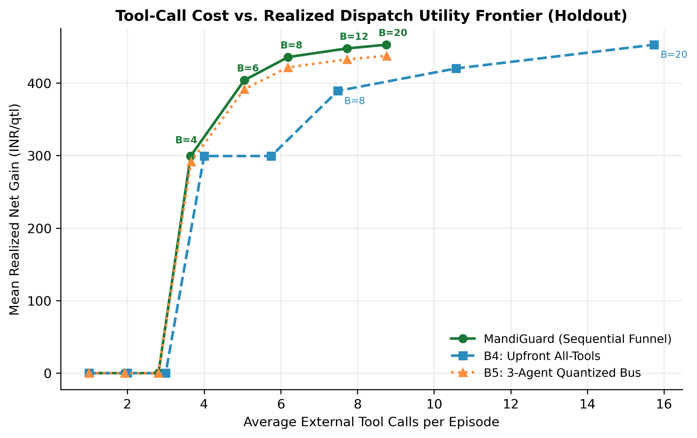
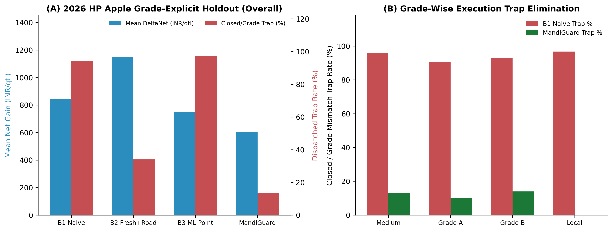
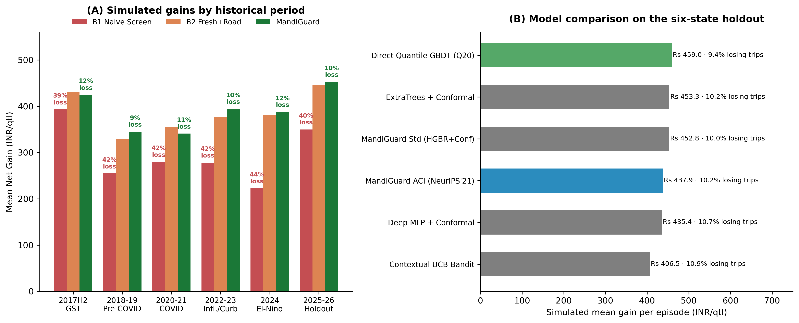
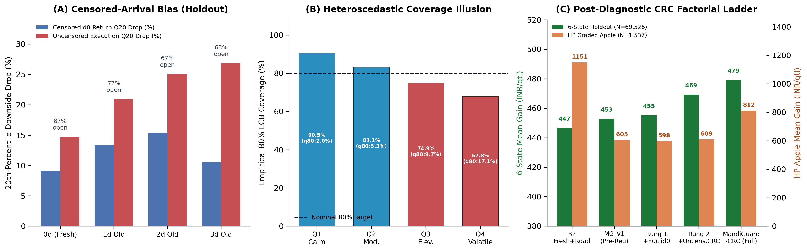
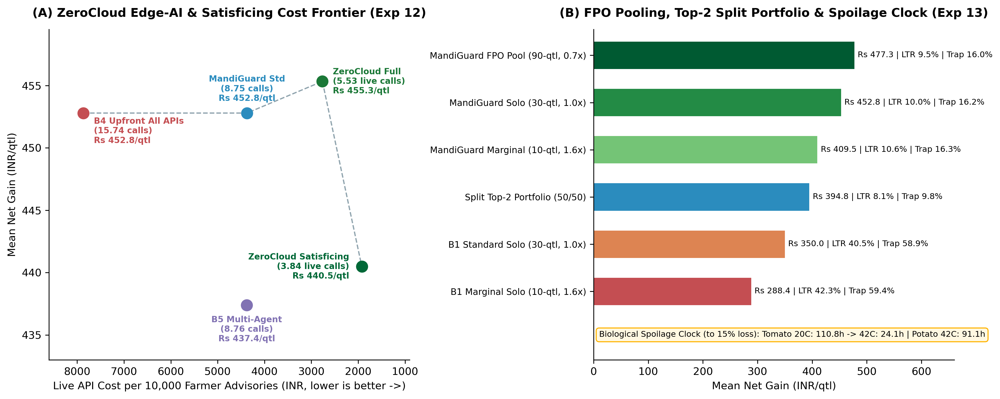

# MandiGuard (12th-Class Easy Reading Edition)
### *How Four Simple Checks Stop Indian Farmers From Losing Money on Apparent "High-Price" Mandis*

---

## 1. The Everyday Mystery: Why Can Seeing a Higher Price Make You Lose Money?

Imagine a tomato farmer in Madhya Pradesh checking an app on her phone in May.
* Her home **mandi** (wholesale market) pays **₹1,400 per quintal** (100 kg).
* Another mandi 200 km away shows **₹2,000 per quintal** on the screen.

Sending one **30-quintal mini-truck** looks tempting. According to the Government of India's **NSS 77th Round Survey**, Indian onion and potato growers harvest about 29.33–38.73 quintals per season, while the average farm household earns only **₹3,798/month** in net crop income. A ₹600/qtl screen gap looks like **+₹18,000** extra cash (`₹600 × 30`).

Yet when we measured **69,526 real dispatch opportunities** across 6 Indian states (Maharashtra, Uttar Pradesh, Karnataka, Madhya Pradesh, Gujarat, and Himachal Pradesh) and 4 crops (Onion, Potato, Tomato, and Apple; June 2025–April 2026), chasing the highest screen price failed often:
* **58.94% of trucks** arrived at a closed gate or found no buyers for their exact crop variety over 3 days (Red vs Desi onion, Grade A vs Grade B apple).
* **40.46% (4 out of every 10 trucks)** earned less money than selling safely at home.
* On the worst 1 out of 10 days, one 30-qtl truck lost **-₹31,879.8** (-₹1,062.66/qtl)—more than 8 months of average household crop income.

We call this **Phantom Spatial Arbitrage**: a tempting price gap on a screen that disappears once real highway freight, state mandi taxes, heat or rain spoilage, closed gates, and arrival-day price drops are counted.

---

## 2. How `MandiGuard` Works Using Class-10/12 Math

`MandiGuard` is not a chatbot or a complex black-box system—there is no LLM or reinforcement-learning policy inside it. Instead, it is a **risk-gated dispatch decision-support system** built from four deterministic checks (`T1 -> T2 -> T3 -> T4`), a frozen 2024 tree predictor, and an empirical safety cushion.

Let's walk through that same 200 km Tomato trip (₹1,400 at home, ₹2,000 on screen) on a hot **40°C May afternoon** (6 hours drive) using five lines of school arithmetic:

1. **Distant Portal Price:** **₹2,000.00/qtl** (₹60,000 on 30 qtl).
2. **Subtract Heat Rot (40°C, 6 hrs):**
   * Government **NABCONS (2022)** surveys report Tomato market transport loss at **3.25% per 24 hours at 20°C**.
   * Biology rule (`Q10 = 2`): every +10°C temperature rise doubles rot speed.
   * At 40°C (+20°C hotter), rot runs `2 × 2 = 4` times faster. Over 6 hours (1/4 day), `3.25% × (1/4) × 4 = 3.25%` spoils on the truck, subtracting **-₹65.00/qtl** (₹1,935.00 remains).
3. **Subtract Truck Rent and State Tax (`T2`):**
   * Loading (₹35) + Highway truck (₹0.45 × 200 km = ₹90) + Madhya Pradesh regulated mandi fee (1.5% × ₹1,400 = ₹21) = **-₹146.00/qtl**, leaving ₹1,789.00/qtl.
4. **Subtract 80% Past-Mistake Cushion (`T4` Conformal Lower Bound):**
   * Suppose over the last 400 completed trips, 80% of the time arrival prices dropped by *no more than 8%* below our tree forecast. Subtracting 8% of ₹1,935 (**-₹154.80/qtl**) gives **₹1,634.20/qtl** cautious cash in hand.
5. **Compare With Home Mandi (₹1,400):**
   * ₹1,634.20 − ₹1,400.00 = **+₹234.20/qtl** (+₹7,026 safe extra profit on the 30-qtl truck).
   * Because +₹234.20 clears our frozen safety margin of **₹50/qtl**, `MandiGuard` outputs `DISPATCH`.

**Why Put the Checks in Order (`T1 -> T2 -> T3 -> T4`)?**  
Think of airport security: staff check your **ticket at the front gate first (1 quick lookup)** before scanning every suitcase. `MandiGuard` follows the same rule:
* **`T1` (Check First — 1 lookup):** Did *my exact variety* sell there in the last 3 days, and is the yard active on my arrival weekday? If NO, stop immediately (`REFUSE_PHANTOM_SPREAD`) and save all later queries.
* **`T2` (Road + Tax Check — +1 lookup):** Subtract real highway distance (OSRM, including 91.59% single-lane Himachal hill roads at 1.45x cost) and statutory state fees (0.5% Karnataka/Gujarat/HP-veg, 1.0% Maharashtra/HP-Apple, 1.5% MP/UP).
* **`T3` (Heat & Monsoon Check — +1 lookup):** Check dispatch-morning weather along that road for `>= 35°C` heat or `>= 35 mm` heavy rain.
* **`T4` (Tree Forecast + 80% Safety Buffer — +1 lookup):** Predict arrival return with a 2024-trained tree model and subtract the 80th-percentile historical mistake. If safe gain still beats ₹50/qtl, send the truck; otherwise sell safely at home (₹0 loss).

---

## 3. Four Simple Metrics & Two Honest Views of the Results

Every method is judged using four clear numbers:
1. **Mean Net Gain** (₹/qtl, and $\times 30$ for one farmer truck)
2. **Loss-Trip Rate** (% of sent trucks that lost money)
3. **Worst-10% Loss** (average loss on the worst 1 out of 10 days, `CVaR_10%`)
4. **Live API Calls / Query** (how many online lookups each decision uses)

### View 1: Main 2025–2026 Holdout (`N = 69,526`, Modeled Trap Penalties, Figure 2)
* **`B1` (Naive Screen Chasing):** ₹350.01/qtl (₹10,500.2 truck), **40.46% losing trips**, worst-10% **-₹1,062.66/qtl** (-₹31,879.8 truck loss).
* **`B3` (Standard ML Price Predictor Without Safety Gates):** ₹330.85/qtl, **45.28% losing trips**, 65.65% traps, worst-10% **-₹1,097.80/qtl**. Predicting average prices without checking open yards (`T1`) or safety buffers (`T4`) sends trucks straight into silent markets.
* **`B2` (Fresh Today + Real Road Heuristic):** ₹446.66/qtl, 18.11% losing trips, worst-10% -₹436.67/qtl (7.87 calls).
* **`MandiGuard` (Ours):** **₹452.79/qtl** (₹13,583.6 truck = **+₹102.78/qtl** or +₹3,083.5 per truck over `B1`, $p_{\text{Holm}} = 0.0012$), **9.97% losing trips** (nearly half `B2`), and worst-10% reduced from -₹436.67 to **-₹37.89/qtl**. It matches upfront all-tools profit (`B4`: ₹452.79/qtl) using **44.4% fewer calls** (`8.75` vs `15.74`, `H4`), an expected benefit of checking `T1` first.
* **Honest Reporting on `H2` and `H4`:** Against `B2`, `MandiGuard`'s +₹6.13/qtl average lead is within statistical noise ($p_{\text{Holm}} = 0.2699$, so `H2` is **not supported**). `MandiGuard` trades away risky lottery trips (48.66% dispatch vs 62.11%) to lower loss risk and tail crashes. An exploratory check on 42,766 trips in the 4 states with full archived weather forecasts shows +₹31.82/qtl over `B2`, confirming that weather estimation in the remaining 43/145 northern grid cells did not distort results—not as a rescue of `H2`. Similarly, saving API calls (`H4`) mainly helps when query caps are tight (`B = 6`), while direct API fee savings (₹0.05/call) are tiny compared with crop profit.

### View 2: Fair Matched Open-Yard Check & Trap-Penalty Crossover (`Exp 15`)
What if missing portal rows do not always mean locked gates? `Exp 15` answers this cleanly without selection bias:
1. **Fair Matched Guaranteed-Open Cohort (`N = 10,162` identical episodes where every top-5 yard had observed arrival-day `d0` prices—zero modeled trap penalties):**
   * `MandiGuard` (**₹510.89/qtl**, 6.82% loss trips, -₹36.07 worst-10%) still beats `B1` (₹472.51/qtl, **+₹38.38**) and `B2` (₹469.99/qtl, **+₹40.91**).
   * However, unfiltered point-ML `B3` earns **₹553.22/qtl** (+₹42.33/qtl higher mean than `MandiGuard`) when all yards are open—at **2.2x more losing trips** (14.77% vs 6.82%) and **10x deeper tail losses** (-₹362.40 vs -₹36.07). On 3-day matched episodes (`N = 16,849`), `MandiGuard` earns ₹592.53/qtl (7.74% loss trips) vs `B1` ₹581.06 (+₹11.47), `B2` ₹572.09 (+₹20.44), and `B3` ₹670.38 (15.02% loss trips).
   * **The simple lesson:** Price forecasting itself works well when yards are open; standard point-ML fails on the full market because it skips `T1` openness checks and `T4` downside cushions.
2. **Trap-Penalty Crossover Curve (`N = 69,526`, varying closed-yard return cost from 1.5x down to 0.0x):**
   * `MandiGuard` beats `B1` and `B3` under baseline 1.5x / 10% (+₹102.78 / +₹121.94), 1.0x one-way / 10% (+₹91.66 / +₹109.39), 0.5x / 5% (+₹42.43 / +₹46.12), and even if missing-3d trips break even at ₹0 (+₹82.26 / +₹73.61).
   * `MandiGuard` crosses below `B1`/`B3` on average profit only at the unrealistic `0.0x` return freight and `0%` discount boundary (-₹10.00 vs `B1`, -₹20.93 vs `B3`), where `MandiGuard` still cuts losing trips roughly three-fold to **6.09%** (vs 18.52% `B1` and 20.40% `B3`).

### Ablations, Budgets, Graded Apples, Sensitivity & 10-Year Checks (`Figures 3–7`)
* **Which Check Helps Most? (`Exp 4`, Figure 3):** Removing `T1` drops profit by -₹134.05/qtl (₹452.79 -> ₹318.74) and raises traps 4.2x (to 67.16%). Removing `T4` raises losing trips from 9.97% to 16.89% and worsens worst-10% tail losses from -₹37.89 to -₹397.19/qtl. Removing `T3` nudges average profit up +₹2.46/qtl (₹455.25) while raising extreme-weather losing trips (10.10% -> 11.39%).
* **Tight API Budget (`Exp 5`, Figure 4):** At `B = 6` calls max, `MandiGuard` earns **₹403.85/qtl** (₹12,115.6 truck) vs ₹299.31/qtl for upfront checking (+₹104.54/qtl more).
* **HP Graded Apples (`Exp 3` & Stage-II `Exp 16`, Figure 5):** Cuts traps seven-fold (94.14% -> 13.24%), reduces worst-10% losses from **-₹8,487.24/qtl to -₹102.76/qtl**, and turns Grade B from -₹427.54 loss to +₹833.70/qtl profit. Candidly, Stage-I overall mean (₹605.06 vs `B2` ₹1,150.83) trailed because Stage-II audit `Exp 16` proved that **`77.82%`** of Stage-I holdout refusals vs `B2` (`82.75%` warmup) were blocked at gate `T1` when newly split apple grades (`Grade A`/`Range-1`) looked sparse on rolling 14-day counters.
* **Stress Grid (`Exp 6`, Figure 6) & Dual-Tier Official Portal Parity (`Exp 14`):** `MandiGuard` beats `B1` across all 9/9 freight $\times$ rot stress combinations (+₹82.62 to +₹121.42/qtl). Bulk 2017–2026 CSVs came from a public archive mirror, audited across two official sources: Tier-1 single-day `data.gov.in` XML (`2023-10-18`, 172 matched keys: **100.00% `Min`/`Max` and 99.42% `Modal` parity**), and Tier-2 direct official **AGMARKNET 2.0 export** spanning **149 trading days** (`2025-11-07..2026-04-13`, 2,042 matched keys: **100.00% `Min`/`Max`/`Modal` parity**), alongside 22 live Nov-2026 `agmarknet.gov.in` checks (11/22 silent for 7 days).
* **Nearly 10 Years Across 6 Eras (`2017–2026`, `Exp 10` & `10b`, Figure 7A):** Across 661,192 matched trips (42,722,187 raw archive records), `MandiGuard` keeps losing trips at **8.78%–12.03%** vs 39.18%–44.29% naive (+₹165.14/qtl over `B1` during the 2024 El-Niño heatwave), and 8-year training adds just +₹2.15/qtl over 1 recent year. *(Honesty note: automated unit tests verify deterministic code execution, schema parity, and split hygiene—not real-world economic truth; truck hire, $Q_{10}$ rot, and closed-yard penalties lack field weighment receipts or farmer survey validation.)*

### Stage-II (`[POST-DIAGNOSTIC / VALIDATION-CALIBRATED]`): Why `MandiGuard` Stalled Against `B2` & How `MandiGuard-CRC` Fixes It (`Exp 16`–`17`, Figure 8)
After seeing `H2` stall at `+₹6.13/qtl` and Stage-I HP Apples miss Grade A trades, we opened the hood (`Exp 16`, Figure 8A–B) and found **three hidden traps inside our own Stage-I design**:
1. **Hiding Closed Days (`Censored-Arrival Survivorship Bias`):** Stage-I `MandiGuard` deleted rows where the arrival mandi never opened (`dropna`), throwing away **55.83%** of raw 2024 routes. Even after passing `T1`, 3-day-old quotes closed **37.37%** of the time on arrival (`d0` open rate dropped from 89.10% to 62.63%). Deleting those losses made risky 3-day-old routes look up to **2.54x safer** on holdout (`-10.55%` vs true `-26.82%` Q20 drop) than they really were!
2. **One-Size-Fits-All Safety Pillow (`Heteroscedastic Coverage Illusion`):** Stage I subtracted one average crop-level safety cushion (`~6–8%`), which was way too thick on calm `Q1` mandis (**90.46%** coverage vs `1.98%` true Q80 error—blocking safe profit) yet twice too thin on noisy `Q4` mandis (collapsing to **67.80%** coverage when true errors hit `17.08%`).
3. **Splitting Apples Into Thin Grades (`T1` Sub-Grade Sparsity):** When Himachal mandis reported `Grade A` vs `Grade B` separately, **`77.82%`** of Stage-I holdout refusals against `B2` came from `T1` thinking the yard was inactive—even when the apple mandi was open!

**How `MandiGuard-CRC` Solves All Three (`Exp 17`, Figure 8C):** Instead of dropping closed trips or adding a rigid quantile pillow, `MandiGuard-CRC` trains two 2024 tree models directly on the `274,296` settled post-`T1` profitable routes using full uncensored profit (`Y_full`): expected net gain ($\hat{\mu}$) and probability of losing money ($\hat{p}_{\text{loss}}$). Using simple arithmetic tuned once on `Val_2025H1` (`N = 42,794`, $\beta_{\text{target}} = 0.095$, zero holdout tuning), it scores each route as $\hat{\mu} - 0.15 \cdot P_{\text{loc}} \cdot \hat{p}_{\text{loss}}$, pre-sorts Step-0 candidates by `1.20x` straight-line freight, and uses the `fresh0` rule (`age == 0` with `open_prob_14d >= 0.20` & `dow_open_rate >= 0.25`) so fresh quotes clear `T1`:
* **Main Holdout (`N = 69,526`):** Climbs from ₹452.79 to **₹479.17/qtl** (`₹14,375.1` per 30-qtl truck)—now beating `B1` by **+₹129.16/qtl** ($p = 0.0004$), beating `B2` by **+₹32.51/qtl** ($p = 0.0016$), and beating `MG_v1` by **+₹26.38/qtl** ($p = 0.0002$) while keeping conditional losing trips near 10% (10.48%).
* **Open-Yard Fairness Check (`N = 10,162` identical `d0`-open episodes):** Reaches **₹533.75/qtl** at **7.14%** losing trips (vs `MG_v1` ₹510.89, `B1` ₹472.51, `B2` ₹469.99, and `B3` ₹553.22 at 14.77% LTR).
* **HP Graded Apples (`N = 1,537`):** Rises **+34.2%** (`₹605.06 -> ₹812.08/qtl`), lifting Grade A from `₹205.46` (20.0% LTR) to **`₹477.56/qtl`** (`11.54%` LTR). *(We report this clearly as post-diagnostic Stage II rather than pre-registered Stage I to uphold zero-HARKing discipline.)*

---

## 4. Plain-English Mini-Dictionary

| Term | Simple Meaning (For Any Class-12 Reader) |
|:---|:---|
| **Phantom Spatial Arbitrage** | Apparent screen price gap that vanishes after freight, heat rot, and traps. |
| **80% Conformal Cushion** | Subtracting past 80th-percentile forecast mistakes so 4/5 arrivals beat your floor. |
| **Adaptive Conformal (`ACI`)** | Safety brake that tightens cushions automatically when markets grow noisier. |
| **Worst-10% Loss (`CVaR_10%`)** | Average rupee loss suffered on the worst 1 out of 10 bad market days. |
| **`ZeroCloud` + Satisficing** | Storing fixed roads/tree offline and stopping search once ₹250/qtl clears. |
| **FPO 90-qtl Truck Pooling** | Farmers sharing one larger cooperative truck to lower per-quintal freight 30%. |
| **Q10 Biological Clock** | Rot speed doubles every +10°C, giving safe travel hours before 15% loss. |
| **Two-Way Cluster Bootstrap** | Resampling whole mandis and 2-week blocks 5,000 times so correlated days don't cheat. |
| **Holm–Bonferroni Test** | Stricter statistical threshold applied when checking multiple hypotheses together. |
| **Temporal Firewall** | Strict time barrier preventing future prices or weather from leaking into decisions. |

---

## Appendix: Optional Deployment & Model Illustrations (`Exp 11`–`Exp 13b` — Not Main Contributions)

> **What This Section Is:** The main findings above (`H1`–`H4` and `Exp 1`–`Exp 15`) stand on their own. The three bonus examples below are extra engineering "what-if" illustrations shown strictly as Appendix material, not main thesis claims.

* **Alternative Predictors & `MandiGuard_ACI` (`Exp 11`, Figure 7B):** A direct quantile tree (`Direct_Quantile_GBDT_Q20`) reaches ₹459.02/qtl on 6 states, a neural net (`Deep_MLP_Conformal`) reaches ₹615.34/qtl on graded HP Apples, and Adaptive Conformal Inference (`MandiGuard_ACI`) reduces HP Apple worst-10% losses by 27.6% (-₹102.76 -> -₹74.42/qtl).
* **`MandiGuard-ZeroCloud` (`Exp 12`, Figure A1A):** Keeping static road tables (`T2`) and the small CPU tree (`T4`) offline yields ₹455.33/qtl (pre-ranking cheaper nearby roads into top-5), while a validation-frozen ₹250/qtl "good enough — stop searching" hurdle reduces modeled API spend by 75.6% (3.84 live calls = ₹1,922 per 10,000 queries vs ₹7,868 upfront at ₹0.05/call).
* **FPO Pooling & Spoilage Clock (`Exp 13/13b`, Figure A1B):** Three 30-qtl farmers sharing one 90-qtl FPO truck (modeled 0.70x freight) reach ₹477.28/qtl; splitting 50/50 across two yards cuts closed traps 39% (16.17% -> 9.85%); and the $Q_{10}$ Biological Spoilage Clock warns when Tomato safe travel drops from 110.8 h (20°C) to 24.1 h (42°C) inside sample `<160`-char SMS cards.

