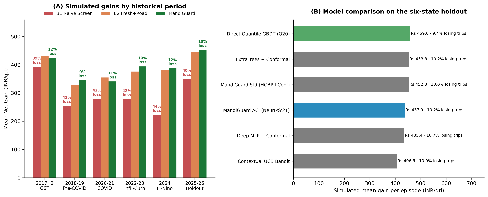
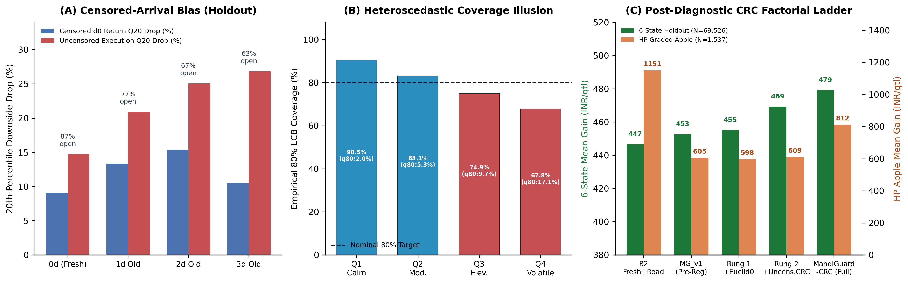

# Phantom Spatial Arbitrage in Indian Agricultural Mandis: Pre-Registered Risk-Gated Verification (`MandiGuard`), Censored-Arrival Diagnosis, and Uncensored Risk Control (`MandiGuard-CRC`)

## Abstract

Public agricultural portals allow Indian vegetable and fruit farmers to compare wholesale prices across regional markets (`mandis`) every morning. On screen, another market 15–500 km away often appears ₹700 to ₹1,330 per quintal higher than the local yard—a large apparent gain on a 30-quintal smallholder mini-truckload. Yet across 69,526 real dispatch opportunities in six Indian states (Maharashtra, Uttar Pradesh, Karnataka, Madhya Pradesh, Gujarat, and Himachal Pradesh) and four perishable crops (Onion, Potato, Tomato, and Apple; June 2025–April 2026), **58.94%** of trucks following top headline quotes arrive at a closed market or find no active buyers for their exact variety over three days, and **40.46%** lose money relative to selling locally. We measure and term this phenomenon **Phantom Spatial Arbitrage**: an apparent price spread on a portal screen that erodes once silent or closed destinations, variety mismatches, highway trucking costs, state mandi fees, ambient heat/rain spoilage, and arrival-day price drops are counted. Even an unfiltered machine-learning (ML) point price forecaster (`B3`) performs worse than chasing headline screens, losing money on **45.28%** of dispatched trips (65.65% closed or missing-variety traps).

To investigate and mitigate these avoidable losses with strict anti-HARKing discipline, we report a **Two-Stage Architecture** grounded in public archives whose parity is verified across two official tiers (`Exp 14`: single-day `data.gov.in` XML across 172 keys at 100.00% `Min`/`Max` and 99.42% `Modal` parity, plus a 149-day official AGMARKNET 2.0 direct export across 2,042 market-variety-grade-day keys at **100.00% `Min`/`Max`/`Modal` parity**). In **Stage I (Pre-Registered Confirmatory System, `MandiGuard` v1)**, a deterministic four-step verification cascade (`T1 -> T2 -> T3 -> T4`, with no large language model or reinforcement-learning policy) pairs a frozen 2024 gradient-boosted tree model with an empirical 80% causal conformal cushion and explicit stay-home refusal (`REFUSE_PHANTOM_SPREAD`). Evaluated via 5,000 two-way cluster bootstrap resamples across 174 origin mandis and 23 two-week blocks with Holm–Bonferroni control (`N = 69,526`), `MandiGuard` confirms three of four pre-registered hypotheses: it beats naive screen chasing (`B1`) by **+₹102.78/qtl** (+₹3,083.5 per 30-qtl truck; 95% CI [+₹48.66, +₹153.45], $p_{\text{Holm}} = 0.0012$), cuts episode phantom losses vs unfiltered point-ML (`B3`) by **37.29 pp** ($p_{\text{Holm}} = 0.0008$), and matches upfront checking (`B4`, ₹452.79/qtl) using **44.4% fewer external calls** (8.75 vs 15.74, $p_{\text{Holm}} = 0.0008$). Against a fresh same-day road heuristic (`B2`, `H2`), Stage-I mean superiority (+₹6.13/qtl, $p_{\text{Holm}} = 0.2699$) is **not** statistically significant—trading dispatch volume (48.66% vs 62.11%) to cut loss-trip rate (9.97% vs 18.11%) and worst-10% losses (-₹37.89 vs -₹436.67/qtl). Under `Exp 15` (`N = 10,162` identical guaranteed-open episodes with zero simulated traps), `MandiGuard` beats `B1` (+₹38.38/qtl) and `B2` (+₹40.91/qtl) while showing that `B3` earns +₹42.33/qtl higher mean on open yards at 2.2x higher loss rate and 10x deeper tail losses.

In **Stage II (`[POST-DIAGNOSTIC / VALIDATION-CALIBRATED]`, `Exp 16`–`Exp 17`)**, a mechanistic autopsy explains *why* `MandiGuard` v1 stalled against `B2` on mean profit (`H2`) and under-performed on graded 2026 Himachal Pradesh apples (`Exp 3`): (1) **Censored-Arrival Survivorship Bias**—dropping missing arrival rows (`dropna`) discards 55.83% of raw `Train_2024` corridors (12.64% post-`T1`) and understates 3-day downside tail risk by 1.94x in training and **2.54x** on holdout; (2) **Heteroscedastic Coverage Illusion**—commodity-pooled additive cushions over-cover calm quartiles (90.46% in `Q1`) while collapsing to **67.80%** in volatile quartiles (`Q4`); and (3) **Sub-Grade `T1` Sparsity**—rolling `open_prob_14d >= 0.50` caused **77.82%** of Stage-I holdout HP Apple refusals vs `B2` (`82.75%` in warmup), rather than conformal interval width (`22.18%`/`16.59%`). Training two 2024 models directly on uncensored payoff `Y_full` ($\hat{\mu}, \hat{p}_{\text{loss}}$) and selecting scalar tail weight $\lambda^* = 0.15$ strictly on `Val_2025H1` ($N = 42{,}794$) via the empirical Conformal Risk Control calibration ratio ($\beta_{\text{target}} = 0.095$, `MandiGuard-CRC`, zero holdout tuning) plus grade-aware `T1` (`fresh0`) liquidity raises out-of-sample holdout gain to **₹479.17/qtl** (+₹14,375.1 per 30-qtl truck)—beating `B1` (+₹129.16/qtl, $p = 0.0004$), `B2` (**+₹32.51/qtl**, 95% CI [+₹12.05, +₹50.49], $p = 0.0016$), and `MG_v1` (+₹26.38/qtl, $p = 0.0002$). Gains persist on trap-free `Matched_AllTopK_Observed_d0` (`N = 10,162`: **₹533.75/qtl**, 7.14% loss trips) and HP Graded Apples (`N = 1,537`: **₹812.08/qtl**, +34.2% over `MG_v1`). Multi-regime testing across 2017–2026 (42,722,187 raw archive records; 661,192 matched episodes) yields 8.78%–12.03% loss-trip rates and +₹165.14/qtl over `B1` during the 2024 El-Niño heatwave. Exploratory Appendix illustrations (`Exp 11`–`Exp 13b`) examine alternative predictors, edge caching, and cooperative FPO logistics.

---

## 1. Introduction: Empirical Measurement of Phantom Arbitrage in Indian Mandis

Economic studies show that price information helps producers earn higher returns when goods move reliably to higher-paying destinations—most notably in Robert Jensen's study of Kerala coastal fisheries \cite{jensen2007digital} and central Indian soybean kiosks \cite{goyal2010information}, alongside platform integration reforms such as Karnataka's Unified Market Platform \cite{levi2020impact}. Inland Indian horticultural markets, however, face substantially higher frictions. Empirical studies document persistent price dispersion and incomplete spatial market integration across Indian wholesale yards due to road transport costs, information frictions, grade fragmentation, and local market structure \cite{sekhar2012agricultural, chatterjee2016six, levi2020impact}. Field experiments with West Bengal potato farmers demonstrate that simply informing smallholders of distant wholesale prices fails to raise farm-gate earnings when safe, reliable transport and market execution are absent \cite{mitra2018asymmetric}, leaving many smallholders dependent on local buyers \cite{negi2018farmers}.

Consider the household stakes for an Indian smallholder. According to the Government of India's National Statistical Office (*NSS Report No. 587*, 77th Round Situation Assessment Survey) \cite{nss77report587}, onion and potato cultivating households harvest an average of 29.33–38.73 quintals per season—roughly **one 30-quintal mini-truckload**. Meanwhile, average monthly net crop income per agricultural household is **₹3,798**, with 50.2% of households carrying an average debt of ₹74,121. If a grower sees an online portal showing a modal price ₹700/qtl higher 200 km away, sending one 30-quintal truck appears to offer +₹21,000 in extra income—more than five months of household net crop earnings.

Our empirical audit across 2017–2026 (`Exp 1`, `Exp 10`) shows why most of that apparent spread erodes before cash reaches the farmer. Four physical and reporting frictions turn tempting screen gaps into losses:

1. **Wrong Crop Variety or Grade (Cultivar Mismatch):** Portals commonly highlight a headline crop price, whereas auction buyers bid separately on specific varieties (Red vs Desi onions) or quality grades (Grade A vs Grade B apples). Arriving at a market with no active buyer for that exact variety triggers distress discounting.
2. **Closed Auction Gates & Stale Screen Quotes (Non-Reporting Hazard):** Regional markets follow rotating weekly holidays or skip daily portal updates during local disruptions \cite{guo2020mandi, deka2026missing}. Dispatching perishables against a several-day-old stale screen quote risks arriving at an inactive yard, incurring overnight waiting fees (₹25/qtl/day) or return haulage.
3. **Real Mountain & Rural Highways vs Straight-Line Map Distance:** Approximating routes with straight-line Euclidean or Haversine distance understates actual road kilometers and drive times \cite{luxen2011osrm}. According to the *Himachal Pradesh Economic Survey 2025–26* \cite{hpeconsurvey2026}, **91.59%** of motorable roads in Himachal Pradesh (39,465 of 43,091 km) are single-lane hill roads—raising fuel costs and transit duration.
4. **Summer Heat, Monsoon Rain & State Market Fees:** Fresh tomatoes, onions, and apples deteriorate along open highways during summer heatwaves (`>= 35°C`) and monsoon downpours (`>= 35 mm/day`). At the same time, statutory state market fees vary by jurisdiction \cite{pib154554apmc}: Karnataka and Gujarat waive APMC fees on fruits and vegetables (leaving ~0.5% user charges), Himachal Pradesh waives vegetables *except apples* (0.5% vegetables vs 1.0% apples), Maharashtra charges 1.0% inside APMC yards, and Madhya Pradesh and Uttar Pradesh collect 1.5% regulated fees.

Recent applied mandi price systems train forecasting models (XGBoost, SARIMA, CNN) and rank markets using straight-line distances and point predictions \cite{madaan2019price, ma2019price, biradar2026agrimarket, manimegalai2026mandicast}. Standard ML loss functions penalize over-prediction and under-prediction symmetrically. For a smallholder earning ₹3,798/month, over-predicting an arrival price and losing sunk freight hurts far more than missing a marginal upside, calling for **cost-sensitive selective abstention** \cite{chow1970optimum, franc2023optimal}.

To address this decision problem without black-box orchestration, `MandiGuard` is built strictly as a **risk-gated dispatch decision-support system** (`four-step verification cascade`). There is **no large language model (LLM) and no reinforcement-learning (RL) policy** inside `MandiGuard`; it combines deterministic ordered filtering (`T1 -> T2 -> T3 -> T4`), a frozen gradient-boosted tree model (`HistGradientBoostingRegressor`), and a causal empirical conformal cushion.

### Summary of Contributions
Grounded in public AGMARKNET price archives, OpenStreetMap road networks, ERA5/NASA POWER climate grids, and official Government of India survey parameters, this thesis makes five structured contributions across pre-registered Stage I and post-diagnostic Stage II:
1. **Empirical Measurement & Dual-Tier Official Parity of Phantom Spatial Arbitrage (`Exp 1`, `Exp 10`, `Exp 14`):** Quantifies where apparent cross-mandi portal spreads vanish across 178 core markets (6 states, 4 perishable crops) from 2017 to 2026 (883,406 panel rows extracted from 42,722,187 raw archive records), audited across two official tiers (`Exp 14`: single-day `data.gov.in` XML on `2023-10-18` across 172 matched keys at 100.00% `Min`/`Max` and 99.42% `Modal` parity, plus 149 days of official `AGMARKNET 2.0` direct export across 2,042 market-variety-grade-day rows at **100.00% `Min`/`Max`/`Modal` parity**)—decomposing highway freight/fees, modeled thermal spoilage, and arrival-day closed/variety traps.
2. **Government-Grounded Payoff Model & Two-View Open-Yard Audit (`Exp 6`, `Exp 15`):** Parameterizes daily spoilage from MoFPI/NABCONS (2022) market loss surveys \cite{nabcons2022phl}, state charges from GoI APMC deregulation notices \cite{pib154554apmc}, hill trucking from GoHP road logs \cite{hpeconsurvey2026}, and smallholder scale from NSO NSS 77th Round household surveys \cite{nss77report587}, while testing sensitivity across a $3\times 3$ freight/spoilage grid, a trap-penalty crossover curve (`N = 69,526`), and fair matched complete-observation cohorts (`N = 10,162` and `N = 16,849`).
3. **Pre-Registered Stage-I Risk-Gated Cascade (`MandiGuard` v1: `H1`–`H4`, `Exp 2`–`Exp 5`, `Exp 7`–`Exp 9`):** Combines a deterministic cheap-first cascade (`T1 -> T2 -> T3 -> T4`) \cite{kachuee2019opportunistic, yao2023react, han2024uala}, frozen 2024 tree arrival forecaster, and empirical 80% causal conformal lower bound \cite{angelopoulos2023conformal, lei2018distribution} with explicit `REFUSE_PHANTOM_SPREAD` abstention \cite{chow1970optimum}, outperforming `B1` (`+₹102.78/qtl`, `H1`), reducing episode losses vs `B3` by 37.29 pp (`H3`), matching `B4` in 44.4% fewer external calls (`H4`, +₹104.54/qtl at `B = 6`), and transferring zero-shot across unseen states (`Exp 9`).
4. **Stage-II Mechanistic Autopsy of Selective-Label Bias, Heteroscedasticity & `T1` Sub-Grade Sparsity (`Exp 16`, `[POST-DIAGNOSTIC]`):** Establishes three failure mechanisms inside Stage-I `MandiGuard` v1: (i) **Censored-Arrival Survivorship Bias** \cite{lakkaraju2017selective}—dropping missing arrival rows (`dropna`) discards 55.83% of raw `Train_2024` corridors and understates 3-day Q20 downside drops by 1.94x (`Train`) and up to 2.54x (`Holdout`); (ii) **Heteroscedastic Coverage Illusion** \cite{romano2019conformalized}—commodity-pooled cushions over-cover `Q1_Calm` (90.46%) while collapsing to 67.80% in `Q4_Volatile`; and (iii) **Sub-Grade `T1` Sparsity**—rolling `open_prob_14d >= 0.50` blocked 77.82% of Stage-I holdout HP Apple refusals vs `B2` (`82.75%` warmup), correcting our initial attribution.
5. **Stage-II Uncensored Risk Control (`MandiGuard-CRC`, `Exp 17`, `[POST-DIAGNOSTIC / VALIDATION-CALIBRATED]`):** Replaces censored return LCB scoring with uncensored payoff $\hat{\mu} - \lambda^* P_{\text{loc}} \hat{p}_{\text{loss}}$ ($\lambda^* = 0.15$ calibrated solely on `Val_2025H1` [$N = 42{,}794$] adapting the empirical Conformal Risk Control ratio at $\beta_{\text{target}} = 0.095$ \cite{angelopoulos2024conformal}) plus grade-aware `T1` (`fresh0`) liquidity, reaching **₹479.17/qtl** on `Holdout_2025_2026` (+₹32.51/qtl over `B2`, $p = 0.0016$; +₹26.38/qtl over `MG_v1`, $p = 0.0002$), **₹533.75/qtl** on trap-free `N = 10,162` open yards, and **₹812.08/qtl** (+34.2% over `MG_v1`) on 2026 HP Graded Apples. *(Exploratory alternative predictors, local `ZeroCloud` caching, cooperative `FPO` truck-sharing, and thermal countdown SMS cards—`Exp 11`–`Exp 13b`—are presented strictly as Appendix illustrations, not main contributions.)*

---

## 2. Related Work & Where `MandiGuard` Fits

**Table 1** summarizes how Stage-I `MandiGuard` and Stage-II `MandiGuard-CRC` build upon prior agricultural economics, mandi forecasting, selective-label auditing, and conformal risk-control research.

**Table 1: Positioning of `MandiGuard` (Stage I) and `MandiGuard-CRC` (Stage II) Against Prior Research**

| Research Area | Key Prior Work | What Prior Studies Show | How `MandiGuard` (Stage I & Stage II) Builds Upon This |
|:---|:---|:---|:---|
| **Indian Mandi Markets & Price Dispersion** | Jensen \cite{jensen2007digital}; Goyal \cite{goyal2010information}; Sekhar \cite{sekhar2012agricultural}; Chatterjee & Kapur \cite{chatterjee2016six}; Mitra et al. \cite{mitra2018asymmetric}; Negi et al. \cite{negi2018farmers}; Levi et al. \cite{levi2020impact}; Mahajan & Tomar \cite{mahajan2021covid} | Regional price gaps persist; price information or portal unification alone raises prices selectively while transport, market-access, and grade-liquidity frictions remain high. | Audits daily `(origin -> destination)` routes for exact / `fresh0` variety liquidity, arrival weekday activity, highway hours, and weather rot before dispatch. |
| **Mandi Price Forecasting & Selective Labels** | Madaan et al. \cite{madaan2019price}; Ma et al. \cite{ma2019price}; Guo et al. \cite{guo2020mandi}; Deka \cite{deka2026missing}; *AgriMarket AI* \cite{biradar2026agrimarket}; *Mandi Cast* \cite{manimegalai2026mandicast}; Lakkaraju et al. \cite{lakkaraju2017selective} | ML apps impute missing series or regress on observed arrivals using straight-line distances, creating selective-label blind spots on closed yards. | Stage I separates open-yard screening (`T1`) from OSRM freight (`T2`), weather rot (`T3`), and safety margins (`T4`); Stage II trains directly on uncensored payoffs (`Y_full`) to prevent 1.82–2.54x censored downside understatement (`Exp 16`–`17`). |
| **Selective Refusal, Heteroscedastic Conformal Bounds & CRC** | Chow \cite{chow1970optimum}; Lei et al. \cite{lei2018distribution}; Romano et al. \cite{romano2019conformalized}; Franc et al. \cite{franc2023optimal}; Angelopoulos & Bates \cite{angelopoulos2023conformal}; Gibbs & Candès \cite{gibbs2021adaptive}; Angelopoulos et al. \cite{angelopoulos2024conformal} | Cost-aware abstention; heteroscedasticity in pooled split conformal intervals (motivating CQR); conformal risk control for monotone bounded losses under exchangeability. | Stage I uses frozen causal 80% conformal bounds with `REFUSE_PHANTOM_SPREAD`; Stage II audits 21–23 pp volatility-quartile miscoverage (`Exp 16`) and adapts the empirical CRC ratio heuristic ($\lambda^*=0.15$ on `Val_2025H1`, $N=42{,}794$, $\beta_{\text{target}}=0.095$) to balance expected net gain vs modeled loss probability (`Exp 17`). |
| **Budgeted Deterministic Verification Cascades** | ReAct \cite{yao2023react}; Kachuee et al. \cite{kachuee2019opportunistic}; UALA \cite{han2024uala} | Ordered feature acquisition and calibrated uncertainty gating cut expensive verification tool calls. | Deterministic `T1 -> T2 -> T3 -> T4` ordering (no LLM or RL policy) matches upfront all-tool utility using 44.4% fewer calls (`ZeroCloud` & `ACI` illustrated in Appendix). |

**Methodological Transparency:** We do not claim new conformal prediction theorems or new spoilage physics. Standard split conformal \cite{angelopoulos2023conformal} and Conformal Risk Control (CRC) Theorem 1 \cite{angelopoulos2024conformal} finite-sample guarantees rely on exchangeability (and fixed evaluation denominators), which daily non-stationary agricultural prices and selective `dispatch(lambda)` denominators violate across monsoon and harvest shifts. In **Stage I**, we therefore freeze tree weights in 2024, update conformal error buffers strictly as prior dispatches mature (`arrival_date <= decision_date`), verify empirical coverage on validation (78.85%) and holdout (79.07%), and illustrate Adaptive Conformal Inference \cite{gibbs2021adaptive} in Appendix A.1. In **Stage II** (`Exp 17`), we explicitly frame `(n_loss + 1)/(n_disp + 1) <= beta_target` (`lambda* = 0.15` frozen on `Val_2025H1`) as an **empirical validation-calibration heuristic** inspired by Angelopoulos et al. \cite{angelopoulos2024conformal}—relying on strictly held-out evaluation (`N = 69,526`, `N = 10,162`, and `N = 1,537`) rather than exchangeability theorems.

---

## 3. Data Sources, Public Archives & Provenance Checks

All price observations, road geometries, weather grids, and statutory parameters in this study come from public datasets and government publications—with **zero synthetic price series** and **zero anti-bot or security bypassing**.

### 3.1 Ten-Year Multi-State AGMARKNET Market Archive (2017–2026) & Official Spot-Check
For our primary training, validation, and holdout pipeline (2024–2026), we streamed **14,443,770** daily AGMARKNET records (2024, 2025, and January–April 13, 2026) from a public archive mirror, filtered to our six states and four perishable crops (681,258 raw rows), removed 284 invalid/outlier price rows (0 bad dates) and 7,003 exact duplicates, leaving **673,971** clean market-day records across 699 yards.

To prevent **survivorship bias** (never using 2025–2026 data to select panel markets), we required markets to record at least 20 trading days in 2024 and 80 total days (469 eligible yards), then selected the top 30 markets per state **based solely on 2024 trading activity** (28 eligible yards in Himachal Pradesh). This locked a fixed **178-mandi core panel of 260,043 daily records** for 2024–2026 (Gujarat: 45,298; Himachal Pradesh: 37,671; Maharashtra: 46,380; Uttar Pradesh: 80,981; Madhya Pradesh: 25,041; Karnataka: 24,672; covering Onion: 89,161, Tomato: 73,241, Potato: 69,296, and Apple: 28,345). Generic clerk labels (Onion, Other, FAQ) were harmonized to Standard and spelling variants unified (Deshi to Desi), while preserving distinct commercial varieties (Red, Hybrid, Royal Delicious, Badshah, etc.).

To evaluate multi-year regime stability across earlier macroeconomic and climate shocks—including India's 2017 GST rollout, 2020–2021 COVID lockdowns, and 2022–2023 onion export restrictions—we additionally streamed **28,278,417** archive rows from 2017–2023. Across all ten annual files (2017–2026), we processed **42,722,187 raw records**, yielding **883,406 daily rows across the fixed 178-mandi panel** (623,363 in 2017–2023 plus 260,043 in 2024–2026).

We supplement this archive with three targeted checks:
1. **Grade-Explicit Himachal Pradesh Apple Panel:** 4,427 grade-tagged records (November 7, 2025–September 1, 2026 across 42 markets, explicitly separating Grade A, Grade B, Grade C, Medium, Grade Range-1, and Local).
2. **Live `agmarknet.gov.in` Queries (`Exp 8`):** 22 live portal API queries executed on November 17, 2026 showing **11/22 (50.0%)** benchmark state corridors had zero reported prices across the entire prior 7 days.
3. **Dual-Tier Official Portal Parity Audit (`Exp 14`):** Because the 2017–2026 bulk CSVs came from a public archive mirror, we cross-checked mirror fidelity across two independent official tiers:
   * **Tier 1 (`data.gov.in` All-India XML Spot-Check, `2023-10-18`):** Cross-checked Government of India's Open Government Data (`data.gov.in`) Resource `9ef84268-d588-465a-a308-a864a43d0070` (`Date-Wise-Prices-all-Commodity.xml`: 6,434 all-India records, 532 in our 6 states/4 crops, 181 in the 178-mandi panel, 172 matched keys), yielding **100.00% (172/172) exact rupee parity on `Min_Price` and `Max_Price` and 99.42% (171/172) on `Modal_Price`**.
   * **Tier 2 (`AGMARKNET 2.0` 149-Day Longitudinal Export, `2025-11-07` to `2026-04-13`):** Cross-checked direct official `AGMARKNET 2.0` exports (`hp_apple_daily_2025_2026.csv`: 4,427 official HP Apple rows spanning Nov 2025–Aug 2026, 2,082 falling within the archive mirror date window (`<= 2026-04-13`), of which **2,042 matched `(date, market, variety, grade)` rows** map onto our top-panel mirror across 149 distinct trading dates), yielding **100.00% (2,042/2,042) exact rupee parity across all three price fields (`Min_Price`, `Max_Price`, `Modal_Price`)** (covering 98.08% [`2,042/2,082`] of all official HP Apple rows in that `<= 2026-04-13` overlap window).

### 3.2 District-Validated Geocoding & OSRM Highway Matrix
Geocoding Indian market names frequently confuses identical village names across states. We enforced district (`admin2`) matching plus a `<= 110 km` distance guard against verified District Headquarters (150 exact yard coordinates, 70 district-center fallbacks across all 220 `(State, District, Market)` tuples). Querying the Open Source Routing Machine (`OSRM`) highway engine \cite{luxen2011osrm} over all intra-state market pairs between 15 km and 500 km produced **8,147 directed highway corridors** (Gujarat: 817, Himachal Pradesh: 4,420, Karnataka: 682, Madhya Pradesh: 750, Maharashtra: 689, Uttar Pradesh: 789).

Because wholesale mandi auctions clear in the morning, afternoon dispatch driving durations (`1.35x` car travel time plus hill-speed adjustment in Himachal Pradesh and 4.0 hours loading/auction buffer) determine the **arrival lag** $\tau \in \{1, 2, 3\}$ days (1 day: 3,810 routes `<= 4.5 h`; 2 days: 3,942 routes `4.5–8.5 h`; 3 days: 395 routes `> 8.5 h`).

### 3.3 Realized Highway Weather (ERA5 & NASA POWER) vs Dispatch-Morning Forecasts (NWP)
To prevent future weather leakage into dispatch decisions, meteorology is split strictly into realized transit exposure and causal morning forecasts:
* **Realized Transit Weather (145/145 Cells 2024–2026 + 114 Cells 2017–2023):** For 2024–2026, daily ECMWF ERA5 reanalysis \cite{hersbach2020era5} (daily maximum temperature, precipitation mm, relative humidity %) covers all 145 `0.1°` grid cells (2024-01-01 to 2026-09-05, **141,955 rows**, 0.0% missing). For 2017–2023, we aligned United States Government NASA POWER `0.5°` agroclimatology daily grids \cite{sparks2018nasapower} (**291,384 rows** across 114 grid cells, 0.0% missing).
* **Dispatch-Morning Weather Forecasts (102/145 Archived NWP + Causal Estimator):** Archived Open-Meteo Historical Numerical Weather Prediction (`NWP`) forecasts cover 102/145 grid cells (100% of Gujarat, Karnataka, Madhya Pradesh, and Maharashtra plus 8 Uttar Pradesh cells). Where daily API quotas left the remaining 43 northern cells (and 2017–2023) without archived NWP files, a causal Ridge estimator—trained *only* on 2024 overlap days using past/current `<= t` weather—filled dispatch-morning forecasts (Jan–May 2025 out-of-sample MAE: 1.047°C temperature, 0.001 mm rain, 0.284% humidity). Section 7.2 includes an exploratory check on the 42,766-episode subset from the 4 states with 100% archived NWP forecasts to verify that northern Ridge estimation did not distort results.

### 3.4 Official Central & State Government Survey Rules
**Table 2** summarizes statutory APMC fee rules, cold-storage capacity, and e-NAM mandi counts from Parliament PIB releases and state surveys.

**Table 2: Statutory APMC Fee Rules, Cold-Storage Stock, and e-NAM Mandi Counts**

| State | Official APMC Fruit & Vegetable Fee Law \cite{pib154554apmc} | Assumed Seller Yard Charge | Cold Storages (Nov 2023, Units / MT) \cite{pib2023coldstorage} | e-NAM Online Mandis (Oct 2024) \cite{pib2086484enam} |
|:---|:---|---:|---:|---:|
| **Gujarat** | Market fee exempted on F&V; user fees permitted | 0.5% | 1,014 / 3,974,593 MT | 144 |
| **Himachal Pradesh** | F&V exempted **except Apple** (service charge only) \cite{pib154554apmc, hpeconsurvey2026} | 0.5% Veg / 1.0% Apple | 89 / 174,072 MT | 38 |
| **Karnataka** | Zero market fee on flowers, F&V (Jan 2014 Act); user fee only | 0.5% | 250 / 838,940 MT | 5 *(state UMP)* |
| **Madhya Pradesh** | Exempted outside notified yards; regulated inside yards | 1.5% | 315 / 1,364,003 MT | 139 |
| **Maharashtra** | Direct outside-yard deregulated (Jul 2016 Ord.); supervision inside APMC | 1.0% | 656 / 1,176,499 MT | 133 |
| **Uttar Pradesh** | Regulated under UP Krishi Utpadan Mandi Adhiniyam | 1.5% | 2,472 / 15,045,874 MT | 125 |

* **Post-Harvest Spoilage Rates (PIB PRID 2151371, MoFPI/NABCONS 2022 \cite{nabcons2022phl}):** Surveys report **market-level transport and handling losses** of **3.25% (Tomato)**, **1.96% (Onion)**, **1.64% (Apple)**, and **0.86% (Potato)** (overall farm-to-market totals: 11.62% tomato, 9.51% apple, 7.27% onion, 5.96% potato, aligned with ICAR-CIPHET 2015 \cite{jha2015ciphet}).
* **Mountain Road Evidence (GoHP Economic Survey 2025–26 \cite{hpeconsurvey2026}):** Documents 88.86% small/marginal growers (0.95 ha average), 65.01 lakh quintals APMC arrivals through Dec 2025, 2025–26 apple volume (647.0 thousand MT vs 502.9 thousand MT in 2024–25), and **91.59% single-lane hill roads (39,465 / 43,091 km)**—motivating our 1.45x mountain freight multiplier.
* **Smallholder Scale (MoSPI NSO NSS Report No. 587 \cite{nss77report587}):** Grounds **30 quintals** (29.33–38.73 qtl typical harvest) as the reference mini-truckload (₹1/qtl = ₹30/truck) and **₹3,798/month** net crop income as household scale.

---

## 4. Profit Model & Zero-Leakage Chronological Firewall

### 4.1 Worked Arithmetic Example on a 30-Quintal Truckload
Suppose a Tomato farmer in Madhya Pradesh (1.5% mandi fee) can sell locally for **₹1,400/qtl** (₹42,000 guaranteed at home). Online, a yard **200 km away** (6 hours drive) lists **₹2,000/qtl**—an apparent **+₹600/qtl (+₹18,000)** gain. During a **40°C May afternoon**, five steps determine conservative expected profit:

1. **Distant Screen Price:** ₹2,000.00/qtl (₹60,000 on 30 qtl).
2. **Subtract Modeled Heat Spoilage (40°C, 6 hrs):** NABCONS benchmarks 3.25% tomato loss per 24 hrs at 20°C. With $Q_{10} = 2$, decay doubles every +10°C (4x faster at 40°C), and 6 hrs is 1/4 day $\to 3.25\% \times \tfrac{1}{4} \times 4 = 3.25\%$ rots $\to$ **-₹65.00/qtl**, leaving ₹1,935.00/qtl.
3. **Subtract Modeled Freight & MP Mandi Fee (`T2`):** ₹35 loading + (₹0.45 × 200 km = ₹90) truck hire + (1.5% × ₹1,400 = ₹21) MP fee = **-₹146.00/qtl**, leaving ₹1,789.00/qtl.
4. **Subtract 80th-Percentile Conformal Error Buffer (`T4`):** Suppose recent matured trips show an 80th-percentile downside shortfall of 8% relative to predicted return (`8% × ₹1,935`) $\to$ **-₹154.80/qtl**, leaving **₹1,634.20/qtl** cautious arrival realization.
5. **Subtract Foregone Home Price (₹1,400):** ₹1,634.20 − ₹1,400.00 = **+₹234.20/qtl** (**+₹7,026** on the 30-qtl truck). Since +₹234.20 exceeds the ₹50/qtl safety margin, `MandiGuard` advises `DISPATCH`.

If instead `T1` detects that the exact variety has not traded there for 5 days (or the arrival weekday is closed), or `T3` spots 40 mm heavy rain, `MandiGuard` refuses the route (`REFUSE_PHANTOM_SPREAD`), keeping net change at ₹0.

### 4.2 Mathematical Formulation
Moving a consignment from origin $i$ to destination $j$ on morning $t$ (OSRM highway distance $d_{ij} \in [15, 500]$ km, truck hours $h_{ij}$, arrival lag $\tau \in \{1, 2, 3\}$ days) changes net profit over local sale (`SELL_LOCAL` = ₹0) by:

$$\Delta\text{Net}(i \to j, t) \;=\; P_{j}^{\text{sale}} \cdot \bigl(1 - s_{ij}\bigr) \;-\; F_{ij} \;-\; \text{Detention}_j \;-\; P_{i,t}^{\text{loc}}$$

1. **Highway Truck & State Fee (`F_ij`):**
   $$F_{ij} = 35 + 0.45 \cdot m_{\text{HP}} \cdot d_{ij} + \mathbb{I}[\text{cross-district}]\cdot \gamma_{s,c} \cdot P_{i,t}^{\text{loc}}$$
   where $m_{\text{HP}} = 1.45$ in Himachal Pradesh and $1.0$ elsewhere, and $\gamma_{s,c} \in \{0.5\%, 1.0\%, 1.5\%\}$ from Table 2 applies only on cross-district dispatches.
2. **Temperature- & Rain-Driven Spoilage (`s_ij`):** From NABCONS 24-hour reference loss $s_{0,c}$ at $20^\circ\text{C}$, $Q_{10} = 2$ thermal scaling, excess humidity $> 70\%$, and heavy rain $\ge 35\text{ mm/day}$ (capped at 55%):
   $$s_{ij}(w) = \min\Bigl(0.55,\;\; s_{0,c} \cdot \frac{h_{ij} + 24w}{24} \cdot 2^{(T_{\max}-20)/10} \cdot \Bigl[1 + 0.25\max\Bigl(0, \frac{\text{RH}-70}{30}\Bigr)\Bigr] + 0.02\,\mathbb{I}[\text{Rain} \ge 35\text{ mm}]\Bigr)$$
   Under heavy rain ($\ge 35\text{ mm/day}$), water-damaged produce shifts realized sale pricing halfway toward yard minimum ($0.5\,P^{\text{modal}} + 0.5\,P^{\text{min}}$).
3. **Baseline Realized Arrival Outcomes (`w` Wait Days & Modeled Closed Traps) across window $t+\tau \dots t+\tau+2$:**
   * **Open & Exact Variety Trades on `d0` (`w = 0` days):** Clears cleanly at arrival-day observed modal price (`real_outcome_type = exact_d0`).
   * **Delayed Opening / Variety Absent (`w = 1–2` days):** Waits overnight (₹25/qtl/day detention + extra $24w$ hrs spoilage) until exact variety trades; flagged as a delay trap.
   * **Closed / Variety Never Trades (3 Days):** Sells another variety at `Min_Price` minus 10% discount, or—if commodity absent 3 days—incurs modeled `-1.5x` return freight plus spoilage (`closed trap`). *(View 2 `Exp 15` varies these penalties from `1.5x` down to `0.0x` and isolates completely observed cohorts.)*

### 4.3 Chronological Split Firewall
Time is partitioned into three non-overlapping zones:

`[Jan–Dec 2024: Fit Price Model] --> [Jan–May 2025: Freeze ₹50 Safety Margin] ==> (PRE-REGISTERED WALL) ==> [Jun 2025–Apr 2026: Holdout Evaluation]`

* **`Train_2024` (701,932 corridor rows):** Fits `CausalArrivalForecaster` (`HistGradientBoostingRegressor` predicting return $(P_{\text{arr}} - P_{\text{ref}}) / P_{\text{ref}}$ from 17 strictly causal lag, volatility, openness, and calendar features; Jan–Sep fit, Oct–Dec initial residual buffer).
* **`Val_2025H1` (280,697 rows / 42,794 episodes):** Audits empirical 80% conformal coverage (78.85%) and freezes **`safety_margin_inr = ₹50.0/qtl`** over `[50, 100, 150, 200, 250]` (validation Mean Net Gain = ₹351.36/qtl at 9.68% losing trips) before holdout evaluation begins.
* **`Holdout_2025_2026` (81,048 total / 69,526 shortlisted episodes):** Evaluated after pre-registering hypotheses `H1`–`H4`. As each dispatched corridor's `arrival_date <= decision_date` matures, its residual updates a rolling 400-trip buffer without ever accessing future dates.

---

## 5. `MandiGuard`: Deterministic Four-Step Verification Cascade

Every morning $t$, **Step 0** screens free price boards for up to $K = 5$ intra-state destinations (15–500 km) whose latest 7-day modal price exceeds local price by `> ₹100/qtl`. Rather than invoking all external services upfront, `MandiGuard` evaluates each candidate through an ordered **four-step verification cascade** (`T1 -> T2 -> T3 -> T4`):

1. **`T1` — Exact-Variety & Arrival-Weekday Gate (1 call):** Rejects immediately if exact-variety quotes are older than 3 days, 14-day reporting probability is below 50%, or historical openness on arrival weekday $t+\tau$ is under 35%.
2. **`T2` — Highway Freight & Statutory Fee Gate (+1 call):** Fetches OSRM road hours/km and Table 2 state fees ($F_{ij}$); rejects if fresh spread fails to cover transport and market fees.
3. **`T3` — Corridor Heat & Rain Spoilage Gate (+1 call):** Fetches dispatch-morning temperature, humidity, and rain forecasts along the route, computes $Q_{10}$ spoilage and rain adjustment, and rejects if expected post-spoilage gain falls below zero.
4. **`T4` — Frozen Tree Model + Empirical 80% Conformal Lower Bound (+1 call):** Queries `CausalArrivalForecaster` and subtracts the rolling 80th-percentile empirical conformal quantile ($\hat{q}_{0.80}$), yielding conservative lower-bound net profit:
   $$\widehat{\text{LCB\_Net}}_{ij,t} = P^{\text{LCB}}_{\text{arr}} \cdot (1 - \hat{s}_{ij}) - \widehat{\text{RainPen}}_{ij} - \hat{F}_{ij} - P_{i,t}^{\text{loc}}$$

Among surviving candidates, `MandiGuard` selects $j^* = \arg\max_j \widehat{\text{LCB\_Net}}_{ij,t}$ and emits `DISPATCH` only if $\widehat{\text{LCB\_Net}}_{ij^*,t} > ₹50\text{/qtl}$; otherwise it outputs **`REFUSE_PHANTOM_SPREAD`** (`SELL_LOCAL`, $\Delta\text{Net} = ₹0$).

---

## 6. Baselines, Metrics & Statistical Protocol

We evaluate every policy around **four minimal metrics**: (1) **Mean Net Gain** (₹/qtl and 30-qtl truck equivalent ₹), (2) **Loss-Trip Rate** (% of dispatched trucks with $\Delta\text{Net} < 0$), (3) **Worst-10% Loss** ($\text{CVaR}_{10\%}$ across episodes, ₹/qtl), and (4) **Live API Calls / Query**, alongside dispatch rate and trap incidence diagnostics.

Seven comparators isolate each design element:
* **`B0_SellLocal`:** Always sell locally (₹0, 0 calls).
* **`B1_NaiveScreenGreedy`:** Naive portal chasing—picks highest `<= 7d` modal price minus $1.2\times$ Haversine freight `> ₹100/qtl` (0 calls).
* **`B2_FreshRoadGreedy`:** Strong simple heuristic—requires same-day exact-variety quote (`age = 0`) plus OSRM freight and statutory fees `> ₹100/qtl` (no weekday gate, no weather rot, no ML safety cushion).
* **`B3_MLPointDispatch`:** Unfiltered point-ML baseline (2024 ML average return + OSRM freight `> ₹50/qtl`), omitting `T1`, `T3`, and `T4` conformal bounds—mirroring standard forecasting recommenders \cite{biradar2026agrimarket, manimegalai2026mandicast}.
* **`B4_UpfrontAllTools`:** Queries all four tools `T1`–`T4` upfront on every shortlisted candidate (`4 × n_cands` calls); under tight query cap $B$, completes $\lfloor B/4 \rfloor$ whole candidates before halting.
* **`B5_MultiAgentCoordinator`:** Splits `MandiGuard` into three roles communicating via coarse ₹150/qtl quantized buckets (`LOW/MED/HIGH`) rather than exact rupee values.
* **`B6_HeuristicBucketRouter`:** Rigid rule-of-thumb router (`age <= 1`, `open_prob >= 0.60`, `50 + 0.55*km`, flat 12% summer/rain cut, ₹200/qtl cutoff).

Inferential tests use paired **Two-Way Origin-Mandi (174) $\times$ 2-Week-Block (23) Cluster Bootstrap** ($R = 5{,}000$ resamples), exact Phipson–Smyth $p$-values \cite{phipson2010permutation}, and Holm–Bonferroni multiple-test correction at FWER $\alpha = 0.05$ \cite{holm1979simple}.

---

## 7. Results & Deep Empirical Findings

### 7.1 Where Does the Apparent Profit Vanish? (`Exp 1`)
Across 63,040 naive dispatches triggered by `B1` during June 2025–April 2026 (Figure 1), headline portal spreads average **₹1,330.49/qtl**, yet realized net gain shrinks 71% to **₹386.02/qtl** (*note:* **Table 4** below reports ₹350.01/qtl across all 69,526 shortlisted episodes by counting the 9.33% stay-home days as ₹0; $386.02 \times 0.9067 = ₹350.01$):
* Highway diesel and statutory fees remove ₹160.81/qtl, and modeled heat/rain spoilage removes ₹68.76/qtl.
* The dominant loss driver is **₹714.90/qtl** from execution traps and price drops during transit: **58.94%** of dispatched trucks encounter closed gates or missing-variety delays (46.69% had zero exact-variety arrivals across 3 consecutive days), causing **40.46% of dispatched trucks to lose money**.
* Onion loses money **48.69%** of the time (netting +₹53.61/qtl on a ₹704.50/qtl headline spread), while Madhya Pradesh (51.57%) and Himachal Pradesh (46.82%) record the highest state-level loss rates. On 250–500 km routes, closed/variety traps reach **62.99%**.

### 7.2 View 1: Main Holdout Benchmark & Confirmatory Tests (`H1`–`H4`, `Exp 2`, `Exp 2b`)
**Tables 3 and 4** report the 69,526-episode Stage-I pre-registered confirmatory evaluation under baseline modeled trap penalties (Figure 2). Empirical causal conformal coverage held near the 80% target (78.85% validation, **79.07%** holdout). *(Note: Table 4 reports conditional **Loss-Trip Rate** among dispatched trucks [9.97% for `MandiGuard`, 45.28% for `B3`], whereas `H3` tests **episode-level loss incidence** across all 69,526 episodes [$48.66\% \times 9.97\% = 4.85\%$ vs $93.05\% \times 45.28\% = 42.14\%$, difference -37.29 pp].)*

**Table 3: Stage-I Pre-Registered Confirmatory Hypothesis Suite (`H1`–`H4`, Holm–Bonferroni FWER $\alpha = 0.05$)**

| Hypothesis | Target Estimand (`N = 69,526`, 174 Mandis $\times$ 23 Blocks) | Estimate | 95% Two-Way CI | $p_{\text{raw}}$ | $p_{\text{Holm}}$ | Outcome |
|:---|:---|---:|---:|---:|---:|:---|
| **`H1`** | `MandiGuard` minus `B1` Mean Net Gain (₹/qtl) | **+102.78** | [+48.66, +153.45] | 0.0006 | **0.0012** | **SUPPORTED** |
| **`H2`** | `MandiGuard` minus `B2` Mean Net Gain (₹/qtl) | +6.13 | [-17.02, +25.02] | 0.2699 | 0.2699 | **NOT_SUPPORTED** |
| **`H3`** | `MandiGuard` minus `B3` Episode Loss Rate (prob) | **-0.3729** | [-0.4019, -0.3424] | 0.0002 | **0.0008** | **SUPPORTED** |
| **`H4`** | `MandiGuard` Calls minus `0.75 × B4` Calls | **-3.0548** | [-3.4408, -2.6906] | 0.0002 | **0.0008** | **SUPPORTED** |

**Table 4: Stage-I Main Holdout Policy Comparison Across Six States and Four Crops (`Holdout_2025_2026`, `N = 69,526`)**

| Policy Comparator | Dispatch Rate (%) | Mean Net Gain (₹/qtl) | 30-qtl Truck Gain (₹) | Loss-Trip Rate (%) | Closed / Variety Trap (%) | Worst-10% Loss (₹/qtl) | Live API Calls / Query |
|:---|---:|---:|---:|---:|---:|---:|---:|
| **`B0_SellLocal`** | 0.00% | ₹0.00 | ₹0.0 | 0.00% | 0.00% | ₹0.00 | 0.00 |
| **`B1_NaiveScreenGreedy`** | 90.67% | ₹350.01 | ₹10,500.2 | 40.46% | 58.94% | -₹1,062.66 | 0.00 |
| **`B2_FreshRoadGreedy`** | 62.11% | ₹446.66 | ₹13,399.7 | 18.11% | 24.32% | -₹436.67 | 7.87 |
| **`B3_MLPointDispatch`** | 93.05% | ₹330.85 | ₹9,925.6 | 45.28% | 65.65% | -₹1,097.80 | 7.87 |
| **`B6_HeuristicBucketRouter`** | 43.36% | ₹431.94 | ₹12,958.3 | 11.88% | 21.59% | -₹42.42 | 11.80 |
| **`B5_MultiAgentCoordinator`** | 41.59% | ₹437.39 | ₹13,121.7 | 9.38% | 16.57% | -₹31.77 | 8.76 |
| **`B4_UpfrontAllTools`** | 48.66% | ₹452.79 | ₹13,583.6 | 9.97% | 16.17% | -₹37.89 | 15.74 |
| **`MandiGuard` (Ours)** | **48.66%** | **₹452.79** | **₹13,583.6** | **9.97%** | **16.17%** | **-₹37.89** | **8.75** |

Three empirical findings emerge from View 1:
1. **Unfiltered Point-ML Underperforms Naive Screens (`B3` vs `MandiGuard`):** Predicting average arrival prices (`B3`) without market-vitality checks or downside cushions loses money **45.28%** of the time (-₹1,097.80/qtl `CVaR_10%`)—worse than `B1`. Adding `MandiGuard`'s cascade lifts mean gain by +₹121.94/qtl and cuts episode losses by 37.29 pp (`H3`).
2. **Candid Evaluation of `H2` (vs `B2`) and Exploratory 4-State NWP Check (`Exp 2b`):** `H2` failed on mean profit: `MandiGuard`'s +₹6.13/qtl mean edge over `B2` lies squarely within cluster sampling noise ($p_{\text{Holm}} = 0.2699$). Rather than winning on average profit over `B2`, `MandiGuard` buys tail protection by abstaining on borderline episodes (48.66% vs 62.11% dispatch), nearly halving loss trips (9.97% vs 18.11%) and reducing worst-10% losses from -₹436.67/qtl to -₹37.89/qtl. Across the 42,766 episodes in the four states with 100% archived Open-Meteo NWP forecasts (Gujarat, Karnataka, Madhya Pradesh, Maharashtra), `MandiGuard` earns ₹485.18/qtl vs `B2` ₹453.37/qtl (+₹31.82/qtl) and `B1` ₹425.65/qtl (+₹59.53/qtl); we treat this strictly as an exploratory check confirming that causal Ridge weather estimation on the 43 northern grid cells did not artificially inflate or distort our benchmark, not as a rescue of `H2`.
3. **Honest Framing of `H4` and Continuous vs Quantized (`B5`/`B6`) Utility:** Saving 44.4% of external calls relative to upfront `B4` (8.75 vs 15.74, `H4`) is an expected design consequence of ordering cheap checks (`T1`) before costlier lookups (`T2`–`T4`). Direct per-call API rupee savings (modeled at ₹0.05/call) are minor relative to crop profit, though call efficiency matters substantially under tight query caps (`B = 6`, Section 7.5). Continuous rupee comparison also outperforms ₹150 quantized messaging (`B5`: -₹15.40/qtl) and rigid rule buckets (`B6`: -₹20.85/qtl).

### 7.3 View 2: Fair Matched Complete-Observation Cohorts & Trap-Penalty Crossover (`Exp 15`)
Because closed-yard diversion penalties (`1.5x` freight, `10%` distress discount) are modeled rules applied when portals lack 3-day arrival records, `Exp 15` evaluates two counterfactual checks across `Holdout_2025_2026` (**Table 5**): (a) **Fair Matched Complete-Observation Cohorts** evaluating an identical set of guaranteed-open episodes across all four policies with zero simulated trap penalties and zero selection bias, and (b) a **Trap-Penalty Crossover Curve** sweeping penalty severity from `1.5x` down to `0.0x` across all 69,526 shortlisted episodes.

**Table 5: `Exp 15` Trap-Penalty Crossover Curve & Fair Matched Complete-Observation Cohorts (`Holdout_2025_2026`)**

| `Exp 15` Sensitivity Regime (`Evaluation Scope`) | `B1` Mean (LTR / `CVaR10`) | `B2` Mean (LTR / `CVaR10`) | `B3` Mean (LTR / `CVaR10`) | `MandiGuard` Mean (LTR / `CVaR10`) | `MG - B1` | `MG - B2` | `MG - B3` |
|:---|---:|---:|---:|---:|---:|---:|---:|
| **`1_Baseline_Div1.5x_Disc10pct`** (`N = 69,526`) | ₹350.01 (40.46% / -₹1,062.66) | ₹446.66 (18.11% / -₹436.67) | ₹330.85 (45.28% / -₹1,097.80) | ₹452.79 (9.97% / -₹37.89) | **+₹102.78** | +₹6.13 | **+₹121.94** |
| **`2_OneWayDiv_Div1.0x_Disc10pct`** (`N = 69,526`) | ₹362.61 (40.46% / -₹1,045.30) | ₹449.33 (18.11% / -₹409.93) | ₹344.88 (45.28% / -₹1,085.36) | ₹454.27 (9.97% / -₹35.25) | **+₹91.66** | +₹4.94 | **+₹109.39** |
| **`3_HalfDiv_Div0.5x_Disc5pct`** (`N = 69,526`) | ₹413.57 (38.01% / -₹949.48) | ₹452.32 (18.08% / -₹381.62) | ₹409.88 (42.07% / -₹953.61) | ₹456.00 (9.97% / -₹32.37) | **+₹42.43** | +₹3.68 | **+₹46.12** |
| **`4_ZeroDiv_Div0.0x_Disc0pct`** (`N = 69,526`) | **₹468.17** (18.52% / -₹877.41) | ₹456.09 (12.50% / -₹70.80) | **₹479.09** (20.40% / -₹851.02) | ₹458.17 (**6.09%** / **-₹28.70**) | -₹10.00 | +₹2.08 | -₹20.93 |
| **`5_ZeroTrap_BreakEven0_Missing3d`** (`N = 69,526`) | ₹376.77 (8.33% / -₹62.39) | ₹457.24 (12.25% / -₹67.00) | ₹385.42 (4.93% / -₹31.21) | ₹459.03 (5.96% / -₹26.20) | **+₹82.26** | +₹1.79 | **+₹73.61** |
| **`6_Fair_Matched_AllTopK_Observed_d0`** (`N = 10,162`) | ₹472.51 (19.84% / -₹694.72) | ₹469.99 (15.09% / -₹94.70) | **₹553.22** (14.77% / -₹362.40) | ₹510.89 (**6.82%** / **-₹36.07**) | **+₹38.38** | **+₹40.91** | -₹42.33 |
| **`7_Fair_Matched_AllTopK_Observed_3d`** (`N = 16,849`) | ₹581.06 (20.63% / -₹829.21) | ₹572.09 (15.81% / -₹588.86) | **₹670.38** (15.02% / -₹464.35) | ₹592.53 (**7.74%** / **-₹48.25**) | **+₹11.47** | **+₹20.44** | -₹77.85 |

Two critical insights emerge from View 2:
1. **Why Unfiltered Point-ML (`B3`) Looks Good on Open Yards Yet Fails on Real Markets:** On `6_Fair_Matched_AllTopK_Observed_d0` (`N = 10,162` identical episodes where every top-5 candidate has observed arrival-day `d0` prices—zero simulated traps), `MandiGuard` (₹510.89/qtl, 47.31% dispatch, 6.82% LTR, -₹36.07 `CVaR_10%`) outperforms `B1` (+₹38.38/qtl) and `B2` (+₹40.91/qtl). Unfiltered point-ML `B3` earns +₹42.33/qtl higher mean profit (₹553.22/qtl, 73.47% dispatch) when all candidate yards are open—yet at a **2.2x higher loss-trip rate** (14.77% vs 6.82%) and **10x deeper tail losses** (-₹362.40 vs -₹36.07). The same pattern holds on `7_Fair_Matched_AllTopK_Observed_3d` (`N = 16,849`: `MandiGuard` ₹592.53/qtl, 7.74% LTR vs `B1` ₹581.06, `B2` ₹572.09, and `B3` ₹670.38 at 15.02% LTR). *Price forecasting itself works well on open yards; standard point-ML fails on the full market specifically because it lacks `T1` openness screening and `T4` downside cushions.*
2. **Where the Crossover Occurs on Trap Severity:** Across `N = 69,526`, `MandiGuard` leads `B1` and `B3` from baseline `1.5x`/`10%` (+₹102.78 / +₹121.94), through `1.0x`/`10%` (+₹91.66 / +₹109.39) and `0.5x`/`5%` (+₹42.43 / +₹46.12), as well as under a `₹0` break-even phone-ahead scenario on missing-3d routes (+₹82.26 / +₹73.61). `MandiGuard` crosses below `B1` and `B3` on mean only at the unrealistic zero-cost boundary (`4_ZeroDiv_Div0.0x_Disc0pct`: `0.0x` return freight and `0%` distress discount, -₹10.00 vs `B1`, -₹20.93 vs `B3`), where `MandiGuard` still cuts loss-trip rate roughly three-fold to 6.09% (vs 18.52% `B1` and 20.40% `B3`) and caps `CVaR_10%` at -₹28.70 vs -₹877.41 / -₹851.02.

### 7.4 Which Check Matters Most? (`Exp 4` Tool Ablations & `Exp 7` Extreme Heat/Rain)
**Table 6** and Figure 3 isolate each gate across all 69,526 episodes and the 21,656 extreme-weather (`>= 35°C` or `>= 35 mm/day`) trips.

**Table 6: Stage-I Tool Ablations Across Full Holdout (`N = 69,526`) and Extreme Weather (`N = 21,656`)**

| Agent Variant | Overall Mean (₹/qtl) | Overall Loss Rate (%) | Overall Trap (%) | Heat/Rain Mean (₹/qtl) | Heat/Rain Loss (%) | Heat/Rain Worst-10% | Live Calls |
|:---|---:|---:|---:|---:|---:|---:|---:|
| **`Full_MandiGuard`** | ₹452.79 | **9.97%** | **16.17%** | ₹470.07 | **10.10%** | **-₹57.11** | 8.75 |
| **`No_T1_Vitality`** | ₹318.74 | 42.80% | 67.16% | ₹367.77 | 38.74% | -₹1,003.01 | 11.03 |
| **`No_T2_OSRM_to_Euclid`** | ₹452.35 | 10.25% | 16.22% | ₹468.22 | 10.59% | -₹58.54 | 7.05 |
| **`No_T3_Weather`** | ₹455.25 | 10.61% | 16.18% | ₹474.31 | 11.39% | -₹67.49 | 7.23 |
| **`No_T4_ConformalLCB`** | ₹448.74 | 16.89% | 16.13% | ₹465.50 | 15.73% | -₹458.74 | 7.23 |

* **`T1` (Market Vitality) & `T4` (80% Safety Cushion) Drive Risk Control:** Removing `T1` reduces mean net gain by -₹134.05/qtl, increases traps 4.2x (67.16%), and raises calls 26% (11.03 vs 8.75). Alone, `T1` stops 30.82% of holdout episodes (`Exp 7`: 25.48% stale/variety + 5.34% closed-weekday risk, in 3.04–3.64 calls). Removing `T4` raises dispatched loss trips from 9.97% to 16.89% and worsens `CVaR_10%` from -₹37.89 to -₹397.19/qtl.
* **Modest Marginal Effect of `T2` & `T3`:** Across 15–500 km routes, OSRM routing (`T2`) adds +₹0.44/qtl overall (+₹1.85/qtl in extreme weather) over $1.15\times$ Haversine approximation. Weather gating (`T3`) improves extreme-weather safety (loss rate 11.39% -> 10.10%, `CVaR_10%` -₹67.49 -> -₹57.11/qtl) while trading -₹2.46/qtl in unconditional mean gain (₹455.25 -> ₹452.79) on hot days where destination price spikes exceeded modeled rot.

### 7.5 Budget-Constrained Query Efficiency (`Exp 5`)
As Figure 4 shows, ordering cheap checks first (`T1 -> T2 -> T3 -> T4`) Pareto-dominates upfront checking whenever query budgets are tight. Under a cap of **B = 6 calls/episode**, `MandiGuard` (5.05 avg calls) earns **₹403.85/qtl** (+₹12,115.6 per 30-qtl truck)—beating `B4_UpfrontAllTools` (₹299.31/qtl at 5.75 calls, which can evaluate only $\lfloor 6/4 \rfloor = 1$ candidate) by **+₹104.54/qtl** using fewer calls. Unrestricted (`B = 20`), `MandiGuard` matches `B4` identically (₹452.79/qtl) in 44.4% fewer calls (`H4`).

### 7.6 Graded Himachal Apples (`Exp 3`), State Transfer (`Exp 9`) & Grid Sensitivity (`Exp 6`)
* **2026 Grade-Explicit HP Apple Harvest (`1,537` Lots):** Under graded apples (Figure 5), naive `B1` (100% dispatch) encounters **94.14% traps** (`CVaR_10%` = -₹8,487.24/qtl), averaging -₹427.54/qtl on Grade B. Stage-I `MandiGuard` v1 reduces traps seven-fold (13.24%), reduces worst-10% losses from **-₹8,487.24/qtl to -₹102.76/qtl**, cuts calls 41% vs `B2` (5.41 vs 9.17), and turns Grade B profitable (**+₹833.70/qtl**). **Candid limitation & causal root cause (`Exp 16`):** overall Stage-I mean profit (₹605.06/qtl, 18.67% dispatch) trails `B2` (₹1,150.83/qtl, 33.64% dispatch) and `B1` (₹841.58/qtl) with low Grade A dispatch (5.39%). Contrary to our earlier hypothesis attributing this gap mainly to wide conformal intervals, Stage-II audit `Exp 16` reveals that on lots where `B2` dispatched and Stage-I `MandiGuard` refused, **`77.82%`** on `HP_Apple_Holdout_2026` (`N = 275`, where `B2` realized +₹3,511.16/qtl) and **`82.75%`** during pre-holdout warmup (`N = 458`, `B2` mean +₹1,004.66/qtl) were rejected at gate **`T1`** due to sub-grade rolling sparsity (`open_prob_14d < 0.50` when market volume splits across distinct `Grade A`/`Range-1` tags), whereas only `22.18%` (`16.59%` warmup) failed at `T4` conformal bounds—motivating the Stage-II grade-aware liquidity fix tested in Section 7.8.
* **Zero-Shot Unseen State Transfer (`Exp 9`):** Training on 5 states (2024) and evaluating on an unseen 6th state (2025–2026) beats naive `B1` in all **6/6 states** (+₹424.19/qtl HP, +₹122.79/qtl MP, +₹69.51/qtl KA, +₹61.54/qtl UP, +₹55.39/qtl MH, +₹11.50/qtl GJ), keeping arrival-day price drops at 3.34%–9.72% vs 45.29%–55.66% naive.
* **Freight, Spoilage & Statutory Fee Sensitivity (`Exp 6`, Figure 6):** Across all 9 freight (`0.75x..1.25x`) $\times$ spoilage (`0.5x..1.5x`) stress combinations, `MandiGuard` beats `B1` in **9/9 cells (+₹82.62 to +₹121.42/qtl)**, beats `B2` at normal and adverse decay (+₹5.27 to +₹14.50/qtl), and trails `B2` marginally (-₹0.02 to -₹1.52/qtl) only if spoilage is halved (`0.5x`). Using state-specific GoI APMC charges instead of uniform 1.5% fees adds **+₹7.12/qtl** (₹452.79 vs ₹445.67/qtl).

### 7.7 Nearly 10 Years of Macro Shocks (2017–2026, 661,192 Trips) & Training Scaling (`Exp 10`, `Exp 10b`)
To test stability across India's 2017 GST rollout, COVID-19 disruptions, inflation/export curbs, and 2024 heatwaves, we aligned 2017–2023 AGMARKNET prices with NASA POWER daily weather \cite{sparks2018nasapower} and evaluated matched policies across **661,192 episodes spanning six macro regimes** (**Table 7** and Figure 7A; Figure 7B illustrates exploratory predictors in Appendix A.1).

**Table 7: Multi-Regime Evaluation Across Six Macro Eras (`2017–2026`, `N = 661,192`)**

| Macro Regime (Matched Trips) | Naive `B1` Mean / Loss Rate | `B2` Fresh+Road Mean / Loss Rate | `MandiGuard` Mean (₹/qtl / 30-qtl) | `MandiGuard` Loss Rate | `MandiGuard` Worst-10% (vs `B1`) |
|:---|---:|---:|---:|---:|---:|
| **2017H2 GST Shift** (31,997) | ₹393.39 / 39.18% | ₹430.35 / 19.75% | ₹425.04 (₹12,751.2) | **11.67%** | **-₹31.62** (vs -₹910.99) |
| **2018–19 Pre-COVID** (145,972) | ₹254.77 / 42.36% | ₹329.53 / 17.69% | **₹345.17** (₹10,355.1) | **8.78%** | **-₹20.93** (vs -₹786.52) |
| **2020–21 COVID Shock** (139,032) | ₹279.96 / 42.24% | ₹355.24 / 18.63% | ₹340.83 (₹10,224.8) | **10.59%** | **-₹23.42** (vs -₹851.55) |
| **2022–23 Infl./Curb** (178,197) | ₹278.41 / 42.22% | ₹376.00 / 18.79% | **₹394.37** (₹11,831.0) | **10.50%** | **-₹33.29** (vs -₹1,057.30) |
| **2024 El-Niño Heat** (96,468) | ₹222.77 / 44.29% | ₹381.99 / 18.94% | **₹387.91** (₹11,637.4) | **12.03%** | **-₹36.82** (vs -₹1,289.28) |
| **2025–26 Holdout** (69,526) | ₹350.01 / 40.46% | ₹446.66 / 18.11% | **₹452.79** (₹13,583.6) | **9.97%** | **-₹37.89** (vs -₹1,062.66) |

Across all six eras, naive screen chasing loses money on 39.18%–44.29% of trips with worst-10% losses reaching **-₹1,289.28/qtl during the 2024 El-Niño heatwave**. `MandiGuard` holds loss-trip rates between **8.78% and 12.03%** (worst-10% loss between -₹20.93 and -₹37.89/qtl), peaking at **+₹165.14/qtl above `B1`** in 2024. Under training-window scaling (`Exp 10b`), training on 8 years (2017–2024, 3,437,098 rows: ₹454.94/qtl) adds only **+₹2.15/qtl** over 1 recent year (2024, 701,932 rows: ₹452.79/qtl; 3-Yr: ₹454.74/qtl)—indicating that recent regime alignment and causal safety cushions matter more than historical sample volume.

### 7.8 `[POST-DIAGNOSTIC / VALIDATION-CALIBRATED]` Stage-II Mechanistic Autopsy & Uncensored Risk Control (`Exp 16`–`17`, Figure 8)

> **Pre-Registration Separation Notice:** Stage I (`H1`–`H4`, Tables 3–4, commit `e421d15`) remains permanently frozen as our pre-registered confirmatory audit. All diagnostics (`Exp 16`) and corrective models (`MandiGuard-CRC`, `Exp 17`) reported in this section are strictly **Stage-II `[POST-DIAGNOSTIC / VALIDATION-CALIBRATED]`** investigations: tree weights are trained solely on the **274,296** settled `Train_2024` corridors passing `T1` and `static_net > 0` (`arrival_date + 2d <= 2024-12-31`), and the single scalar risk weight ($\lambda^* = 0.10$ for `Rung 2` strict `T1`, $\lambda^* = 0.15$ for `Rung 3` `MandiGuard-CRC`) is selected exclusively on **`Val_2025H1` (`N = 42,794`, enforcing `arrival_date <= 2025-05-31`)** with **zero holdout tuning**.

#### Mechanistic Diagnosis of Stage-I Failures (`Exp 16`)
Auditing Stage-I `MandiGuard` v1 across `Train_2024`, `Val_2025H1`, `Holdout_2025_2026`, and `HP_Apple` (**Table 8**, Figure 8A–B) isolates three root-cause mechanisms:

1. **Censored-Arrival Survivorship Bias (Up to `2.54x` Downside Understatement):** `CausalArrivalForecaster` trained only on complete cases (`dropna(subset=["target_ret"])`), discarding **55.83%** of raw `Train_2024` corridors (and **12.64%** even *after* passing `T1`). Across `age = 0d..3d` post-`T1` quotes, exact arrival-day `d0` market openness falls from 89.10% to 62.63% (`Train_2024`) and 86.90% to 62.97% (`Holdout`). Dropping closed/missing arrivals causes 20th-percentile (`Q20`) return errors to understate true uncensored downside drops by **1.82x–2.00x** in `Train_2024` and **1.57x–2.54x** on `Holdout_2025_2026`, structurally mirroring the selective-labels distortion formalized by Lakkaraju et al. \cite{lakkaraju2017selective}.
2. **Heteroscedastic Coverage Illusion (`21.07–22.66 pp` Quartile Collapse):** Commodity-pooled additive cushions in `MandiGuard` v1 exhibit strong conditional miscoverage \cite{lei2018distribution, romano2019conformalized} across 14-day destination price volatility quartiles (`dest_vol_14d`). On `Holdout_2025_2026`, empirical coverage reaches **90.46%** on calm `Q1` markets (issuing a `6.04%` cushion against a `1.98%` true Q80 error—unnecessarily suppressing safe trades) while collapsing to **67.80%** on volatile `Q4` markets (issuing `8.89%` against a `17.08%` true Q80 error—nearly half the required buffer).
3. **Sub-Grade `T1` Sparsity in Graded Auctions (`77.82%` of HP Apple Refusals):** Among `B2`-dispatched / `MG_v1`-refused lots, **`77.82%`** on `HP_Apple_Holdout_2026` (`N = 275`, `B2` mean `+₹3,511.16/qtl`) and **`82.75%`** in pre-holdout warmup (`N = 458`, `B2` mean `+₹1,004.66/qtl`) were rejected at `T1` (`open_prob_14d < 0.50`) rather than `T4` conformal bounds (`22.18%` / `16.59%`). Fragmenting apple auctions across sparse sub-grade labels mimics low liquidity \cite{levi2020impact, goyal2010information}.

**Table 8: `Exp 16` Mechanistic Autopsy of Stage-I Failure Modes Across Development and Holdout Splits**

| Diagnostic Family (`Exp 16`) | Split & Stratum | $N$ | Metric A | Metric B | Metric C |
|:---|:---|---:|---:|---:|---:|
| **1. Censored-Arrival Bias** | `Train_2024` (`age_0d -> age_3d` post-`T1`) | 287,234 $\to$ 3,195 | Censored Q20: `-4.81% -> -13.46%` | Uncensored Q20: `-9.62% -> -26.08%` (`2.00x..1.94x`) | `d0` Open: `89.10% -> 62.63%` |
| **1. Censored-Arrival Bias** | `Holdout` (`age_0d -> age_3d` post-`T1`) | 174,453 $\to$ 2,641 | Censored Q20: `-9.09% -> -10.55%` | Uncensored Q20: `-14.72% -> -26.82%` (`1.62x..2.54x`) | `d0` Open: `86.90% -> 62.97%` |
| **2. Coverage Illusion** | `Val_2025H1` (`Q1_Calm` vs `Q4_Volatile`) | 32,290 vs 32,281 | Coverage: **88.91%** vs **67.84%** (`-21.07 pp`) | Cushion: `4.09%` vs `7.15%` | True Q80 Err: `1.43%` vs `14.12%` |
| **2. Coverage Illusion** | `Holdout` (`Q1_Calm` vs `Q4_Volatile`) | 49,100 vs 49,094 | Coverage: **90.46%** vs **67.80%** (`-22.66 pp`) | Cushion: `6.04%` vs `8.89%` | True Q80 Err: `1.98%` vs `17.08%` |
| **3. HP Apple `T1` Sparsity** | `HP_Warmup` (`B2_Disp & MG_Refuse`) | 458 | Blocked by `T1`: **82.75%** | Blocked by `T4` LCB: 16.59% | `B2` Mean: `+₹1,004.66/qtl` |
| **3. HP Apple `T1` Sparsity** | `HP_Apple_Holdout` (`B2_Disp & MG_Refuse`) | 275 | Blocked by `T1`: **77.82%** | Blocked by `T4` LCB: 22.18% | `B2` Mean: `+₹3,511.16/qtl` |

#### Corrective Design: Validation-Calibrated Uncensored Risk Control (`MandiGuard-CRC`)
To repair these mechanisms with minimal complexity, `MandiGuard-CRC` introduces three sequential changes inside the `T1 -> T2 -> T3 -> T4` architecture:
1. **Rung 1 — Zero-Call Freight-Aware Step-0 Sorting:** Operating on the identical pre-screened `screen_spread > ₹100/qtl` candidate table (`candidates_6state.parquet`, up to 12 candidates per episode), both `Rung 1` and `Rungs 2–3` rank Step-0 candidates descending by `screen_spread - (35 + 0.45 \cdot m_{\text{HP}} \cdot 1.20 \cdot \text{euclid\_km})` prior to selecting the top $K_{\max} = 5$ shortlist (instead of sorting by raw gross portal spread).
2. **Rung 2 — Dual-Head Uncensored Payoff Forecaster + Validation-Calibrated Risk Control:** Trains two `HistGradientBoosting` estimators on the **274,296 settled 2024 corridors passing `T1` and `static_net > 0`** (`arrival_date + 2d <= 2024-12-31`) using **uncensored** payoff $Y_{\text{full}}$ (both open arrivals and closed/delay penalties): a net-gain regression head $\hat{\mu}(x)$ predicting $\mathbb{E}[Y_{\text{full}} \mid x]$ and an uncalibrated `HistGradientBoostingClassifier` loss-probability head (`predict_proba`) estimating $\hat{p}_{\text{loss}}(x) \approx \mathbb{P}(Y_{\text{full}} < 0 \mid x)$. Each candidate is scored by expected net profit penalized by downside loss hazard scaled to origin value:
   $$\text{Score}_{\text{CRC}}(m) \;=\; \hat{\mu}(m) \;-\; \lambda^* \cdot P_{\text{loc}} \cdot \hat{p}_{\text{loss}}(m)$$
   and dispatched only if $\text{Score}_{\text{CRC}}(m^*) > ₹50\text{/qtl}$ and $\hat{\mu}(m^*) > ₹50\text{/qtl}$. Adapting Conformal Risk Control \cite{angelopoulos2024conformal}, we sweep $\lambda \in \{0.00, 0.05, \dots, 1.20\}$ (25 grid points) strictly on **`Val_2025H1`** (`N = 42,794`) and stop at the **first feasible grid point (`break`)** satisfying $(n_{\text{loss}}(\lambda) + 1) / (n_{\text{disp}}(\lambda) + 1) \le \beta_{\text{target}} = 0.095$, freezing **`lambda* = 0.10`** for `Rung 2` (`Strict T1`) and **`lambda* = 0.15`** for `Rung 3` (`MandiGuard-CRC`) prior to holdout. *Explicit Statistical Caveat:* Because non-stationary daily market prices violate exchangeability and the dispatched denominator $n_{\text{disp}}(\lambda)$ varies with threshold $\lambda$, `(n_loss+1)/(n_disp+1) <= 0.095` is used strictly as an **empirical finite-sample validation calibration heuristic** rather than claiming Theorem 1 theoretical guarantees from Angelopoulos et al. \cite{angelopoulos2024conformal}.
3. **Rung 3 — Grade-Aware `T1` Liquidity Aggregation (`MandiGuard-CRC`):** Uses the `fresh0 | strict` admission rule—allowing fresh same-day quotes (`age == 0` with `open_prob_14d >= 0.20` and `dow_open_rate >= 0.25`) alongside historically persistent routes (`open_prob_14d >= 0.50` and `dow_open_rate >= 0.35`) to clear `T1`, preventing `77.82%` false sub-grade refusals while preserving weekday closure screening.

#### Stage-II Out-of-Sample Results & Counterfactual Open-Yard Check (`Exp 17`)
**Tables 9 and 10** and **Figure 8C** trace each incremental rung from `MG_v1_PreReg` (`₹452.79/qtl`) to `MandiGuard-CRC` (**₹479.17/qtl** on `Holdout_2025_2026`, `N = 69,526`, frozen $\lambda^* = 0.15$):

**Table 9: `Exp 17` `[POST-DIAGNOSTIC / VALIDATION-CALIBRATED]` Stage-II `MandiGuard-CRC` Causal Ablation & Cross-Cohort Evaluation ($\lambda^* = 0.15$ for `Rung 3`; $\lambda^* = 0.10$ for `Rung 2`)**

| Cohort (`Scope`, $N$) | Policy / Ablation Rung | Disp (%) | Mean Net (₹/qtl) | 30-qtl Truck (₹) | Cond LTR (%) | Ep Loss (%) | Trap (%) | `CVaR_10%` (₹/qtl) | Calls |
|:---|:---|---:|---:|---:|---:|---:|---:|---:|---:|
| **`Val_2025H1`** (`N = 42,794`) | `MG_v1_PreReg`\* | 52.95% | ₹351.48 | ₹10,544.4 | 9.65% | 5.11% | 13.85% | -₹26.69 | 9.10 |
| **`Val_2025H1`** (`N = 42,794`) | **`Rung3_MandiGuard_CRC`** ($\lambda^*=0.15$) | 56.60% | **₹365.46** | **₹10,963.8** | **9.15%** | 5.18% | 13.15% | **-₹26.19** | 9.37 |
| **`Holdout_2025_2026`** (`N = 69,526`) | `MG_v1_PreReg` (Rung 0) | 48.66% | ₹452.79 | ₹13,583.6 | 9.97% | 4.85% | 16.17% | -₹37.89 | 8.75 |
| **`Holdout_2025_2026`** (`N = 69,526`) | `Rung1_EuclidStep0` | 48.89% | ₹455.15 | ₹13,654.4 | 9.91% | 4.84% | 16.17% | -₹37.75 | 8.81 |
| **`Holdout_2025_2026`** (`N = 69,526`) | `Rung2_UncensoredCRC_StrictT1` | 55.17% | ₹469.29 | ₹14,078.8 | 10.52% | 5.80% | 14.82% | -₹43.49 | 8.81 |
| **`Holdout_2025_2026`** (`N = 69,526`) | **`Rung3_MandiGuard_CRC`** | **55.09%** | **₹479.17** | **₹14,375.1** | **10.48%** | **5.77%** | **15.57%** | **-₹44.03** | **9.07** |
| **`Matched_Observed_d0`** (`N = 10,162`) | `B1_NaiveScreen` / `B2_FreshRoad` | 74.78% / 64.38% | ₹472.51 / ₹469.99 | ₹14,175 / ₹14,100 | 19.84% / 15.09% | 14.84% / 9.71% | 0.11% / 0.00% | -₹694.72 / -₹94.70 | 0.00 / 5.21 |
| **`Matched_Observed_d0`** (`N = 10,162`) | `B3_MLPoint` / `MG_v1_PreReg` | 73.47% / 47.31% | **₹553.22** / ₹510.89 | ₹16,597 / ₹15,327 | 14.77% / 6.82% | 10.85% / 3.23% | 0.00% / 0.00% | -₹362.40 / -₹36.07 | 5.21 / 8.74 |
| **`Matched_Observed_d0`** (`N = 10,162`) | **`Rung3_MandiGuard_CRC`** | 55.41% | **₹533.75** | **₹16,012.5** | **7.14%** | **3.96%** | 0.02% | **-₹35.00** | 8.91 |
| **`HP_Apple_2026`** (`ALL`, `N = 1,537`) | `MG_v1_PreReg` / `B2_FreshRoad` | 18.67% / 33.64% | ₹605.06 / **₹1,150.83** | ₹18,152 / ₹34,525 | 21.25% / 28.43% | 3.97% / 9.56% | 13.24% / 34.04% | -₹102.76 / -₹272.50 | 5.41 / 9.17 |
| **`HP_Apple_2026`** (`ALL`, `N = 1,537`) | **`Rung3_MandiGuard_CRC`** | 22.84% | **₹812.08** *(+34.2%)* | **₹24,362.4** | **21.08%** | 4.81% | 18.23% | **-₹113.40** | 5.53 |
| **`HP_Apple_2026`** (`Grade A`, `N = 371`) | `MG_v1` $\to$ **`MandiGuard_CRC`** | 5.39% $\to$ 7.01% | ₹205.46 $\to$ **₹477.56** | ₹6,164 $\to$ **₹14,327** | 20.00% $\to$ **11.54%** | 1.08% $\to$ 0.81% | 10.00% $\to$ 15.38% | -₹4.86 $\to$ **-₹4.57** | 4.82 $\to$ 4.89 |
| **`HP_Apple_2026`** (`Grade B`, `N = 330`) | `MG_v1` $\to$ **`MandiGuard_CRC`** | 30.30% $\to$ 33.03% | ₹833.70 $\to$ **₹852.01** | ₹25,011 $\to$ **₹25,560** | 22.00% $\to$ 27.52% | 6.67% $\to$ 9.09% | 14.00% $\to$ 18.35% | -₹117.76 $\to$ -₹142.46 | 5.80 $\to$ 5.88 |

*\*Note:* On clean `Val_2025H1` (`N = 42,794`), `MG_v1_PreReg` reports ₹351.48/qtl (9.65% cond LTR) in `Exp 17` vs ₹351.36/qtl (9.68%) in Stage-I Sec 4.3 because the frozen `forecaster_2024.pkl` on disk reflects post-validation conformal deque state (`Holdout` and `MandiGuard-CRC` are unaffected); `Rung2_UncensoredCRC_StrictT1` ($\lambda^* = 0.10$) achieves 57.14% dispatch, ₹358.52/qtl, and 9.34% cond LTR on `Val_2025H1`.

**Table 10: `Exp 17` Paired Two-Way Cluster Bootstrap Comparisons ($R = 5{,}000$, 174 Origin Mandis $\times$ 23 2-Week Blocks, `Holdout_2025_2026`)**

| Stage-II Comparison (`N = 69,526`) | Estimate | 95% Two-Way Cluster CI | Exact $p$-value (Phipson–Smyth) | Interpretation |
|:---|---:|---:|---:|:---|
| **`MandiGuard_CRC` minus `B1_NaiveScreen`** (₹/qtl) | **+129.16** | [+72.06, +184.95] | **0.0004** | +₹3,874.9 per 30-qtl truck over naive portals |
| **`MandiGuard_CRC` minus `B2_FreshRoad`** (₹/qtl) | **+32.51** | [+12.05, +50.49] | **0.0016** | Resolves `H2` bottleneck statistically out-of-sample (+₹975/truck) |
| **`MandiGuard_CRC` minus `MG_v1_PreReg`** (₹/qtl) | **+26.38** | [+18.28, +37.25] | **0.0002** | Validated gain from uncensored dual-head + grade-aware `T1` |
| **`MandiGuard_CRC` minus `B3_MLPoint`** (Ep Loss Rate) | **-0.3636** | [-0.3922, -0.3342] | **0.0002** | Cuts episode phantom losses by 36.36 percentage points vs `B3` |

Three verification points stand out in **Stage II**: (1) **Resolution of `H2` without Holdout Overfitting:** Across 69,526 holdout episodes, `MandiGuard-CRC` lifts net return from ₹452.79 to **₹479.17/qtl** (`+₹26.38/qtl` over `MG_v1`, $p = 0.0002$; **`+₹32.51/qtl` over `B2`**, $p = 0.0016$), with Rung 2 (`+₹14.14/qtl`) and Rung 3 (`+₹9.88/qtl`) contributing cleanly while conditional loss-trip rate holds near the 10% target (`10.48%`, `-₹44.03/qtl` `CVaR_10%` vs `B2`'s `-₹436.67/qtl`); (2) **Robustness Under Zero Modeled Penalties (`Matched_AllTopK_Observed_d0`, `N = 10,162`):** Because `MandiGuard-CRC` trains on `Y_full`, it is vital to check that gains are not an artifact of penalized closed rows—on identical guaranteed-open corridors, `MandiGuard-CRC` reaches **₹533.75/qtl** at **7.14% LTR** (`-₹35.00` `CVaR_10%`), ahead of `MG_v1` (`+₹22.86`), `B1` (`+₹61.24`), and `B2` (`+₹63.76`), while halving `B3`'s `14.77%` LTR and reducing `CVaR_10%` ten-fold; and (3) **HP Graded Apple Recovery (`+34.2%`):** Grade-aware `T1` boosts mean Apple return from ₹605.06 to **₹812.08/qtl** (`Grade A` +132% to ₹477.56/qtl with LTR cut 20.0% $\to$ 11.54%), while candidly remaining below `B2` overall mean (`₹1,150.83`) at 2.4x lower worst-10% losses (`-₹113.40` vs `-₹272.50`; `Grade B` `-₹142.46` vs `-₹4,472.90`).

*Figure 8 (`Exp 16`–`Exp 17`, `[POST-DIAGNOSTIC / VALIDATION-CALIBRATED]`): (A) Censored-arrival Q20 downside understatement across quote ages on Holdout; (B) Stage-I pooled conformal coverage across volatility quartiles on Holdout; (C) Stage-II CRC factorial ladder across 6-State Holdout (`N = 69,526`) and 2026 HP Graded Apples (`N = 1,537`).*

---

## 8. Limitations & Practical Deployment Boundaries

We state six boundaries candidly (*noting broadly that market prices, reporting presence, OSRM road durations, and ERA5/NASA POWER weather are observed from public archives, whereas trucking fees [`₹35 + ₹0.45/km`], transit spoilage, closed-yard return penalties, API pricing [`₹0.05/call`], and Appendix scenarios [`Exp 11`–`Exp 13b`] are modeled*):
1. **Unvalidated Field Cost Parameters:** Trucking rates (`₹35 + ₹0.45/km`), $Q_{10}$ spoilage curves anchored to NABCONS (2022) \cite{nabcons2022phl}, and closed-yard diversion penalties lack field weighment receipts or farmer survey validation; sensitivity analyses across `[0.5x, 1.5x]` (`Exp 6`) and `[0.0x, 1.5x]` (`Exp 15`) bound how conclusions depend on those assumptions.
2. **Scope of Software Verification Tests:** Our automated `pytest` unit test suite verifies **deterministic code execution, chronological split boundaries, schema/checksum parity, and figure/result integrity—not real-world economic truth or physical farm-gate weighment**.
3. **Dual-Tier Archive Mirror vs Live Official Parity:** Bulk 2017–2026 CSVs came from a public AGMARKNET archive mirror, audited across two official benchmarks (`Exp 14`: single-day `2023-10-18` `data.gov.in` XML across 172 matched keys at 100.00% `Min`/`Max` and 99.42% `Modal` parity, plus 149 trading days of official `AGMARKNET 2.0` direct export across 2,042 matched keys at **100.00%** `Min`/`Max`/`Modal` parity) alongside 22 live Nov-2026 `agmarknet.gov.in` queries (`Exp 8`); full multi-year multi-crop official XML archives remain unpulled due to portal history constraints.
4. **Local Yard Unobservables & Open-Yard Tradeoff:** Informal *arhtiya* credit ties, gate queues, highway tolls, and intra-day arrival gluts remain unobserved in daily tables. Moreover, on `Matched_AllTopK_Observed_d0` (`N = 10,162`), unfiltered point-ML (`B3`) earns higher unconditional mean profit (`₹553.22/qtl`) than `MG_v1` (`₹510.89`) and `MandiGuard-CRC` (`₹533.75`), though at 2.1x higher loss-trip rate (`14.77%` vs `7.14%`) and 10x deeper tail losses (`-₹362.40` vs `-₹35.00/qtl`).
5. **Post-Diagnostic Stage-II Status & Lack of Exchangeability Guarantees:** Stage-II `MandiGuard-CRC` (`Exp 17`, `λ* = 0.15`) is explicitly post-diagnostic relative to pre-registered Stage I (`e421d15`), calibrated solely on `Val_2025H1`. Furthermore, because non-stationary daily crop prices violate exchangeability and `n_disp(λ)` varies with threshold `λ`, neither Stage-I empirical coverage (78.85% val / 79.07% holdout) nor Stage-II validation CRC tuning inherits distribution-free Theorem 1 guarantees \cite{angelopoulos2023conformal, angelopoulos2024conformal}.
6. **Graded Apple Risk-Return Residual:** While `MandiGuard-CRC` raises `HP_Apple_Grade_2026` mean gain +34.2% to ₹812.08/qtl (`Grade A` LTR cut from 20.00% to 11.54%), it still dispatches conservatively relative to `B2` (22.84% vs 33.64%, ₹812.08 vs ₹1,150.83/qtl) when rare high-value varieties fluctuate sharply.

---

## 9. Conclusion

Across six Indian states and nearly ten years of public AGMARKNET records (2017–2026: 42,722,187 raw archive rows; 661,192 matched episodes; verified in `Exp 14` across both 172 official `data.gov.in` XML keys and 2,042 149-day official `AGMARKNET 2.0` rows at 100.00% Min/Max parity), most apparent cross-mandi spreads erode once closed or silent yards, exact-variety absences, highway freight, state charges, and thermal spoilage are counted—causing naive screen chasing (`B1`) to lose money on 40.46% of 2025–2026 dispatches (39.18%–44.29% across 2017–2026) and unfiltered point-ML (`B3`) to lose money on 45.28%. In **Stage I (Pre-Registered)**, `MandiGuard` v1 (`T1 -> T2 -> T3 -> T4` deterministic cascade, frozen 2024 tree model, causal 80% conformal cushion, `REFUSE_PHANTOM_SPREAD`) beats `B1` by **+₹102.78/qtl** (+₹3,083.5 per 30-qtl truck, `H1`, $p_{\text{Holm}} = 0.0012$), cuts episode phantom losses by **37.29 pp** vs `B3` (`H3`, $p_{\text{Holm}} = 0.0008$), and matches upfront all-tool profit using **44.4% fewer calls** (`H4`, $p_{\text{Holm}} = 0.0008$), while revealing a deliberate risk–return tradeoff vs `B2` (`+₹6.13/qtl`, $p_{\text{Holm}} = 0.2699$, halving loss trips from 18.11% to 9.97%). In **Stage II (`[POST-DIAGNOSTIC / VALIDATION-CALIBRATED]`)**, `Exp 16` uncovers why Stage I stalled: `dropna` arrival censoring understated 3-day downside risk by up to **2.54x**, pooled conformal bounds swung from **90.46%** (`Q1_Calm`) to **67.80%** (`Q4_Volatile`), and sub-grade `T1` sparsity blocked **77.82%** of holdout `B2`-profitable Apple lots. Training dual-head estimators directly on uncensored payoff `Y_full` with validation-frozen CRC penalty $\lambda^* = 0.15$ and grade-aware `T1` liquidity (`MandiGuard-CRC`, `Exp 17`) raises out-of-sample holdout return to **₹479.17/qtl** (+₹129.16 vs `B1`, +₹32.51 vs `B2` [$p = 0.0016$], +₹26.38 vs `MG_v1` [$p = 0.0002$]), improves open-yard `N = 10,162` returns to **₹533.75/qtl** at 7.14% LTR, and lifts 2026 HP Graded Apples by **+34.2%** (`₹605.06 -> ₹812.08/qtl`). Companion Appendix illustrations (`Exp 11`–`Exp 13b`) sketch adaptive conformal bounds, local road/CPU caching, and cooperative FPO logistics for future field pilots.

---

## Appendix: Exploratory Extensions & Deployment Illustrations (`Exp 11`–`Exp 13b`)

> **Scope Disclosure:** All results in this Appendix (`Exp 11`–`Exp 13b`) are **exploratory post-hoc illustrations** evaluated outside the pre-registered `H1`–`H4` confirmatory suite using un-preregistered forecaster variants or stylized operational cost parameters (₹0.05/call API pricing, 0.70x cooperative freight scaling, 50/50 split lots). They are included as deployment and architectural illustrations rather than core thesis contributions.

### A.1 Alternative Forecasters & Adaptive Conformal Illustration (`Exp 11`, Figure 7B)
Comparing alternative predictors plugged into the identical `T1`–`T4` cascade (`Exp 11`, Figure 7B):
* On 6-state holdout (`N = 69,526`), `Direct_Quantile_GBDT_Q20` reaches **₹459.02/qtl** (9.40% LTR, -₹32.28/qtl `CVaR_10%`), compared with `ExtraTrees_Conformal` (₹453.30), `MandiGuard_Standard` (₹452.79), `MandiGuard_ACI_NeurIPS21` (₹437.90), `Deep_MLP_Conformal` (₹435.38), and `Contextual_UCB_Bandit` (₹406.47).
* Under steep grade shift (`HP_Apple_Grade_2026`, `N = 1,537`), `Deep_MLP_Conformal` leads mean profit (₹615.34/qtl, 18.15% LTR), while **Adaptive Conformal Inference (`MandiGuard_ACI`)** \cite{gibbs2021adaptive} adapts apple's risk level from 0.200 to 0.164 (and Tomato on 6-state to 0.038), reducing worst-10% HP Apple losses by **27.6%** (-₹102.76 -> -₹74.42/qtl).

### A.2 Local Edge Caching & Satisficing Early-Exit Illustration (`Exp 12`, Table A1 & Figure A1A)
Because highway distances rarely change overnight (`T2`) and the frozen tree model runs in under a tenth of a millisecond on local CPU hardware (`T4`), keeping static roads and CPU inference offline (`MandiGuard-ZeroCloud`) illustrates potential query-cost reductions (**Table A1** and Figure A1A).

**Table A1: Illustrative Edge Caching (`ZeroCloud`), Cooperative FPO Truck-Sharing & Split-Lot Portfolios (`Exp 12`–`Exp 13`)**

| System / Farmer Cooperative Variant (`N = 69,526`, API ₹0.05/call) | Mean Net Gain (₹/qtl) | 30-qtl Truck (₹) | Loss-Trip Rate (%) | Worst-10% Loss (₹/qtl) | Live API Calls | API Spend / 10k Queries |
|:---|---:|---:|---:|---:|---:|---:|
| **`B4_UpfrontAllTools`** *(reference)* | ₹452.79 | ₹13,583.6 | 9.97% | -₹37.89 | 15.74 | ₹7,868 |
| **`MandiGuard_Standard`** *(main system, live T1..T4)* | ₹452.79 | ₹13,583.6 | 9.97% | -₹37.89 | 8.75 | ₹4,374 (-44.4%) |
| **`MandiGuard_ZeroCloud_Full`** (`cached T2 + CPU T4`) | **₹455.33** | **₹13,659.8** | **9.89%** | -₹37.83 | **5.53** | **₹2,764** (-64.9%) |
| **`MandiGuard_ZeroCloud_Satisficing`** (`Val >= ₹250`) | ₹440.48 | ₹13,214.5 | 10.30% | -₹38.97 | **3.84** | **₹1,922** (-75.6%) |
| **`FPO 90-qtl Shared Truck`** (`0.70x` freight) | **₹477.28** | **₹14,318.5** *(30-qtl share)* | 9.51% | -₹37.44 | 8.93 | — |
| **`Top-2 Split-Lot Portfolio`** (`50/50` split) | ₹394.82 | ₹11,844.6 | **8.09%** (9.85% traps) | **-₹26.40** | 8.75 | — |

* **`ZeroCloud` Pre-Ranking & Satisficing Early Exit (`Exp 12`):** Caching `T2 + T4` reduces modeled API spend by 64.9% (₹2,764 vs ₹7,868 per 10,000 queries) and lifts mean profit by +₹2.54/qtl to **₹455.33/qtl** (9.89% loss trips), because cached highway freight lets `MandiGuard_ZeroCloud_Full` pre-rank Step-0 candidates by freight-adjusted spread before selecting the top-5 shortlist. Stopping search early once a verified corridor clears a validation-frozen **₹250/qtl** hurdle (`MandiGuard_ZeroCloud_Satisficing`) drops live calls to **3.84 calls/query** (₹1,922 per 10k queries = -75.6% modeled API spend at 0.075 ms/query CPU) while retaining 97.3% of standard net gain (₹440.48/qtl).

### A.3 Cooperative FPO Truck-Sharing, Split-Lot & Spoilage-Clock Illustrations (`Exp 13`, `Exp 13b`, Figure A1B)
* **Cooperative FPO 90-qtl Shared Trucks & Top-2 Split Loads (`Exp 13`):** Under an illustrative 0.70x bulk freight factor, Farmer Producer Organizations (`FPO`s) pooling three 30-qtl lots into one **90-qtl truck** raise modeled net profit to **₹477.28/qtl** (+₹24.49/qtl over solo 30-qtl and +₹67.75/qtl over marginal 10-qtl smallholders paying 1.60x freight at ₹409.53/qtl). Splitting a consignment 50/50 across the top two LCB-cleared markets reduces closed-yard trap exposure by 39% relative (16.17% -> 9.85%) and lowers loss trips to 8.09% (₹394.82/qtl).
* **Biological Spoilage Clock & `<= 160`-Char SMS Advisories (`Exp 13b`, Figure A1B):** Measuring safe transit hours before modeled $Q_{10}$ thermal shrinkage reaches 15% loss illustrates practical dispatch windows: **Tomato** safe transit compresses from **110.8 h (20°C winter)** to **48.2 h (32°C spring/monsoon)** and **24.1 h (42°C summer)** (versus 183.7 h / 79.9 h / 40.0 h for Onion and 418.6 h / 182.2 h / 91.1 h for Potato). From holdout episodes, `MandiGuard` formats `<= 160`-character feature-phone SMS cards: *`[MandiGuard DISPATCH] MH Onion: Amrawati->Kamthi (170km/3.3h). LCB +Rs154, Real +Rs268/qtl!`* and *`[MandiGuard RAIN STOP] KA Tomato at Udupi: SKIP Chikkamagalo. Rain 123mm -> spoil risk. Sell local!`*

