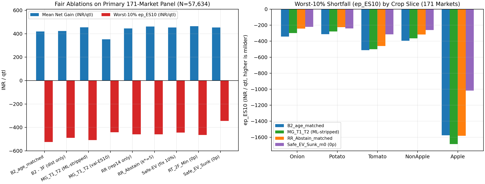
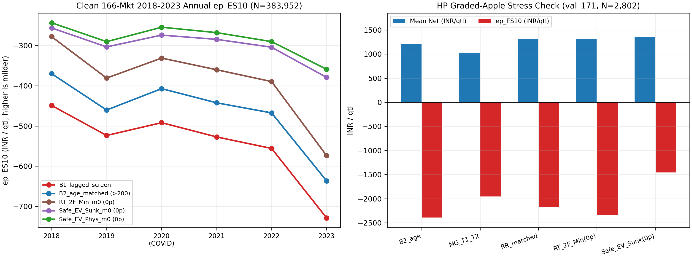

# When Online Mandi Prices Mislead: A Leak-Free Replay and Risk-Aware Triage Rules on Public Indian Wholesale Data

**Aditya Sharma** (M.Tech Thesis Research, supervised by **Dr. Sonia**) — Shoolini University, Solan, Himachal Pradesh, India

## Abstract

Whether spreads on India's AGMARKNET portal survive transit hinges on unobserved arrival-day blanks. Under sequential closed-yard settlement (`div = 1.5`), chasing lagged spreads above `₹100/qtl` across `171` zero-lookahead markets (`N = 57,634` test episodes, `June 2025–April 2026`) loses money on **`45.07%`** of dispatches (`ES10 −₹642.15/qtl`); under open-yard Missing-At-Random (MAR) counterfactuals, road dispatch (`B2_age_matched`) earns `+₹97.01/qtl` higher mean than simple triage.

Claiming no methodological novelty, we formalize an audit benchmark built around nine fixed structural choices (zero validation-tuned weights) via pocket-arithmetic rules (`Safe_EV_Sunk_m0`: $p_{\text{dow}} G_{\text{1SD}} - F_{\text{road}} > 0$; `Safe_EV_Phys_m0`; `RT_2F_Min_m0`) under a `<= t - 1` firewall. Across exploratory `PREREG_A18` tests (`R = 2,000`, `p_holm_2s = 0.0040`; CGM `G*` `p = 0.0051–0.0680`), `Safe_EV_Sunk_m0` (`63.23%` dispatch) attains `₹452.74/qtl` mean (`+₹33.12`), `14.88%` losses (`−11.56 pp`), **`ES10 −₹345.53/qtl`**, and **`cond_ES10 −₹447.48/qtl`**. `2×2` orthogonal decomposition shows volatility haircut `cv28` drives essentially the entire conditional tail reduction (`−₹447.13`), while `p_dow` drives diversion avoidance and mean lift. Over a full `17`-month cycle (`n = 113,374`), `Mean-Q10` gradient-boosted trees (`₹455.83–₹458.27` mean, `cond_ES10 −₹420.57` without needing `safe_ev_feat`) and heteroscedastic Split-CQR (`−₹367.09`) achieve the unconstrained frontier, with zero-parameter `Safe_EV_Sunk_m0` recovering near-frontier performance without training history. Gains survive `t - 2` lag (`p = 0.001`), coupled-settlement Manski `cond_ES10` bounds (`+₹105.96`), non-collided geocodes (`35.23%`), `2018–2023` archives (`166` markets, `N = 383,952`), and `PhoneCall_TopK_Open`, while scale non-invariance breaks the `p_dow` screen in Himachal apples (`p = 0.094` NS, `79.52%` low freight-ratio), solved partially by `ScaleInv_Safe_EV_24tau` (`−₹1,616.08`).

---

## 1. Three Research Questions and Honest Methodological Scope

Indian wholesale agricultural markets (*mandis*) publish daily minimum, modal, and maximum prices by variety on AGMARKNET. While digital price dissemination reduces spoilage when execution is smooth [jensen2007digital, goyal2010information], and targeted market-information services can raise realized farmer prices under symmetric bargaining [courtois2015farmer], empirical trials across rural India show that portal quotes frequently fail to deliver arbitrage when transport, fees, volatility, and bargaining frictions bind [fafchamps2012sms, mitra2018asymmetric, chatterjee2023market]. Four operational mechanisms drive our retrospective audit:
1. **Reporting Latency (`<= t - 1` or `<= t - 2`):** At 6 a.m. decision day $t$, same-day auctions have not cleared, and thinner yards publish `1–7` days late (and even slower under multi-day portal lag).
2. **Transfer Frictions and Deterioration:** Road freight, single-lane terrain, out-of-district market friction, and ambient transit decay erode nominal spreads [baulch1997transfer, nabcons2022phl].
3. **Price Volatility and Silent Arrival Boards:** Volatile lagged modal prices (`dest_price_cv_28d`) revert on arrival day $t + \tau$, while blank arrival rows (`settle_any_min_dw = NaN`) trigger sequential turn-back or fallback losses [deka2026missing].
4. **Role as an Upstream 6 a.m. Call-Priority Alert Filter:** Smallholders routinely phone a destination *arhtiya* (commission agent) for 30 seconds before dispatch [jensen2007digital, ziegler2019fresh]. These heuristics filter 6 a.m. portal alerts to prioritize trader calls (`PhoneCall_TopK_Open`) and never replace live confirmation.

We examine six Indian states (Gujarat, Himachal Pradesh, Karnataka, Madhya Pradesh, Maharashtra, Uttar Pradesh) and four crops (Onion, Potato, Tomato, Apple) through three questions:
- **RQ1 (Screen-Chasing Risk & Settlement Realism):** Under a `<= t - 1` causal firewall and sequential arrival settlement, how often do lagged portal spreads (`> ₹100/qtl`) lose money, and how strongly do 3-day hindsight and day-$t$ origin conditioning distort apparent risk?
- **RQ2 (`2×2` Risk Decomposition & Honest ML/OR Frontier):** On equal Top-5 menus (`age 1..3`), how do volatility truncation (`cv28`) and reporting reliability (`p_dow`) decompose risk inside zero-tuned-parameter rules (`Safe_EV_Sunk_m0`, `Safe_EV_Phys_m0`, `RT_2F_Min_m0`) relative to full-season `17`-month ML (`Mean-Q10`, heteroscedastic Split-CQR), `OR` baselines, and $D_S \cap D_B$ common-intersection routing vs screening?
- **RQ3 (Partial Identification, Scale Non-Invariance & Structural Stress Tests):** How sensitive are conclusions to exact coupled Manski `cond_ES10` bounds [manski1990bounds, rubin1976inference], `<= t - 2` portal latency, Schedule #7 biological decay, stochastic conditional MAR (`Stoch_CondMAR`), SUTVA crowding, non-collided geocodes, outsider `Min_Price`/LCV/`4%` *arhtiya* stress, `B = 12` CGM `G*` inference, reverse-survivorship-aware `2018–2023` data [sparks2018nasapower], and Himachal graded-apple scale non-invariance?

### Explicit Protocol Chronology (`Stage I -> A10 -> A18 -> Omega v8 Final Audit`)
1. **Stage I Legacy Baseline (`e421d15`):** An unlagged gradient-boosted tree system (`HistGradientBoostingRegressor`) with ERA5 weather and conformal LCB proved **inconclusive against road dispatch `B2`** on `H2` (`+₹6.13/qtl`, 95% CI `[−₹17.02, +₹25.02]`, Holm `p = 0.2699`) and failed on HP graded apples.
2. **Audit Remediation (`A10`, Commit `87a0b62`):** Removed day-$t$ leaks and `98.64%` ERA5-identical forecast leakage (`66,222 / 67,135`), fixed APMC fee bases (`M9`), fixed fractional `ES10`, and tested `RR_Abstain_matched` (which hit grid ceiling `kappa* = 5.0`, averaged `rep28` over Sunday closures, and shifted cutoff to `−₹328.99` at `kappa = 20.0` in `a10_summary.json`).
3. **Closed-Form Simplification (`PREREG_A18.md`, `4cbb02d`) & Revision v8 Hostile Audit:** Evaluated three rules derived from `9` fixed structural choices (zero tuned weights) before `eval_a18.py`, replaced `178` lookahead markets with strict `2024`-active `171` markets (`N_test = 57,634`), evaluated a clean `166`-market `2018–2023` historical cohort (`N = 383,952`) inside the `2024`-active corridor frame alongside `115` `2017`-active overlap yards (`N = 325,993`), repaired `_spoil_return_leg`, upgraded `5m`/`17m` ML/CQR and `2×2` orthogonal decompositions, implemented sub-yard-first `clean_market_query` plus non-collided geocode audits, and applied finite-sample CGM `G/(G-1)` correction. Because `2025-06-01..2026-04-08` and HP apples were exposed prior to `A18`, **all `PREREG_A18` contrasts operate as specification-locked exploratory inference**.

---

## 2. Identification Architecture, Stylized Calibration, and Causal Firewall

### 2.1 Epistemic Layers: Observed vs Estimated vs Stylized vs Unidentified

| Epistemic Layer | Exact Variables / Mechanisms | Source & Explicit Caveats |
|---|---|---|
| **Observed (Public Archives)** | Daily AGMARKNET `Min/Modal/Max_Price`, variety/grade, arrival reporting; OSRM `road_km` (`15.19–499.43`); realized ERA5 `Tmax, RH, rain_mm` & NASA POWER `2017–2023` | AGMARKNET OGD via HuggingFace mirror (`99.42%` [`171/172`] Tier-1 XML parity; `100%` HP); OSRM/OSM ODbL [luxen2011osrm]; ERA5 [hersbach2020era5]; NASA POWER [sparks2018nasapower] |
| **Estimated (`<= t - 1`)** | 8w same-weekday Laplace `p_dow`, `rep28`, `rep14`, `cv28`; two-way cluster bootstrap (`R = 2,000`), finite-sample `G/(G-1)` CGM `G*`, studentized `t`, 1-way Webb6 (`B = 12`) | Strictly `date < t`; `State\|Market` clusters across fortnights; UP unconditional `VaR10 = 0` atom disclosed (`7.28% < 10%`) |
| **Stylized / Survey-Anchored** | `F_road = 35 + 0.45 * h_s * km` (`h_s = 1.45` HP); stylized `{0.5, 1.0, 1.5}%` seller-fee tiers; cumulative NABCONS `{3.25, 1.96, 1.64, 0.86}%` scaled as 24h benchmark alongside USDA Schedule #7; `₹25` wait; `30 qtl` load | NITI/RMI `₹0.258/qtl-km` *national avg* heavy truck [nitiaayog2021freight]; GoHP `91.59%` single-lane roads [hpeconsurvey2026]; GoI PIB `relid=154554` [pib154554apmc] (qualitative F&V deregulation; omits UP; statutory APMC fees usually buyer-paid); NABCONS [nabcons2022phl] & CIPHET [jha2015ciphet]; NSS 587 [nss77report587] (holdings/income benchmark, not truckload survey); RBI WP [rbi2024top] |
| **Unidentified (Bounded)** | Whether blank arrival row (`no_comm_divert`) is closed/inactive yard or unrecorded open auction; outsider `Min_Price` bargaining; SUTVA crowd impact | Coupled/decoupled Manski `ES10` & `cond_ES10` [manski1990bounds, horowitz2000nonparametric, rubin1976inference], `Stoch_CondMAR`, blind-wait clocks, `Outsider_Mid/MinPrice_LCV_4pctArh`, crowding (`v7_exp2..5`) |
| **Unobserved Out-of-Scope** | Negotiated truck bills, credit ties, weighment loss, live *arhtiya* telephone confirmations | Disclosed in Section 6; prospective FPO field trial required (`Gate J`) [levi2025improving] |

### 2.2 Tracked Official Data Provenance and Transparency
Six tracked files regenerate all outputs offline cleanly without live network calls:
1. **`agmarknet_6state_top_apple_2024_2026.parquet` (`260,043` raw, `178` core markets):** Extracted from the AGMARKNET HuggingFace mirror (`1 Jan 2024–13 Apr 2026`). Retaining `369` extreme outlier rows (`<₹100` or non-Apple `>₹15,000`) and pooling `90.3%` grade strings (`25.62%` cross-grade mismatch) is audited directly in `v7_exp5` (`OutlierClean369` & `GradeExplicit_6State`). Strict `2024`-only selection (`>= 80` days in 2024, `<= 30`/state) drops `7` post-2024 lookahead yards and `1` OSRM-distant yard (`>500 km`), yielding **`171` zero-lookahead markets** (`257,576` raw rows).
2. **`agmarknet_6state_decade_2017_2026.parquet` (`623,363` raw, `2017–2023`):** To stay offline inside the `2024`-active OSRM Top-30 corridor frame while removing all `7` post-2024 lookahead yards from the legacy `173`-market extract (`N = 389,357`), we intersect with `171` to form a **clean `166`-market cohort (`N = 383,952`)** plus a **`115`-market `2017`-active overlap cohort (`N = 325,993`)**, both explicitly subject to reverse-survivorship conditioning on `2024` corridor inclusion [sparks2018nasapower].
3. **`hp_apple_daily_2025_2026.csv` & `osrm_corridor_matrix.parquet`:** `4,427` grade-explicit HP apple rows (`42` yards) and `8,147` OSRM road corridors (`15.19–499.43 km`). Forensic geocode auditing (`v7_exp5`) uncovers **`56` of `171` markets sharing collapsed parent-town coordinates** (`33` falsely tagged exact in legacy geocoding), shrinking true **non-collided exact-geocode row coverage from `59.50%` (`19,362` all-5 episodes) to `35.23%` (`PureAll5_NonCollided_Exact_N6605` `6,605` episodes)**; `src/data/build_road_network.py` now prioritizes parenthesized sub-yard names in `clean_market_query` ahead of future OSRM rebuilds.
4. **`state_apmc_and_loss_parameters.csv` & `mandi_weather_2024_2026.parquet`:** Statutory APMC fees are predominantly buyer-paid and PIB `154554` omits UP, so `{0.5%, 1.0%, 1.5%}` seller tiers represent **stylized market-friction tiers** (`0%–6%` stress-tested). Weather variables are **excluded completely from all decisions**; arrival-day realized ERA5 (`0.1°`, clipped to `[5, 48]°C` and `[20, 100]%` RH) enters settlement only.

### 2.3 Reconciled Cleaning Funnel and Ex-Post Conditioning
Strict deduplication (`Median` modal, `Min` floor) collapses `257,576` raw `171`-market rows (`−759` out-of-range -> `256,817`; `−2,284` duplicate excess across `1,481` conflicting modal groups -> `254,533`; `−8,695` variant merges) to `245,838` canonical rows (`317,985` Top-5 rows across `35,870` val + `57,634` test episodes). Purging `939` spillover episodes from validation (`arrival_date + 2d > 2025-05-31`, `v7_exp4`) leaves `B2` threshold unchanged (`₹200.00`). Conditioning baseline episodes on day-$t$ local uploads (`settle_local_price_d0`) omits `28,420` missing-origin episodes from `86,054` unconditional test episodes; we audit the complete **`86,054`-episode unconditional panel** (`v7_exp3`).

### 2.4 Causal Timing Firewall
Every feature in shortlisting/scoring satisfies `dest_quote_date < t` and `origin_quote_date < t` (`<= t - 2` audited in `v7_exp1`). Counterfactual corruption tests in `pytest` (`test_timing_and_leakage_r3.py`) inject `₹99,999/qtl` spikes and drop active yards for all days `>= t*`, asserting bit-for-bit invariance of candidate menus and scores for `t <= t*`.

---

## 3. Payoff Physics, Sequential Settlement, and Decision Rules

### 3.1 Physical Freight, Stylized Fee Tiers (`M9`), and Biological Decay
For corridor $c = (o \to d)$ in state $s$ and commodity $k$, freight is $F_{\text{road}}(c) = 35.0 + 0.45 \cdot h_s \cdot \text{road\_km}(c)$ (`h_s = 1.45` HP, `1.0` elsewhere). Ambient `20°C / 65%` RH reference spoilage over transit `truck_hours` plus wait days $w \in \{0, 1, 2\}$ [kader2002postharvest, gross2016usda66] uses:
$$s(k, w) = \min\!\left(0.55,\; b_k \cdot \frac{\max(1,\; \text{truck\_hours} + 24 w)}{24}\right)$$
with stylized daily rates $b_k \in \{0.0325 \text{ Tomato}, 0.0196 \text{ Onion}, 0.0164 \text{ Apple}, 0.0086 \text{ Potato}\}$ calibrated from NABCONS cumulative shares [nabcons2022phl] — contrasted directly in `v7_exp2` against biological Schedule #7 ($24\tau_{\text{days}}$ from harvest/loading + USDA-66 $Q_{10} = 2^{(T_{\max}-20)/10}$). Stylized destination fees $\tau_{\text{fee}} \in \{0, 0.005, 0.010, 0.015\}$ apply strictly on post-decay destination gross auction sales (`0` intra-district or unsold return).

<!-- WORKED_EXAMPLE_START -->
> **Worked Example 1 (Physical Freight, Decay & Post-Decay Fee):** On an out-of-district MP Tomato trip (`fee = 1.5%`, `km = 200`, `truck_hours = 6`, arrival sale `₹2,000` vs local `₹1,500`): $F = 35 + 0.45(200) = ₹125.00/\text{qtl}$; $s(0) = 0.0325(6/24) = 0.008125$; post-decay gross $= 2000(0.991875) = ₹1,983.75$; net after 1.5% fee $= 1983.75(0.985) = ₹1,953.99$; net gain $= 1953.99 - 125 - 1500 = +₹328.99/\text{qtl}$.
<!-- WORKED_EXAMPLE_END -->

### 3.2 Sequential Non-Anticipative Settlement vs Hindsight Lookahead
Starting at $w = 0$ on arrival $t + \tau$ (`tau_days in 1..3`): if exact variety trades (`Modal_Price` present), sell at $P_{\text{sale}}(1 - s(k, w))(1 - \tau_{\text{fee}}) - F - 25w - P_{\text{loc}, d0}$; if missing while another variety trades (`settle_any_min_dw > 0`), wait 1 day (`₹25` + decay) for $w < 2$ (`0.90 * settle_any_min_d2` at $w = 2$); if zero commodity trade prints on day $w$, divert home: $\Delta\text{Net}_{\text{divert}}(w) = -\text{div}\cdot F - P_{\text{loc}, d0} s(k, w) - 25w$ (`div = 1.5`, zero fee). Crucially, Revision v8 fixes the `_spoil_return_leg` bug in `S6_Smallholder_4pctArh_USDA_ERA5_Frozen` so unsold return legs accumulate full $24\tau_{\text{days}} + \text{hrs} + 24w$ biological clock and full realized ERA5 multipliers (`q10`, `rh_f`, `chill`, `rain_f`). Blindly waiting 1–2 days regardless of empty day-0 boards is tested in `Causal_BlindWait` (`v7_exp2`).

<!-- WORKED_EXAMPLE_START -->
> **Worked Example 2 (Sequential vs 3-Day Hindsight):** If destination Tomato is absent on arrival day 0 yet trades at `₹2,000` on day +1, sequential settlement returns at $w = 0$ ($\Delta\text{Net} = -1.5(125) - 1500(0.008125) = -₹199.69$), whereas 3-day hindsight records $+₹239.97$ — a ₹439.66/qtl distortion.
<!-- WORKED_EXAMPLE_END -->

### 3.3 Equal-Menu Baselines, `9` Structural Choices, and Algebraic Risk Identity
On identical Top-5 candidates (`lag_spread > 100`, max 1 pick, abstention `0`), all equal-age (`1..3d`) comparators match `val_171` dispatch (`70.43%`): `B1_lagged_screen` (1 free param, age `1..7`, `100%`), `B2_age_matched` ($G - F > ₹200$, `1` param), `B_simple_activity_matched` (`rep14 >= 0.50`, `₹168.46`, `2` params), `MG_T1_T2_matched` (ML-stripped `rep14 >= 0.50 & dow8 >= 0.35`, `₹133.03`, `4` params; distinct from heteroscedastic Split-CQR `MG_T1..T4` in `v7_exp4`), and `RR_Abstain_matched` (`k*=5.0`, `m*=₹5.40`, `2` params).

Locked in `PREREG_A18.md` (`S > 0`), the tuning-free rules rest on **nine fixed structural design choices** (`age 1..3`, Top-5 cutoff, `lag_spread > 100`, Laplace $p_{\text{dow}} = (k+1)/10$, `28d` window, $z = 1.0$ `cv28` haircut, `0.05` `cnt28 < 2` fallback [checked against `cnt28 < 5` / `cv28 == 0`], sunk $F$/$1.5F$/$2F$ cost weights, threshold `0`):
- **`Safe_EV_Sunk_m0`:** With $G_{\text{1SD}}(c, t) = P_{\text{dest,lag}}(1 - \text{cv}_{28})(1 - \tau_{\text{fee}}) - P_{\text{orig,lag}}$, score $\arg\max_{c} S_{\text{Safe-EV}}(c,t) = p_{\text{dow}} G_{\text{1SD}} - F_{\text{road}} > 0$. **Exact algebraic identity:**
$$p_{\text{dow}} G_{\text{1SD}} - F_{\text{road}} \equiv p_{\text{dow}}(G_{\text{1SD}} - F_{\text{road}}) + (1 - p_{\text{dow}})(-1.0 F_{\text{road}})$$
  proving `Safe_EV_Sunk_m0` prices `-1.0 * F_road` sunk return freight on silent yards (rather than literal zero), while `Safe_EV_Phys_m0` replaces `-1.0 * F_road` with `-1.5 * F_road`, differing purely by $0.5(1 - p_{\text{dow}})F_{\text{road}}$. Switching from additive INR `argmax` to ratio `argmax` ($G_{\text{1SD}}/F_{\text{road}} - 1/p_{\text{dow}}$) switches `5,113` (`14.03%`) test destinations (`Mean ₹437.28`, `ES10 −₹329.26`, `v7_exp4`).
- **`RT_2F_Min_m0` (`0` tuned params, NO `cv28`, NO `spoil`):** Using plain $G$ and $p_{\min} = \min(\text{rep}_{28}, p_{\text{dow}})$, dispatch if $p_{\min} G - 2F > 0$.
- **`ScaleInv_Safe_EV_24tau` & `2×2` Orthogonal Components (`v7_exp4`–`v7_exp5`):** To isolate `cv28` vs `p_dow`, we decompose into `Ortho_Pure_cv28_only` ($G_{\text{1SD}} - F_{\text{road}} > 0$) and `Ortho_Pure_pdow_only` ($p_{\text{dow}} G - F_{\text{road}} > 0$). When spreads dwarf freight ($F / G_{\text{1SD}} < 0.10$, occurring on `79.52%` of HP apple `Safe_EV` dispatches), $p_{\text{dow}} G_{\text{1SD}} - F_{\text{road}} > 0$ suffers **scale non-invariance** because proportional origin spoilage $P_{\text{orig}} \cdot s_{24\tau}$ is omitted. Adding full transit-horizon spoilage and $1.5 F$ yields scale-invariant `ScaleInv_Safe_EV_24tau` ($p_{\text{dow}}(G_{\text{1SD,fix}} - F - P_{\text{dest}} s_{24\tau}) - (1-p_{\text{dow}})(1.5F + P_{\text{orig}} s_{24\tau}) > 0$).

<!-- WORKED_EXAMPLE_START -->
> **Worked Example 3 (Pocket Arithmetic & Algebraic Identity):** On MP Tomato ($G = +₹470$, `cv28 = 0.15`, $G_{\text{1SD}} = +₹174.50$, $F = ₹125$): steady yard (`dow8 = 0.90`, `p_min = 0.85`) yields `Safe_EV = +₹32.05 > 0` and `RT_2F = +₹149.50 > 0` (**DISPATCH**); Sunday yard (`dow8 = 0.20`, `p_min = 0.20`) gets `B2 = +₹345` blindly yet yields `Safe_EV = −₹90.10` and `RT_2F = −₹156.00` (**ABSTAIN**). Equivalently, $0.90(174.50 - 125) + 0.10(-125) = +₹32.05$.
<!-- WORKED_EXAMPLE_END -->

### 3.4 Fractional `ES10`, Conditional `cond_ES10`, and Finite-Sample CGM `G*` Inference
Following coherent expected shortfall [rockafellar2000cvar], we report both **unconditional `ES10`** (including `0` on abstention — rewarding selectivity mechanically; in Uttar Pradesh where episode loss rate is `7.28% < 10%`, unconditional $q_{10} = 0$ creates a point-mass zero atom absent in `cond_ES10`) and **conditional `cond_ES10`** over dispatched trips via fractional interpolation $m = 0.10n = k + f$:
$$\text{ES10}(x) = \frac{1}{m}\left(\sum_{i=1}^{k} x_{(i)} + f \cdot x_{(k+1)}\right)$$

<!-- WORKED_EXAMPLE_START -->
> **Worked Example 4 (Fractional `ES10`):** On $\{1, 2, \dots, 11\}$, $m = 1.1$ ($k = 1, f = 0.1$), giving $(1 + 0.1 \times 2)/1.1 \approx 1.09$.
<!-- WORKED_EXAMPLE_END -->

Specification-locked exploratory inference evaluates `PREREG_A18.md` (`R = 2,000` paired two-way cluster bootstraps [phipson2010permutation, holm1979simple], `166` `State|Market` × `23` fortnights), supplemented in Revision v8 (`stats_utils.py`, `v7_exp_summary.json`) by **finite-sample $G/(G-1)$-scaled Cameron–Gelbach–Miller (`CGM`) `G*` t-tests**, studentized `t` bootstraps, **1-way block-only Webb6 wild tests (`p_wild_webb6_1w_block_only`, `B = 12`)**, and joint `val+test` threshold propagation.

---

## 4. Results

### 4.1 RQ1 & RQ2: Primary `171`-Market Benchmark (`N = 57,634`), `2×2` Orthogonal Split, & ML/CQR Frontier

Across `N = 57,634` episodes (`v7_main_171.csv`), blind spread-chasing (`B1`) loses on **`45.07%`** (`mean ₹384.61`, `ES10 −₹642.15`), with `69.78%` (`40,217`) `d0` sales, `0.49%` (`284`) waits, `1.06%` (`609`) distress fallbacks, and **`28.67%`** (`16,524`) zero-commodity returns (`B1` exact-`d0` destination reversion `−₹238.71` vs origin rebound `+₹40.23`, a `₹278.95` winner's curse gap in `v7_exp_summary.json`); 3-day hindsight drops `B1` losses artificially to `31.27%` (`mean ₹523.68`). Table 2 compares all rules on `ES10` and `cond_ES10`.

| Policy (`N = 57,634`, `171` Mkts) | Params | Disp (%) | Mean (₹/qtl) | EpL (%) | `ES10` (₹/qtl) | `cond_ES10` (₹/qtl) | LGL | Mean km |
|---|---:|---:|---:|---:|---:|---:|---:|---:|
| **`B1_lagged_screen`** (`1..7d`) | 1 | `100.00%` | `₹384.61` | `45.07%` | `−₹642.15` | `−₹642.15` | `−₹271.11` | `225.09` |
| **`B2_age_matched`** (`1..3d`, `₹200`) | 1 | `71.73%` | `₹419.62` | `26.43%` | `−₹524.78` | `−₹628.37` | `−₹294.33` | `207.06` |
| **`B_simple_activity_matched`** | 2 | `70.46%` | `₹426.29` | `23.30%` | `−₹505.84` | `−₹614.38` | `−₹299.27` | `207.36` |
| **`MG_T1_T2_matched`** *(ML-stripped)* | 4 | `69.16%` | `₹454.07` | `18.35%` | `−₹508.72` | `−₹638.55` | `−₹330.98` | `204.49` |
| **`RR_Abstain_matched`** (`k*=5.0`) | 2 | `68.75%` | `₹461.41` | `17.07%` | `−₹459.46` | `−₹584.66` | `−₹308.82` | `183.15` |
| **`Safe_EV_Sunk_m0`** *(0-tuned)* | **0** | **`63.23%`** | **`₹452.74`** | **`14.88%`** | **`−₹345.53`** | **`−₹447.48`** | **`−₹261.53`** | `196.56` |
| **`Safe_EV_Sunk_matched`** | 1 | `70.74%` | `₹457.08` | `18.37%` | `−₹367.79` | **`−₹443.54`** | **`−₹244.85`** | `194.81` |
| **`Safe_EV_Phys_m0`** (`1.5F`, `0`-tuned) | **0** | `60.84%` | `₹449.52` | **`13.70%`** | **`−₹334.80`** | **`−₹447.33`** | `−₹265.89` | `194.89` |
| **`RT_2F_Min_m0`** *(NO `cv28`)* | **0** | `64.79%` | **`₹463.98`** | `16.21%` | `−₹464.84` | `−₹618.35` | `−₹323.98` | `177.52` |
| **`EV_RT_Min_m0`** | **0** | `77.17%` | `₹470.44` | `20.38%` | `−₹512.47` | `−₹602.97` | `−₹307.16` | `191.18` |

Key findings from Tables 2–4 and `v7_exp4`–`v7_exp5`:
1. **`PREREG_A18` Exploratory Family & Finite-Sample CGM `G*` (`R = 2,000`, Table 3):** All 4 pre-registered contrasts pass `p_holm_2s_prereg4 = 0.0040` across 3 clusterings (`H_A18_1` `ES10` `+₹179.24`; `H_A18_2` `+₹91.67` vs `RR`; `H_A18_3` EpLoss `−11.56 pp`; `H_A18_4` `RT_2F` Mean `+₹44.36`). With finite-sample `G/(G-1)` CGM scaling (`v7_exp_summary.json`), `H_A18_1` passes `p_cgm_gstar = 0.00511` (`0.01001` b2dest; `p_stud_2s = 0.0010`/`0.0035`; `p_wild_webb6_1w_block_only = 0.0005`), whereas `H_A18_2` is significant on origin (`p_cgm_gstar = 0.04887`, `p_stud_2s = 0.01199`) and borderline on `b2dest` (`p_cgm_gstar = 0.06800`, `p_stud_2s = 0.05697`; joint `val+test` `91.67` CI `[+₹34.81, +₹158.11]`, `p_null = 0.0030`), and `4w` (`B = 12`) Mean of `Safe_EV_Sunk_m0` stays NS on `CGM` (`p_cgm_gstar = 0.0880`, `p_stud_2s = 0.0050`).
2. **`2×2` Orthogonal Decomposition (`cv28` vs `p_dow`) & $D_S \cap D_B$ Routing Lift (`v7_exp4`–`v7_exp5`):**
   - `Ortho_Pure_cv28_only` (`p_dow = 1.0`, `71.91%` disp — nearly equal to `B2` `71.73%`) attains **`cond_ES10 −₹447.13`** (`Mean ₹421.62`, `ES10 −₹387.46`), proving **`cv28` volatility subtraction alone captures virtually all conditional tail truncation** (`Safe_EV_Sunk_m0`: `−₹447.48`) by pruning volatile high-loss corridors (`cnt28 <= 4`, `n = 242` shows `65.29%` loss and `cond_ES10 −₹1,296.41`; `cv28 == 0` guard `[5,274` rows`]` is invariant at `Mean ₹452.10`, `cond_ES10 −₹447.65`). By contrast, `Ortho_Pure_pdow_only` (`84.10%` disp) leaves `cond_ES10 −₹607.18` near `B2` (`−₹628.37`) while raising Mean to `₹466.68` by avoiding closed yards — explaining why `RT_2F_Min_m0` (which omits `cv28`) keeps Mean (`₹463.98`) yet collapses on `cond_ES10` (`−₹618.35`).
   - Across the common dispatched intersection $D_S \cap D_B$ (`n = 33,398`, `v7_exp5`), `Safe_EV_Sunk_m0` beats `B2` by **`+₹65.66` Mean (`₹773.38` vs `₹707.72`) and `+₹53.40` `ES10` (`−₹464.82` vs `−₹518.22`) purely via better corridor routing**, while pruned `B2`-only dispatches (`n = 7,944`) earn `₹68.96` Mean with **`58.60%` losses (`ES10 −₹1,018.70`)** and added `Safe`-only dispatches (`n = 3,043`) earn `₹86.67` (`ES10 −₹224.83`).
3. **Honest `5`-Month vs `17`-Month ML, Heteroscedastic Split-CQR & OR Frontier (`v7_exp4`, Table 4):**
   Prior rejections of ML/CQR reflected `5`-month off-season starvation (`Ridge/HGBR EV`), unnormalized INR-squared penalty (`OR_Vargas_MeanVar_g0002`, `cond_ES10 −₹511.42`), and a homoscedastic CQR bug (`0` destination switches). Once trained cleanly across **`17` full seasonal months (`2024-02..2025-05`, `n = 113,374`, validation-purged)**, **`ML_17m_MeanQ10_Hybrid_eq63`** (`0.4 EV + 0.6 Q10`, matched `63.23%`) reaches **`Mean ₹455.83`, `ES10 −₹320.02`, `cond_ES10 −₹420.57`** [romano2019conformalized, lei2018distribution, gibbs2021adaptive], outperforming `Safe_EV_Sunk_m0` (`₹452.74 / −₹345.53 / −₹447.48`) across Mean and tail. Ablating `safe_ev_feat` (`ML_17m_MeanQ10_NoSafeEV_eq63`, `63.23%`) yields **`Mean ₹458.27`, `ES10 −₹321.73`, `cond_ES10 −₹423.88`**, proving full-season GBDTs learn the spread-volatility-reliability interaction autonomously without feature engineering. Repairing Split-CQR via conditional IQR scaling (`sigma = q80 - q20`) unlocks `8,848` (`5m`) and `8,115` (`17m`) destination switches (`MG_T1_T2_T3_T4_Intact_matched`: `66.32%`, `Mean ₹356.78`, `cond_ES10 −₹414.44`; `ML_17m_CQR80_valmatch`: `57.30%`, `Mean ₹364.03`, `ES10 −₹261.29`, **`cond_ES10 −₹367.09`**), while `ML_HGBR_Q20_m0` (`33.67%`) trades volume for `−₹162.15` `ES10` and scale-invariant `OR_Stylized_MeanSD_17m_valmatch` (`61.40%`) reaches `₹443.57 / −₹439.77`. **Practical role:** zero-parameter `Safe_EV_Sunk_m0` captures almost the entire `17`-month `Mean-Q10` Mean (`₹452.74` vs `₹458.27`) and conditional tail protection (`−₹447.48` vs `−₹420.57`) at **`n_train = 0`**, consistent with simple-heuristic findings [demiguel2009optimal, gigerenzer2011heuristic].

| Contrast (`N = 57,634`, `R = 2,000`, `v7_bootstrap_prereg_2000.csv`) | Est. | `origin_x_2week` (`166×23`) | `b2dest_or_origin` (`166×23`) | `policy_dest_or_origin` (`165–166×23`) |
|---|---:|---|---|---|
| **`H_A18_1`:** `ES10(Safe_EV_Sunk_m0 − B2)` (`p_holm_2s`) | **+₹179.24** | `[+121.99, +251.09]` (**0.0040**) | `[+103.83, +296.01]` (**0.0040**) | `[+121.87, +267.10]` (**0.0040**) |
| **`H_A18_2`:** `ES10(Safe_EV_matched − RR_matched)` (`p_holm_2s`) | **+₹91.67** | `[+39.11, +161.52]` (**0.0040**) | `[+25.45, +203.65]` (**0.0040**) | `[+36.37, +175.47]` (**0.0040**) |
| **`H_A18_3`:** `EpLoss(Safe_EV_Sunk_m0 − B2)` (`p_holm_2s`) | **−11.56 pp** | `[−13.30, −9.96]` (**0.0040**) | `[−14.11, −8.95]` (**0.0040**) | `[−14.34, −9.26]` (**0.0040**) |
| **`H_A18_4`:** `Mean(RT_2F_Min_m0 − B2)` (`p_holm_2s`) | **+₹44.36** | `[+31.22, +59.30]` (**0.0040**) | `[+23.31, +68.04]` (**0.0040**) | `[+25.81, +66.20]` (**0.0040**) |
| `SEC_1`: `Mean(Safe_EV_Sunk_m0 − B2)` (`p_2s`) | +₹33.12 | `[+13.59, +54.50]` (`0.0040`) | `[+1.42, +66.87]` (`0.0430`) | `[+6.60, +63.90]` (`0.0110`) |
| `SEC_2`: `ES10(Safe_EV_Phys_m0 − B2)` (`p_2s`) | +₹189.97 | `[+132.14, +262.24]` (`0.0010`) | `[+114.41, +306.03]` (`0.0010`) | `[+131.77, +278.20]` (`0.0010`) |
| `SEC_3`: `ES10(MG_T1_T2_matched − B2)` *(NS)* | +₹16.05 | `[−14.80, +43.23]` (`0.2409`) | `[−21.56, +50.25]` (`0.3428`) | `[−21.43, +48.37]` (`0.3258`) |

| `2×2` Orthogonal & Clean ML/OR Frontier (`N = 57,634`, `v7_ablations` & `v7_exp4`) | Disp (%) | Mean (₹/qtl) | EpL (%) | `ES10` (₹/qtl) | `cond_ES10` (₹/qtl) |
|---|---:|---:|---:|---:|---:|
| `B2_test_matched_to_SafeM0` (`th=₹295.00`) | `63.23%` | `₹413.34` | `23.12%` | `−₹501.23` | `−₹644.95` |
| `Ortho_Pure_cv28_only` (`p_dow = 1.0`) | `71.91%` | `₹421.62` | `24.10%` | `−₹387.46` | **`−₹447.13`** |
| `Ortho_Pure_pdow_only` (`cv28 = 0.0`) | `84.10%` | `₹466.68` | `24.63%` | `−₹546.75` | `−₹607.18` |
| `ScaleInv_Safe_EV_24tau` (`24*tau + 1.5F`) | `53.19%` | `₹431.30` | **`11.33%`** | **`−₹288.61`** | `−₹421.27` |
| `ML_Ridge_EV_m0` (`5m` purged) | `85.00%` | `₹467.15` | `25.77%` | `−₹494.44` | `−₹542.58` |
| `ML_HGBR_Q20_m0` (`5m` `20`th-pct `> 0`) | `33.67%` | `₹286.72` | `4.95%` | `−₹162.15` | `−₹441.94` |
| `MG_T1_T2_T3_T4_Intact_matched` (`5m` CQR, `8,848` sw.) | `66.32%` | `₹356.78` | `14.94%` | `−₹323.41` | `−₹414.44` |
| `OR_Stylized_MeanSD_17m_valmatch` (`EV - 0.35*IQR`) | `61.40%` | `₹443.57` | `13.06%` | `−₹324.93` | `−₹439.77` |
| `ML_17m_CQR80_valmatch` (`17m` CQR, `8,115` sw.) | `57.30%` | `₹364.03` | `12.85%` | `−₹261.29` | **`−₹367.09`** |
| **`ML_17m_MeanQ10_Hybrid_eq63`** (`0.4 EV + 0.6 Q10`) | `63.23%` | `₹455.83` | `14.94%` | `−₹320.02` | **`−₹420.57`** |
| **`ML_17m_MeanQ10_NoSafeEV_eq63`** *(no `safe_ev`)* | `63.23%` | **`₹458.27`** | `14.87%` | `−₹321.73` | `−₹423.88` |
| **`ZeroParam_Safe_EV_Sunk_m0`** (`n_train = 0`) | `63.23%` | `₹452.74` | `14.88%` | `−₹345.53` | `−₹447.48` |

### 4.2 RQ3: Exact Coupled Manski Bounds, Latency, Biology, Geocodes & Crowding Stress
1. **Identification Boundaries & Exact Coupled Manski `cond_ES10` (`v7_missing_tests`, `v7_exp3`):** Under free turn-back (`div=0`), `Safe_EV_Sunk_m0` Mean is NS (`+₹12.03`, `p = 0.220`), though `ES10` retains `+₹174.40` (`p = 0.001`). Under **Open-MAR**, **`B2` leads Mean by `+₹97.01/qtl`** (`₹698.17` vs `₹601.16`), while `Ortho_Pure_cv28_only` retains `Mean ₹667.23`, `cond_ES10 −₹288.76` (vs `Safe_EV ₹601.16 / −₹298.52`, `B2 −₹534.52`). Exact Rockafellar–Uryasev coupled Manski `cond_ES10` bounds remain strictly positive on **`Manski_Supp1` (`[+₹152.20, +₹328.28]`)** and **`Manski_Supp2_div20_q95` (`[+₹105.96, +₹394.89]`)**, whereas decoupled bounds turn fragile on `Supp2` (`−₹0.51` `cond_ES10`, `−₹35.57` `ES10`) and coupled worst-case Means favor `B2` (`−₹124.95`, `−₹199.51`, `−₹325.40`). On `PreChoice_AllCandidates_ExactD0` (`N = 24,654`), `B2` leads Mean (`₹478.23` vs `₹457.48`) while `Safe_EV` gains `+₹260.20` `ES10`; on `Unconditional_86054_SymClosedOrigin`, `Safe_EV` retains `+₹34.92` Mean and `+₹175.19` `ES10`.
2. **Latency (`<= t - 2`, `v7_exp1`), Fixed `_spoil_return_leg` `S6` (`v7_exp2`), Call Priority & Outsider LCV (`v7_exp5`):** Under `<= t - 2` (`N = 57,047`, `t2_age_2_3`), `Safe_EV_Sunk_m0` preserves `ES10 +₹143.88` (`−₹364.48`) and `cond_ES10 +₹188.07` (`−₹484.32`, `p = 0.001`), while `RT_2F` fails both (`p = 0.363` / `p = 0.981` NS). With the repaired `_spoil_return_leg` (`24*tau + hrs + 24*wait` + full ERA5) on **`S6_Smallholder_4pctArh_USDA_ERA5_Frozen`**, `Safe_EV_Sunk_m0` outperforms `B2` (`Mean ₹307.39` vs `₹247.15`, `ES10 −₹576.57` vs `−₹832.00`, **`cond_ES10 −₹725.73` vs `−₹969.71`**) and keeps **`+₹366.85` `cond_ES10`** under `Stoch_CondMAR_p1.00` (`−₹595.27` vs `−₹962.12`). Under 6 a.m. trader confirmation (`PhoneCall_TopK_Open`, `v7_exp5`), `Safe_EV_Sunk_m0` achieves `Mean ₹501.09 / EpLoss 4.99% / ES10 −₹204.98 / cond_ES10 −₹355.07` (`Pure_cv28`: `₹517.49 / −₹249.12 / −₹396.59` vs `B2 ₹527.55 / −₹440.72 / −₹691.79`). Under outsider `LCV (0.75/km)` + `4%` *arhtiya* pricing, `Outsider_Mid_LCV_4pctArh` leaves `Safe_EV` at `₹212.28 / −₹668.22 / −₹842.50` (`B2 ₹152.37`), while worst-case **`Outsider_MinPrice_LCV_4pctArh` compresses `Safe_EV` to `Mean ₹102.62` (`34.29%` loss, `cond_ES10 −₹1,290.83`)**, `B2` to `₹33.86` (`−₹1,573.13`), and `B1` negative (`−₹88.33`).
3. **Subgroups, Non-Collided Geocodes & SUTVA (`v7_splits_171`, `v7_exp5`):** On unconditional `ES10`, `Safe_EV_Sunk_m0` passes percentile CIs across all 6 states and 5 crop slices (`Holm11 <= 0.039`), **yet on `cond_ES10` and finite-sample CGM/studentized inference**, Himachal Pradesh (`B = 12`, `g_star_block = 1.535 < 3.0`, warning flagged) turns NS (`cond_ES10 +₹250.82`, `p = 0.1239`; `ES10 p_cgm_gstar = 0.2995`, `p_stud = 0.1879`), and Apple is borderline (`cond_ES10 p = 0.0550`; `ES10 p_cgm_gstar = 0.0744`, `p_stud = 0.0595`). Across `36/36` tornado cells, `Safe_EV` gains `+₹15.03..+₹61.22` Mean and `+₹114.97..+₹263.60` `ES10`. Results hold on `OutlierClean369` (`N = 57,521`, `ES10 −₹344.17`, `p = 0.001`), `GradeExplicit` (`N = 54,858`, `−₹329.55`), `PureAll5_ExactGeocode_N19362` (`cond_ES10 −₹567.95`, `p = 0.001`), **and strict `PureAll5_NonCollided_Exact_N6605`** (`Safe_EV` `34.56%` disp, `Mean ₹194.97` vs `B2 ₹200.37`, `EpLoss 8.30%` vs `17.38%`, `ES10 −₹231.27` vs `−₹449.14` [`p = 0.001`], `cond_ES10 −₹497.57` vs `−₹687.18` [`p = 0.019`]). Imposing `5%`/`10%` crowding impact (`max = 27` trucks) drops `Safe_EV` Mean to `₹86.06` / `−₹5.31/qtl` (vs `B2 −₹75.37`), while a `k <= 2` cap (`31.29%` disp) preserves `₹207.00` Mean and `−₹230.30` `ES10`.

### 4.3 Realized ERA5, Clean `2018–2023` Archive & HP Apple Scale Non-Invariance
- **Realized ERA5 & Break-Even (`v7_era5_and_reconcile.csv`, `v7_breakeven_171.csv`):** Under `100%` arrival ERA5, `Safe_EV_Sunk_m0` keeps `Mean ₹440.28` (`+₹34.55`), `ES10 −₹365.11` (`+₹187.80`, `p_holm = 0.0024`), decomposing the `−₹31.16` `B1` shift into `−₹13.26` (`178->171`) + `−₹17.90` (`20°C->ERA5`). Silent break-even vs `B2` requires `+₹348.61/qtl` (`25.45%` Open-MAR; `29.78%` thin-MAR when thick yards stay closed, `v7_exp3`).
- **Clean `166`-Mkt `2018–2023` (`N = 383,952`, Reverse-Survivorship Framed, `v7_decade_*.csv`):** Evaluated within the `2024`-active OSRM corridor frame (`166` markets; `115` `2017`-active overlap yards `N = 325,993`), frozen `Safe_EV_Sunk_m0` gains `+₹35.00` Mean (`₹356.57` vs `B2 ₹321.57`), `+₹169.27` `ES10` (`−₹304.29`), and **`+₹155.08` `cond_ES10`** (`+₹174.27` vs equal-dispatch `B2_eq_SafeM0` [`th=₹303.27`], `p = 0.001`), holding under `2017`-tuned `B2` (`th=500`, `v7_exp5`), CPI-adjusted `B2` (`Mean ₹320.11`, `ES10 −₹467.21`), and NASA POWER × USDA Schedule #7 (`Safe_EV ₹328.15` vs `B2 ₹284.26`, `cond_ES10 −₹507.15` vs `−₹693.39`). Year-by-year (`v7_decade_by_year_boot_2000.csv`), `Safe_EV` wins `ES10` and `cond_ES10` in `6/6` years (`p = 0.001`), while **`2020` (`+₹12.93`, `p = 0.208`) and `2023` (`+₹20.35`, `p = 0.077`) Means remain NS**.
- **HP Graded-Apple Scale Non-Invariance Diagnosis & Fix (`N = 2,802`, `v7_hp_apple_171.csv`, `v7_exp5`):** While `Safe_EV_Sunk_m0` narrows unconditional `ES10` (`−₹1,454.86` vs `B2 −₹2,392.12`, `p = 0.002`), **`F / G_1SD < 0.10` on `79.52%` of its HP dispatches collapses the `p_dow` screen**, leaving `41.38%` dispatched losses and NS `cond_ES10` (`+₹613.46`, `p = 0.0940`, `n_clusters = 34`). Scale-invariant **`ScaleInv_Safe_EV_24tau` cuts HP `ep_loss` from `27.91%` to `17.92%` (`cond_loss 34.93%`), `ES10` to `−₹958.08`, and `cond_ES10` to `−₹1,616.08`** (`Mean ₹1,287.44` at `51.28%` disp), while `Safe_EV_Sunk_pFloor50` achieves `15.17%` `ep_loss` (`Mean ₹1,036.94`, `ES10 −₹1,011.73`, `cond_ES10 −₹1,759.81`; primary `171`-mkt `ScaleInv_Safe_EV_24tau` `11.33%` loss, `cond_ES10 −₹421.27`).

Table 5 summarizes counterfactual missingness, latency, repaired smallholder stress, non-collided geocodes, outsider LCV sensitivity, and `2018–2023` robustness checks.

| Robustness / Stress Panel | `B2_age` (Mean / `ES10` / `cond_ES10`) | `Safe_EV_Sunk_m0` (Mean / `ES10` / `cond_ES10`) | `RT_2F_Min_m0` (Mean / `ES10` / `cond_ES10`) |
|---|---|---|---|
| `div_0.0_spoil_only` *(`Safe_EV` Mean NS)* | `₹461.04` / `−₹360.86` / — | `₹473.07` / **`−₹186.46`** / — | **`₹481.62`** / `−₹348.53` *(NS)* / — |
| `open_yard_MAR_lagged_price` *(`B2` Mean wins)* | **`₹698.17`** / `−₹383.44` / — | `₹601.16` / **`−₹193.47`** / — | `₹611.88` / `−₹357.40` / — |
| `t2_age_2_3` (`<= t - 2` latency, `N = 57,047`) | `₹393.49` / `−₹508.36` / `−₹672.39` | `₹431.17` / **`−₹364.48`** / **`−₹484.32`** | **`₹437.19`** / `−₹494.68` *(NS)* / `−₹671.92` *(NS)* |
| `S6_Smallholder_4pctArh_USDA_ERA5_Frozen` | `₹247.15` / `−₹832.00` / `−₹969.71` | `₹307.39` / **`−₹576.57`** / **`−₹725.73`** | **`₹307.90`** / `−₹728.51` / `−₹934.78` |
| `S6_Frozen × Stoch_CondMAR_p1.00` *(`B2` Mean wins)* | **`₹473.48`** / `−₹754.09` / `−₹962.12` | `₹432.71` / **`−₹407.13`** / **`−₹595.27`** | `₹427.76` / `−₹653.68` / `−₹918.36` |
| `Clean 166-Mkt 2018–2023` (`N = 383,952`) | `₹321.57` / `−₹473.56` / `−₹576.44` | `₹356.57` / **`−₹304.29`** / **`−₹421.35`** | **`₹370.86`** / `−₹395.63` / `−₹553.64` |
| `Decade 166 NASA POWER × USDA_Sched7` | `₹284.26` / `−₹567.71` / `−₹693.39` | `₹328.15` / **`−₹363.00`** / **`−₹507.15`** | **`₹336.62`** / `−₹473.39` / `−₹661.70` |
| `PureAll5_NonCollided_Exact_N6605` | **`₹200.37`** / `−₹449.14` / `−₹687.18` | `₹194.97` / **`−₹231.27`** / **`−₹497.57`** | `₹212.34` / `−₹323.06` / `−₹632.79` |
| `Outsider_MinPrice_LCV_4pctArh` | `₹33.86` / `−₹1,300.12` / `−₹1,573.13` | **`₹102.62`** / **`−₹996.49`** / **`−₹1,290.83`** | `₹71.37` / `−₹1,359.54` / `−₹1,777.05` |

---

## 5. Related Work and Surviving Applied Contribution

Five streams frame this retrospective audit:
1. **Spatial Arbitrage and Agri-Information Trials:** Parity-bound models [baulch1997transfer] and Indian market integration analyses [sekhar2012agricultural, chatterjee2016six, negi2018farmers, mahajan2021covid, chatterjee2023market] explain why transport, fees, and market power erode raw spreads. Field evidence spans phone arbitrage gains in fisheries [jensen2007digital], soybeans [goyal2010information], and MIS bargaining [courtois2015farmer] to muted SMS effects under credit/middleman ties [fafchamps2012sms, mitra2018asymmetric] and e-auction gains [levi2020impact, levi2025improving].
2. **Mandi Price Forecasting and Imputation:** Forecasting and advisory papers optimize price RMSE or user workflows [madaan2019price, ma2019price, guo2020mandi, ziegler2019fresh, ladhar2023ai, biradar2026agrimarket, manimegalai2026mandicast] or reconstruct blank North-East rows [deka2026missing], without evaluating sequential missing-arrival turn-backs or `cond_ES10`.
3. **Decision-Focused Learning, Selective Prediction & Operational Heuristics:** Reject-option classifiers and DFL theory model risk-aware decisions [chow1970optimum, el_yaniv2010selective, geifman2017selective, ban2019bigdata, elmachtoub2022smart, franc2023optimal, mandi2024dfl] — where the `JAIR` 80 survey covers predict-then-optimize methodology broadly — while produce export optimization models mean-variance tradeoffs [vargas2026mean]. Consistent with `1/N` portfolio out-of-sample studies [demiguel2009optimal] and fast-and-frugal heuristics [gigerenzer2011heuristic], full-season `17`-month `Mean-Q10` trees achieve the unconstrained ceiling while `Safe_EV_Sunk_m0` recovers most of that gain with zero training history.
4. **Partial Identification and Expected Shortfall:** Rubin missingness [rubin1976inference], Manski bounds [manski1990bounds, horowitz2000nonparametric], selective-label confounding [lakkaraju2017selective, kallus2021minimax], and CVaR/ES10 [rockafellar2000cvar] anchor our coupled/decoupled identification bounds.
5. **Conformal Risk Control Scope:** While conformal quantile regression and non-exchangeable calibration provide finite-sample bounds under exchangeability or adaptive weights [lei2018distribution, romano2019conformalized, gibbs2021adaptive, angelopoulos2023conformal, barber2023beyond, jin2023selection, angelopoulos2024conformal, lekeufack2024conformal], our heteroscedastic Split-CQR baseline reduces tail shortfall (`cond_ES10 −₹367.09`) by surrendering Mean, and non-stationary missing-arrival panels violate exchangeability; we claim zero formal coverage guarantees.

**Surviving Contribution:** Claiming no methodological novelty, this audit contributes: (1) an open `<= t - 1` sequential replay benchmark (`171` primary markets + `166`-market `2018–2023` archive) isolating hindsight, origin-conditioning, and homoscedastic CQR illusions; (2) a `2×2` orthogonal risk-triage decomposition proving `cv28` drives conditional tail truncation while `p_dow` drives diversion avoidance / Mean lift, plus $D_S \cap D_B$ routing separation (`+₹65.66` Mean); (3) honest diagnosis and resolution of seasonal ML starvation (`17m Mean-Q10` edging `Safe_EV_Sunk_m0` without needing `safe_ev_feat`, while `Safe_EV_Sunk_m0` gives a zero-data cold-start rule) and HP graded-apple scale non-invariance (`ScaleInv_Safe_EV_24tau`); and (4) explicit failure boundaries across coupled Manski `cond_ES10`, non-collided geocodes (`35.23%`), outsider `Min_Price` bargaining, and SUTVA crowding.

---

## 6. Explicit Limitations and Non-Claims

1. **Modeled Payoffs $\ne$ Farm Income:** Freight, buyer-paid vs stylized fees, NABCONS cumulative anchors, and `30 qtl` scaling are model approximations, not audited truck *patti* slips. Outsider `Min_Price` + LCV + `4%` *arhtiya* squeezes `Safe_EV` Mean to `₹102.62` (`34.29%` losses).
2. **Blank Row $\ne$ Closed Gate (Open-MAR & Manski Reversals):** Open-MAR reverses Mean (`B2 +₹97.01`, `25.45%` break-even) and worst-case Manski `Supp1..3` Means favor `B2` (`−₹124.95..−₹325.40`), even though coupled `cond_ES10` stays positive through `Supp2` (`+₹105.96`).
3. **6 a.m. Call-Priority Alert Filter Only:** Never replaces phoning destination traders (`Gate J` prospective FPO field trial remains open beyond `2026-04-13`).
4. **Statistical, Reverse-Survivorship & Scale Limits:** Exploratory `2025–2026` inference; HP (`B = 12`, `g_star_block = 1.535` warning, `cond_ES10 p = 0.124`, `F/G_1SD < 0.10` on `79.52%`) and Apple (`cond_ES10 p = 0.055`) remain fragile; `2018–2023` `166`-market cohort is reverse-survivorship conditioned on `2024` corridor presence with NS `2020/2023` Means; UP shows an unconditional `q10 = 0` atom.
5. **General Equilibrium (SUTVA), Geocode Collisions & Non-Conformal Scope:** Herding (`max = 27`) requires coordination (`k <= 2`); `56/171` markets collide on legacy parent-town geocodes (shrinking pure non-collided exact coverage to `35.23%`, with `clean_market_query` fixed in code); zero formal conformal guarantees are claimed.

---

## 7. Conclusion

Chasing AGMARKNET spreads above `₹100/qtl` loses money on `45.07%` of dispatches under strict `<= t - 1` sequential closed-yard settlement. Decomposing tuning-free triage reveals an orthogonal split: `cv28` volatility truncation supplies essentially all conditional tail protection (`cond_ES10 −₹447.13`), whereas `p_dow` supplies diversion avoidance and Mean lift (`−11.56 pp` losses, `+₹33.12` Mean, `ES10 −₹345.53`). Fair `17`-month `Mean-Q10` trees (`₹455.83–₹458.27` Mean, `−₹420.57` `cond_ES10` without needing `safe_ev_feat`) and heteroscedastic Split-CQR (`−₹367.09`) trace the true unconstrained frontier, while `Safe_EV_Sunk_m0` offers a near-frontier zero-data cold-start filter (`9` structural choices, surviving `t - 2`, repaired `S6` × ERA5 × `Stoch_CondMAR`, non-collided geocodes, and `166`-market `2018–2023` archives) subject to HP scale non-invariance (`ScaleInv_Safe_EV_24tau`), outsider `Min_Price` stress, and `k <= 2` crowding coordination ahead of prospective field trials.

---

## 8. Data, Code, Reproducibility, and Ethics Statement

All analyses use public aggregated quotes (AGMARKNET OGD NDSAP), OSM/OSRM routing (ODbL), Copernicus ERA5 (CC-BY), and NASA POWER meteorology, with zero PII. All tables, figures, PDFs, and LaTeX/DOCX bundles regenerate offline deterministically from tracked repository data, verified by cleanroom `a16_independent_audit.py`, `verify_traceability.py`, automated leakage tests (`pytest`), and zero-diff clean-clone rebuild verification (`Makefile` reproduction target).

---

## References

- `[angelopoulos2023conformal]` Angelopoulos, A. N., & Bates, S. (2023). Conformal prediction: A gentle introduction. *Foundations and Trends in Machine Learning* 16(4), 494–591. DOI: `10.1561/2200000101`
- `[angelopoulos2024conformal]` Angelopoulos, A. N., Bates, S., Fisch, A., Lei, L., & Schuster, T. (2024). Conformal risk control. *ICLR 2024*.
- `[ban2019bigdata]` Ban, G.-Y., & Rudin, C. (2019). The big data newsvendor: Practical insights from machine learning. *Operations Research* 67(1), 90–108. DOI: `10.1287/opre.2018.1757`
- `[barber2023beyond]` Barber, R. F., Candès, E. J., Ramdas, A., & Tibshirani, R. J. (2023). Conformal prediction beyond exchangeability. *Annals of Statistics* 51(2), 816–845. DOI: `10.1214/23-AOS2276`
- `[baulch1997transfer]` Baulch, B. (1997). Transfer costs, spatial arbitrage, and testing for food market integration. *AJAE* 79(2), 477–487. DOI: `10.2307/1244145`
- `[biradar2026agrimarket]` Biradar, A. V., & Divyashree, N. (2026). AgriMarket AI: Intelligent market selection and profit prediction system for farmers using ML. *IJEDR* 14(3), 538–547.
- `[chatterjee2016six]` Chatterjee, S., & Kapur, D. (2017). Six puzzles in Indian agriculture. *India Policy Forum* 13(1), 185–229.
- `[chatterjee2023market]` Chatterjee, S. (2023). Market power and spatial competition in rural India. *Quarterly Journal of Economics* 138(3), 1649–1711. DOI: `10.1093/qje/qjad004`
- `[chow1970optimum]` Chow, C. K. (1970). On optimum recognition error and reject tradeoff. *IEEE Trans. Info. Theory* 16(1), 41–46. DOI: `10.1109/TIT.1970.1054406`
- `[courtois2015farmer]` Courtois, P., & Subervie, J. (2015). Farmer bargaining power and market information services. *AJAE* 97(3), 953–977. DOI: `10.1093/ajae/aau051`
- `[deka2026missing]` Deka, P. (2026). Reconstructing missing mandi prices in North-East India with regional factors. *arXiv:2610.39949*. DOI: `10.48550/arXiv.2610.39949`
- `[demiguel2009optimal]` DeMiguel, V., Garlappi, L., & Uppal, R. (2009). Optimal versus naive diversification: How inefficient is the 1/N portfolio strategy? *Rev. Financ. Stud.* 22(5), 1915–1953. DOI: `10.1093/rfs/hhm075`
- `[el_yaniv2010selective]` El-Yaniv, R., & Wiener, Y. (2010). On the foundations of noise-free selective classification. *JMLR* 11, 1605–1641.
- `[elmachtoub2022smart]` Elmachtoub, A. N., & Grigas, P. (2022). Smart "Predict, then Optimize". *Management Science* 68(1), 9–26. DOI: `10.1287/mnsc.2020.3922`
- `[fafchamps2012sms]` Fafchamps, M., & Minten, B. (2012). Impact of SMS-based agricultural information on Indian farmers. *WBER* 26(3), 383–414. DOI: `10.1093/wber/lhr056`
- `[franc2023optimal]` Franc, V., Prusa, D., & Voracek, V. (2023). Optimal strategies for reject option classifiers. *JMLR* 24(11), 1–49.
- `[geifman2017selective]` Geifman, Y., & El-Yaniv, R. (2017). Selective classification for deep neural networks. *NeurIPS* 30, 4878–4887.
- `[gibbs2021adaptive]` Gibbs, I., & Candès, E. J. (2021). Adaptive conformal inference under distribution shift. *NeurIPS* 34, 1660–1672.
- `[gigerenzer2011heuristic]` Gigerenzer, G., & Gaissmaier, W. (2011). Heuristic decision making. *Annual Review of Psychology* 62, 451–482. DOI: `10.1146/annurev-psych-120709-145346`
- `[goyal2010information]` Goyal, A. (2010). Information, direct access to farmers, and rural market performance in Central India. *AEJ: Applied Economics* 2(3), 22–45. DOI: `10.1257/app.2.3.22`
- `[gross2016usda66]` Gross, K. C., Wang, C. Y., & Saltveit, M. (2016). *The Commercial Storage of Fruits, Vegetables, and Florist and Nursery Stocks*. USDA ARS AH-66.
- `[guo2020mandi]` Guo, H., Woodruff, A., & Yadav, A. (2020). Improving lives of indebted farmers using deep learning. *AAAI-20* 34(08), 13294–13299. DOI: `10.1609/aaai.v34i08.7039`
- `[hersbach2020era5]` Hersbach, H., et al. (2020). The ERA5 global reanalysis. *QJRMS* 146(730), 1999–2049. DOI: `10.1002/qj.3803`
- `[holm1979simple]` Holm, S. (1979). A simple sequentially rejective multiple test procedure. *Scandinavian Journal of Statistics* 6(2), 65–70.
- `[horowitz2000nonparametric]` Horowitz, J. L., & Manski, C. F. (2000). Nonparametric analysis of randomized experiments with missing covariate and outcome data. *JASA* 95(449), 77–84. DOI: `10.1080/01621459.2000.10473902`
- `[hpeconsurvey2026]` Department of Economics and Statistics, GoHP (2026). *Economic Survey 2025–26: Himachal Pradesh*.
- `[jensen2007digital]` Jensen, R. (2007). The digital provide: Information, market performance, and welfare in the South Indian fisheries sector. *QJE* 122(3), 879–924. DOI: `10.1162/qjec.122.3.879`
- `[jha2015ciphet]` Jha, S. N., et al. (2015). *Report on Assessment of Quantitative Harvest and Post-Harvest Losses of Major Crops in India*. ICAR-CIPHET, MoFPI.
- `[jin2023selection]` Jin, Y., & Candès, E. J. (2023). Selection by prediction with conformal p-values. *JMLR* 24(244), 1–41.
- `[kader2002postharvest]` Kader, A. A. (Ed.) (2002). *Postharvest Technology of Horticultural Crops* (3rd ed.). UC ANR Pub. 3311.
- `[kallus2021minimax]` Kallus, N., & Zhou, A. (2021). Minimax-optimal policy learning under unobserved confounding. *Management Science* 67(5), 2870–2890. DOI: `10.1287/mnsc.2020.3699`
- `[ladhar2023ai]` Ladhar, R., et al. (2023). AI-based market intelligence systems for farmer collectives: A case study from India. *ACM JCSS* 1(1), 1–32. DOI: `10.1145/3609262`
- `[lakkaraju2017selective]` Lakkaraju, H., et al. (2017). The selective labels problem: Evaluating algorithmic predictions in the presence of unobservables. *ACM KDD '17*, 275–284. DOI: `10.1145/3097983.3098066`
- `[lei2018distribution]` Lei, J., G'Sell, M., Rinaldo, A., Tibshirani, R. J., & Wasserman, L. (2018). Distribution-free predictive inference for regression. *JASA* 113(523), 1094–1111. DOI: `10.1080/01621459.2017.1307116`
- `[lekeufack2024conformal]` Lekeufack, J., et al. (2024). Conformal decision theory: Safe autonomous decisions from imperfect predictions. *IEEE ICRA*, 11668–11675. DOI: `10.1109/ICRA57147.2024.10610041`
- `[levi2020impact]` Levi, R., Rajan, M., Singhvi, S., & Zheng, Y. (2020). The impact of unifying agricultural wholesale markets on prices and farmers' profitability. *PNAS* 117(5), 2366–2371. DOI: `10.1073/pnas.1906854117`
- `[levi2025improving]` Levi, R., Rajan, M., Singhvi, S., & Zheng, Y. (2025). Improving farmers' income on online agri-platforms: Evidence from the field. *Manuf. Serv. Oper. Manag.* 27(6), 1683–1700. DOI: `10.1287/msom.2022.0437`
- `[luxen2011osrm]` Luxen, D., & Vetter, C. (2011). Real-time routing with OpenStreetMap data. *ACM SIGSPATIAL*, 513–516. DOI: `10.1145/2093973.2094062`
- `[ma2019price]` Ma, W., Nowocin, K., Marathe, N., & Chen, G. H. (2019). An interpretable produce price forecasting system for small and marginal farmers in India. *ICTD '19*, 1–11. DOI: `10.1145/3287098.3287100`
- `[madaan2019price]` Madaan, L., et al. (2019). Price forecasting & anomaly detection for agricultural commodities in India. *ACM COMPASS '19*, 52–64. DOI: `10.1145/3314344.3332488`
- `[mahajan2021covid]` Mahajan, K., & Tomar, S. (2021). COVID-19 and supply chain disruption: Evidence from food markets in India. *AJAE* 103(1), 35–52. DOI: `10.1111/ajae.12158`
- `[mandi2024dfl]` Mandi, J., et al. (2024). Decision-focused learning: Foundations, state of the art, benchmark and future opportunities. *JAIR* 80, 1623–1701. DOI: `10.1613/jair.1.15320`
- `[manimegalai2026mandicast]` Manimegalai, M., Sanjay, B., Siddarth, J., & Udayabhaarathi, K. (2026). Mandi Cast: AI-based crop price forecasting and sell advisory system. *IJRPR* 7(11), 1–5.
- `[manski1990bounds]` Manski, C. F. (1990). Nonparametric bounds on treatment effects. *American Economic Review* 80(2), 319–323.
- `[mitra2018asymmetric]` Mitra, S., Mookherjee, D., Torero, M., & Visaria, S. (2018). Asymmetric information and middleman margins: An experiment with Indian potato farmers. *REStat* 100(1), 1–13. DOI: `10.1162/rest_a_00699`
- `[nabcons2022phl]` NABCONS (2022). *Study to Determine Post-Harvest Losses of Agri Produces in India*. MoFPI, GoI (PIB `PRID=2151371`).
- `[negi2018farmers]` Negi, D. S., Birthal, P. S., Roy, D., & Khan, M. T. (2018). Farmers' choice of market channels and producer prices in India. *Food Policy* 81, 106–121. DOI: `10.1016/j.foodpol.2018.10.008`
- `[nitiaayog2021freight]` NITI Aayog & RMI (2021). *Fast Tracking Freight in India*. Government of India.
- `[nss77report587]` National Statistical Office (NSO), MoSPI, GoI (2021). *NSS Report No. 587: Situation Assessment of Agricultural Households* (PIB `PRID=1753856`).
- `[phipson2010permutation]` Phipson, B., & Smyth, G. K. (2010). Permutation p-values should never be zero. *Stat. Appl. Genet. Mol. Biol.* 9(1). DOI: `10.2202/1544-6115.1585`
- `[pib154554apmc]` Ministry of Consumer Affairs, Food and Public Distribution, GoI (2016). *14 States Deregulated Fruits & Vegetables Marketing from APMC* (PIB `relid=154554`).
- `[rbi2024top]` Roy, R., et al. (2024). *Vegetables Inflation in India: A Study of Tomato, Onion and Potato (TOP)*. RBI Working Paper Series No. 08/2024.
- `[rockafellar2000cvar]` Rockafellar, R. T., & Uryasev, S. (2000). Optimization of Conditional Value-at-Risk. *Journal of Risk* 2(3), 21–41. DOI: `10.21314/JOR.2000.038`
- `[romano2019conformalized]` Romano, Y., Patterson, E., & Candès, E. J. (2019). Conformalized quantile regression. *NeurIPS* 32, 3538–3548.
- `[rubin1976inference]` Rubin, D. B. (1976). Inference and missing data. *Biometrika* 63(3), 581–592. DOI: `10.1093/biomet/63.3.581`
- `[sekhar2012agricultural]` Sekhar, C. S. C. (2012). Agricultural market integration in India: An analysis of select commodities. *Food Policy* 37(3), 309–322. DOI: `10.1016/j.foodpol.2012.03.002`
- `[sparks2018nasapower]` Sparks, A. H. (2018). nasapower: A NASA POWER global meteorology, surface solar energy and climatology data client for R. *JOSS* 3(30), 1035. DOI: `10.21105/joss.01035`
- `[vargas2026mean]` Vargas, N., Klapp, M., & Mac Cawley, A. (2026). A mean-variance optimisation model for produce export distribution with postponed shipment and market allocation options. *Int. J. Prod. Res.* 64(1), 125–150. DOI: `10.1080/00207543.2025.2543493`
- `[ziegler2019fresh]` Ziegler, M., Garg, L., Tiwary, S., Vashistha, A., & Heimerl, K. (2019). Fresh insights: User research towards a market information service for Bihari vegetable farmers. *ICTD '19*, 1–11. DOI: `10.1145/3287098.3287115`
