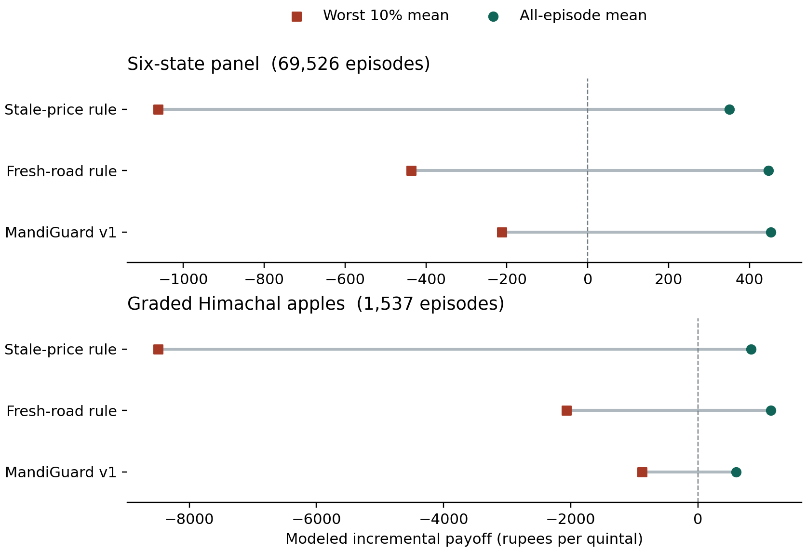

# Dispatch decisions from incomplete Indian mandi price reports

## Abstract

A higher listed price at another mandi can justify a trip only if the lot can earn enough on arrival to cover the journey. We evaluate dispatch rules retrospectively on 69,526 shortlisted origin-day-variety episodes. A deterministic policy that checks reporting history, route cost, weather-adjusted value and a forecast cushion scores ₹102.78 per quintal above a stale-price heuristic under the reference settlement assumptions. Its advantage over a heuristic using fresh prices and road costs is ₹6.13, with a paired 95% bootstrap interval from −₹17.02 to +₹25.02. The stronger comparison remains inconclusive. Our contribution is an inspectable comparison of decisions under alternative assumptions about missing quotes. The archive records prices reported by markets. Individual transactions, rejected lots and foregone local sales would require field observation.

## 1. Research question and prior work

When evaluating a destination policy, what changes if a listed variety lacks a quote at the expected arrival? Transfer costs already explain why spatial price spreads can persist. Ma and colleagues documented missing AGMARKNET records even when a market traded. Ziegler and colleagues studied the logistical constraints on vegetable farmers choosing markets in Bihar. We bring arrival-date reporting and explicit settlement scenarios into a paired policy comparison. We use “phantom spread” only as shorthand for a positive screen spread with a negative modeled incremental payoff. Priority for the underlying economic phenomenon is unsupported. [Baulch](https://doi.org/10.2307/1244145) · [Ma et al.](https://doi.org/10.1145/3287098.3287100) · [Ziegler et al.](https://doi.org/10.1145/3287098.3287115) · [Detailed literature comparison](../final/reviews/novelty-review.md)

## 2. Records and decision time

The retained modern panel contains 260,043 records covering onion, potato, tomato and apple at 178 markets in six states. The main experiment pools grades, while the Himachal Pradesh apple evaluation keeps grade in the matching key. The archive's full-period minimum reporting requirement conditions the study population on subsequent activity. Duplicate keys and 759 modal prices outside the reported minimum–maximum range remain material quality limitations. On the official single-day XML overlap, 171 of 172 shared price triplets agreed. Across the apple overlap, all 2,042 shared triplets agreed, with 40 additional official-only keys and 34 mirror-only keys. Agreement supports transcription fidelity on those overlaps. [Data audit](../final/reviews/data-source-review.md)

A decision uses a reported local modal price and destination quotes dated through the decision day. Archive dates alone cannot establish the hour those reports became public. Reporting practice permits later revisions. Both routing and the weather-adjusted rule are retrospective scenarios. The 102-cell weather cache lacks forecast issue times. Rain and humidity exactly equal the corresponding realized values on all 99,858 joined cell-days. A further 43 cells use same-day reanalysis in the decision proxy. A real-time interpretation would require archived issue times and contemporaneous quote snapshots. [Independent weather check](../final/weather-and-apple-checks.json)

## 3. Settlement and comparison

For a dispatched lot the incremental payoff per quintal is the assumed proceeds after quality and physical losses, less modeled freight, fees, waiting costs and the foregone local modal price. A local sale has incremental payoff zero. The simulator looks for the exact variety on arrival and the following two days. When no exact quote appears it applies a specified other-variety discount or diversion rule. A missing record can also reflect a reporting gap or trade outside the portal. Aggregate survey losses, estimated road lengths and assumed freight rates do not identify a particular lot’s proceeds. Of 63,040 naive dispatches, 5,488 had an exact quote one day later and 2,236 had one two days later. The historical 58.94% flag includes both groups. [Settlement implementation](../src/evaluation/payoff_model.py) · [Outcome counts](../results/exp1b_b1_outcome_types.csv)

Stage I uses 2024 training, January–May 2025 validation and June 2025–April 2026 evaluation. Git places the four hypotheses and calibration before committed results, without independently dating first access to the evaluation data. The unit of pairing is a shortlisted origin-day-variety episode. The loss-trip denominator is the number dispatched. Mean gain and episode-level loss incidence include local sales. Tail loss uses the lowest tenth of the episode payoff distribution, with fractional weight on the last ordered observation. Selected-route diagnostics retain a missing value whenever that destination lacks an arrival-day outcome.

## 4. Replayed Stage I results

| Policy | Dispatches (%) | Modeled mean (₹/quintal per episode) | Losing trips (% of dispatches) |
|---|---:|---:|---:|
| Stale-price heuristic B1 | 90.67 | 350.01 | 40.46 |
| Fresh-price and road-cost heuristic B2 | 62.11 | 446.66 | 18.11 |
| Point-forecast policy B3 | 93.05 | 330.85 | 45.28 |
| MandiGuard v1 | 48.66 | 452.79 | 9.97 |

The paired bootstrap resamples 174 origin markets and 23 two-week blocks, using 5,000 draws and seed 20261117. The original one-sided percentile-tail statistic, adjusted over four tests, gives 0.0012 for B1 and 0.269946 for B2. The method gives conditional uncertainty under its clustering assumptions. Shared destination shocks, longer dependence and uncertainty in the payoff function are outside these intervals. Stage I reduced episode-level loss incidence by 37.29 percentage points relative to B3. Its simulated tool count was 8.75 against 15.74 for the same policy charged for upfront checks. This is an accounting result. [Replayed benchmark](../results/exp2_main_benchmark_6state.csv) · [Paired inference](../results/confirmatory_holm_summary.csv)

For the main cohort, the corrected lower-decile means are −₹436.69 for B2 and −₹212.93 for v1. Averaging every payoff tied at the percentile previously gave −₹37.89 for v1, materially understating downside. The redesigned Stage II rule scores −₹223.19 on this measure. [Exact-decile audit](../final/exact-decile-audit.csv)

On the separate graded apple comparison, B2 averaged ₹1,150.83 across 1,537 episodes and v1 averaged ₹605.06. The corrected lower-decile means were −₹2,069.03 and −₹876.47 respectively. This illustrates the difference between mean gain and downside exposure. [Independent apple reconstruction](../final/weather-and-apple-checks.json)

In a paired control with fixed decision weather, v1 scored ₹454.61 per quintal on the six-state cohort and ₹588.19 on HP apples. Against the archived-weather arm, the losing-trip share increased in both cohorts. This tests sensitivity to the decision inputs with the settlement model held fixed. [Weather control](../final/DECISION_WEATHER_CONTROL.md)

## 5. Stage II and interpretation

Stage II fits a payoff and loss model using scenario-assigned outcomes and selects a score threshold on validation. Diagnostics of the Stage I holdout informed this redesign. Its archived gain of ₹32.51 per quintal over B2 on that same holdout is exploratory. Its 10.48% loss rate among holdout dispatches exceeded the 9.5% validation target. The selection-dependent risk denominator, route re-ranking and temporal dependence preclude a formal conformal guarantee. The historical comparison of observed arrival price returns with all-row scenario payoffs also changes the response variable. It cannot identify the effect of missingness alone. Selecting episodes using eventual quote availability gives a conditional retrospective cohort. In the historical five-candidate arrival-day cohort, B1 chose outside those five on 14 dispatches, eight of which had no day-zero quote. Consequently this cohort does not eliminate the missing-price settlement rule for every selected route. [Selected-route replay](../final/SELECTED_ROUTE_AUDIT.md) [Statistical and methodological review](../final/reviews/adversarial-review.md)

## 6. Conclusion and reproducibility

Under the declared settlement assumptions, sequential checks improved the historical score over stale screen chasing. Their advantage over the fresh-road comparator remains uncertain. The narrower application is a way to compare refusal, downside and modeled gain when reports are missing. Establishing value to farmers requires timestamped predictions, independent market checks, lot-specific offers, receipts, transport costs and a credible comparison of available alternatives. The revised metric, selected-route replay and decision-weather control are documented with their execution commands in the [correction record](../final/CORRECTIONS.md).

**Figure 1.** Both markers are computed across all shortlisted episodes, assigning zero incremental payoff to selling locally. Horizontal axes have different scales across cohorts. The connecting segment shows two summaries of each policy's payoff distribution.
