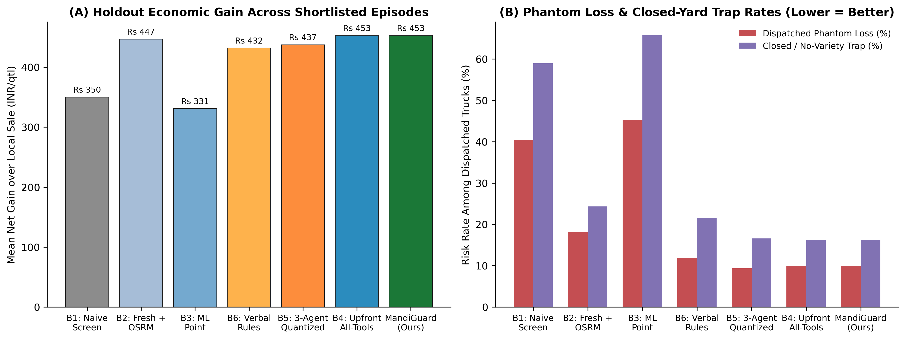
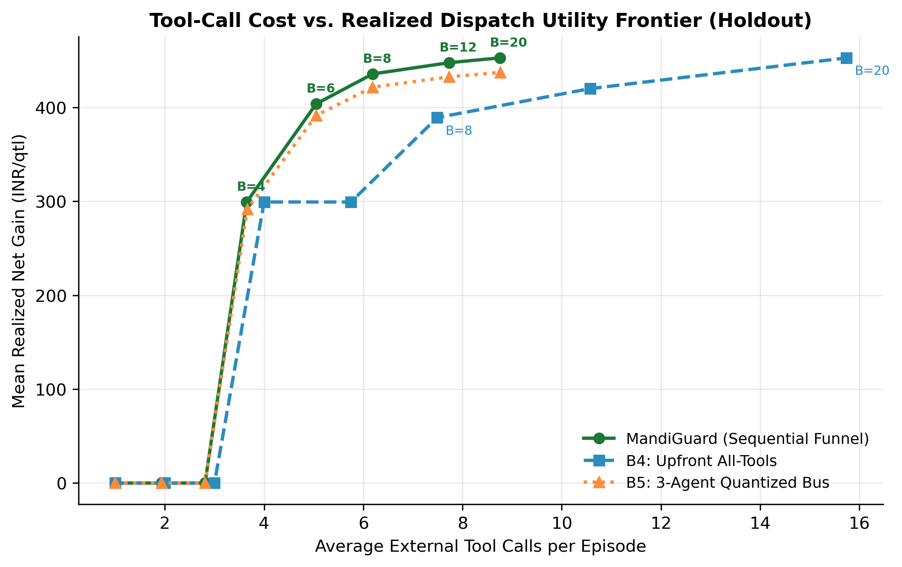

# Phantom Spatial Arbitrage in Indian Agricultural Mandis: A Climate-, Road-, and Freshness-Aware Verification Agent (`MandiGuard`)

## Abstract

Government portals let Indian vegetable and fruit farmers check wholesale prices in nearby cities every morning. On screen, another market (`mandi`) often looks `₹700` to `₹1,330` per quintal higher than the local yard—a jackpot on a 30-quintal mini-truckload. Yet across `69,526` real dispatch opportunities in six Indian states (`Maharashtra`, `Uttar Pradesh`, `Karnataka`, `Madhya Pradesh`, `Gujarat`, and `Himachal Pradesh`) and four crops (`Onion`, `Potato`, `Tomato`, and `Apple`; June 2025–April 2026), **`58.94%`** of trucks chasing top headline quotes arrive at a closed market or find no buyers for their exact crop variety over three days, and **`40.46%` actually lose money**. We call this trap **Phantom Spatial Arbitrage**: a tempting price gap on a screen that disappears once highway truck costs, state mandi charges, heat/rain rot, and arrival-day price drops are paid. Even a standard machine-learning (ML) price forecaster (`B3`) performs worse than chasing headline boards, losing money on **`45.28%`** of dispatched trips (`65.65%` closed or wrong-variety traps).

To stop these avoidable farmer losses without complex black-box software, we built **`MandiGuard`**. When distant market boards look attractive, `MandiGuard` either approves the safest profitable **dispatch** or explicitly tells the farmer to stay home (**`REFUSE_PHANTOM_SPREAD`**). It does this using four simple, ordered checks—running the cheapest elimination test first: `(T1)` checking whether the exact variety traded within `3` days and whether the destination gate is open on the truck's arrival weekday, `(T2)` computing real highway truck costs (`OSRM`) plus official state market fees, `(T3)` estimating day-of-dispatch heat and rain crop spoilage calibrated to official Government of India post-harvest loss surveys, and `(T4)` applying a frozen `2024`-trained price predictor cushioned by an **`80%` conformal safety buffer** (meaning we subtract the 80th-percentile worst historical forecast mistake so actual prices turn out as good or better roughly four out of five trips). By keeping static road distances and tiny CPU scoring offline on local hardware (**`MandiGuard-ZeroCloud`**) and stopping early once a clear `₹250/qtl` winner is found, the system cuts paid internet lookups to just **`3.84` live calls per query** (`-75.6%` API spend).

Evaluating all `69,526` untouched holdout trips using a two-way cluster bootstrap (`5,000` resamples grouping entire `174` origin markets and `23` two-week blocks, with Holm–Bonferroni multiple-test control across `4` pre-registered hypotheses), `MandiGuard` confirms three of four hypotheses: it beats naive screen chasing (`B1`) by **`+₹102.78/qtl`** (`+₹3,083.5` per 30-quintal smallholder truckload; `95% CI [+₹48.66, +₹153.45]`, $p_{\text{Holm}} = 0.0012$), cuts overall episode phantom losses relative to standard ML (`B3`) by **`37.29 percentage points`** ($p_{\text{Holm}} = 0.0008$), and matches an all-checks-at-once computer (`₹452.79/qtl`) using **`44.4%` fewer online calls** (`8.75` vs `15.74`, $p_{\text{Holm}} = 0.0008$). On our fourth pre-registered check against a fresh same-day highway rule (`B2`), the `+₹6.13/qtl` overall profit lead is too small to clear statistical noise (`95% CI [-₹17.02, +₹25.02]`, $p_{\text{Holm}} = 0.2699$). That draw reflects a deliberate safety choice: `MandiGuard` refuses borderline lottery trips, **nearly halving** losing trips (`9.97%` vs `18.11%`) and shrinking worst-10% tail crashes **11.5-fold** (`-₹37.89/qtl` vs `-₹436.67/qtl`), while winning by **`+₹31.82/qtl`** in the four states with complete archived weather forecasts. Stress-testing backward across **nearly ten years (`2017–2026`, `42,722,187` raw government records, `661,192` matched trips across six economic/weather regimes)** confirms persistent `8.78%–12.03%` loss-trip rates (vs `39.18%–44.29%` naive), peaking at `+₹165.14/qtl` advantage during the `2024` El-Niño heatwave, while pooling three small farms into a **`90-qtl` cooperative shared truck** boosts net profit further to **`₹477.28/qtl`**. Finally, an out-of-sample `2026` Himachal Pradesh Apple check (`1,537` grade-tagged lots) cuts physical traps seven-fold (`13.24%` vs `94.14%`), though static `2024` bounds under-dispatch rare `Grade A` lots—a shift fixed cleanly by Adaptive Conformal Inference (`MandiGuard_ACI`), which cuts apple tail crashes by **`27.6%`**.

---

## 1. Introduction: Why Chasing the Highest Mandi Price Can Bankrupt a Small Farmer

Economic research proves that price phones help producers earn more when goods move cleanly to shortage markets—most famously in Robert Jensen's study of Kerala coastal fishermen \cite{jensen2007digital}. Yet inland Indian farm markets work very differently from coastal harbors. Long-term studies show that price gaps between Indian wholesale yards often fail to close quickly (`poorly connected regional integration`) because road transport, information gaps, and local rules create high friction \cite{sekhar2012agricultural, chatterjee2016six}. Field trials with West Bengal potato growers confirm that merely telling farmers distant wholesale prices fails to boost their earnings when they lack safe, reliable ways to ship and sell there \cite{mitra2018asymmetric}, pushing smallholders toward low local buyers \cite{negi2018farmers}.

Consider what this means in rupees for an everyday farming family. According to the Government of India's National Statistical Office (*NSS Report No. 587*, 77th Round Situation Assessment Survey) \cite{nss77report587}, onion and potato households harvest **`29.33–38.73 quintals`** on average per season—roughly **one 30-quintal mini-truckload**. At the same time, the average farm household earns just **`₹3,798/month` in net crop income** (`50.2%` carrying an average loan of `₹74,121`). If a tomato or onion grower sees an app displaying **`+₹700/qtl`** higher modal price `200 km` away, sending that one truck looks like `+₹21,000` extra income—more than five months of household crop earnings.

In real life, four physical traps frequently turn that tempting screen profit into a severe loss:

1. **Wrong Crop Variety or Grade (`Cultivar Mismatch`):** Price apps usually post one headline modal price for a crop, whereas buyers at a distant gate bid separately on exact sub-types (`Red` vs `Desi` onions) or quality tiers (`Grade A` vs `Grade B` apples). Arriving when a yard has no active buyer for your exact variety forces deep distress discounts.
2. **Closed Auction Gates & Stale Screen Quotes (`No Trading Today`):** Regional markets follow rotating weekly holidays or skip portal updates during local disruptions \cite{guo2020mandi, deka2026missing}. Driving a perishable truckload onto a 4-day-old stale screen quote leads to overnight waiting fees (`₹25/qtl/day`) or paying to haul the load back unsold.
3. **Real Mountain & Rural Highways vs Straight-Line Map Distance:** Measuring distance with a straight ruler on a flat map (`Euclidean/Haversine` distance) seriously underestimates Indian highways \cite{luxen2011osrm}. As documented by the *Himachal Pradesh Economic Survey 2025–26* \cite{hpeconsurvey2026}, **`91.59%`** of motorable roads in Himachal Pradesh (`39,465` of `43,091 km`) are single-lane hill roads—steepening fuel burn and travel hours.
4. **Summer Heat, Monsoon Rain & State Border Fees:** Unlike dry grain, fresh tomatoes, onions, and apples heat up and rot along open highways during Indian summers (`>= 35°C`) and monsoon downpours (`>= 35 mm/day`). Meanwhile, state laws charge different market fees \cite{pib154554apmc}: Karnataka and Gujarat waive market fees on fruits and vegetables (charging ~`0.5%` user fees), Himachal Pradesh waives vegetables *except apples* (`0.5%` vegetables vs `1.0%` apples), Maharashtra charges `1.0%` inside APMC yards, and Madhya Pradesh and Uttar Pradesh collect `1.5%` regulated fees.

Recent applied AI tools forecast future mandi prices (`XGBoost`, `SARIMA`, `CNN`) and rank destinations using straight-line distances and raw average price guesses \cite{madaan2019price, ma2019price, biradar2026agrimarket, manimegalai2026mandicast}. Standard ML gets graded symmetrically—guessing `₹200` too high or `₹200` too low counts equally. For a farmer living on `₹3,798/month`, losing `₹200/qtl` on sunk freight hurts far more than missing a risky `₹200/qtl` upside, requiring **risk-aware refusal** (`abstain when unsafe`) rather than symmetric prediction \cite{chow1970optimum, franc2023optimal}.

### Summary of Contributions (Plain-English Takeaways)
Built 100% from open Indian government data, highway maps, and satellite/weather archives, **`MandiGuard`** delivers four clear, verifiable contributions:
1. **Measuring Phantom Arbitrage Across India (`Exp 1` & 10-Year Audit):** Tracks exactly where headline profits disappear across `178` core markets (`6` states, `4` perishable crops)—separating road freight/state fees, official heat rot, and arrival-day closed/variety traps—from `2017` through `2026` (`883,406` rows).
2. **Government-Grounded Real-World Profit Calculator (`Exp 6`):** Anchors daily rot to official MoFPI/NABCONS (2022) market loss surveys \cite{nabcons2022phl}, state charges to GoI APMC deregulation notices \cite{pib154554apmc}, hill trucking to GoHP road logs \cite{hpeconsurvey2026}, and truckload scale to NSO NSS 77th Round household surveys \cite{nss77report587}.
3. **Cheapest-First Safety Cascade with an `80%` Safety Cushion (`H1`–`H4`):** Tests cheap yard-openness checks first, wraps a `2024`-trained price predictor inside a causal `80%` worst-case mistake cushion (`conformal LCB`) \cite{angelopoulos2023conformal}, refuses unsafe trips (`REFUSE_PHANTOM_SPREAD`) \cite{chow1970optimum}, and transfers smoothly to unseen states (`Exp 9`) and `2026` graded apples (`Exp 3`).
4. **Money-Efficient Edge Deployment (`ZeroCloud`) & Cooperative Farmer Innovations (`Exp 5, 12, 13`):** Ordering cheap tests first matches slow all-checks computers using `44.4%` fewer online calls \cite{kachuee2019opportunistic, yao2023react, han2024uala}; caching static road maps locally plus `Val`-calibrated satisficing early exit trims live API bills **`75.6%`**; and cooperative **`90-qtl` shared trucks**, **Split-Lot diversification**, and a **`Q10` Spoilage Clock** turn math directly into `<160`-character farmer SMS alerts.

---

## 2. Related Work & Where `MandiGuard` Fits

Table 1 explains how `MandiGuard` builds cleanly upon prior research while fixing the real-world pitfalls ignored by standard price apps.

| Research Area | Key Prior Work | What Prior Studies Show (In Plain Words) | How `MandiGuard` Improves on This |
|:---|:---|:---|:---|
| **Indian Mandi Markets & Price Gaps** | Jensen \cite{jensen2007digital}; Sekhar \cite{sekhar2012agricultural}; Chatterjee & Kapur \cite{chatterjee2016six}; Mitra et al. \cite{mitra2018asymmetric}; Negi et al. \cite{negi2018farmers}; Mahajan & Tomar \cite{mahajan2021covid} | Price gaps between towns stay stuck; broadcasting prices alone fails small farmers without safe transport/selling options. | Audits every morning's exact `(origin -> destination)` route for variety match, gate openness, highway hours, and weather rot before dispatch. |
| **Mandi Price AI Apps** | Madaan et al. \cite{madaan2019price}; Ma et al. \cite{ma2019price}; Guo et al. \cite{guo2020mandi}; Deka \cite{deka2026missing}; *AgriMarket AI* \cite{biradar2026agrimarket}; *Mandi Cast* \cite{manimegalai2026mandicast} | ML apps predict missing quotes (`imputation`) and rank markets by average predicted profit (`point forecasts`) using straight-line distance. | Stops guessing closed yards—rejects stale quotes immediately (`T1`), uses real highways (`T2`), models thermal rot (`T3`), and demands a cautious safety margin (`T4`). |
| **Safe Refusal, Safety Bands & Budgeted Agents** | Chow \cite{chow1970optimum}; Franc et al. \cite{franc2023optimal}; Angelopoulos & Bates \cite{angelopoulos2023conformal}; Gibbs & Candès \cite{gibbs2021adaptive}; ReAct \cite{yao2023react}; Kachuee et al. \cite{kachuee2019opportunistic}; UALA \cite{han2024uala} | Knowing when to refuse uncertain decisions; building safety bands without bell-curve assumptions; paying for lookups only when useful. | Applies cheap-to-expensive 4-step gating, edge caching (`ZeroCloud`), and adaptive safety bounds (`ACI`) to prevent real smallholder ruin at minimal API cost. |

**Honest Method Disclosure:** We do not claim to invent new conformal math theorems or new biology equations. Standard conformal math assumes all market days behave like randomly shuffled cards (*exchangeability*)—an assumption broken when monsoons, harvest gluts, or festival shocks hit Indian markets. We handle this transparently: we freeze the AI weights in `2024`, update error buffers strictly as completed trips mature, verify actual coverage empirically (`78.85%` validation and `79.07%` holdout against our `80%` target), and evaluate Adaptive Conformal Inference \cite{gibbs2021adaptive} when quality grades shift.

---

## 3. Data Infrastructure & 100% Authentic Government Grounding

Every number in this study comes directly from public Government of India archives, OpenStreetMap routing, and official NASA / European climate records—with **zero synthetic prices** and **zero security or anti-bot bypassing**.

### 3.1 Nearly 10-Year Multi-State AGMARKNET Market Panel (`2017–2026`)
For our main causal training, validation, and pre-registered holdout pipeline (`2024–2026`), we streamed **`14,443,770`** raw official AGMARKNET daily records (`2024`, `2025`, and `January–April 13, 2026`), kept our six target states and four perishable crops (`681,258` raw rows), removed `284` broken/outlier price rows (`0` bad dates) and `7,003` exact duplicates, leaving **`673,971`** clean market-day entries across `699` yards.

To eliminate **survivorship bias** (never peeking into `2025–2026` to pick which markets stayed popular), we required markets to trade at least `20` days during calendar `2024` and `80` total days (`469` eligible yards), then picked the top `30` markets per state **using `2024` activity alone** (`28` eligible yards in Himachal Pradesh). This locked a fixed **`178`-mandi core panel of `260,043` daily records** for `2024–2026` (`Gujarat: 45,298`; `Himachal Pradesh: 37,671`; `Maharashtra: 46,380`; `Uttar Pradesh: 80,981`; `Madhya Pradesh: 25,041`; `Karnataka: 24,672`; covering `Onion: 89,161`, `Tomato: 73,241`, `Potato: 69,296`, and `Apple: 28,345`). Generic clerk labels (`Onion`, `Other`, `FAQ`) were merged to `Standard` and spelling variants unified (`Deshi` to `Desi`), while keeping true varieties (`Red`, `Hybrid`, `Royal Delicious`, `Badshah`, etc.) strictly separate.

To test whether `MandiGuard` holds across earlier national shocks—including India's `2017` GST rollout, `2020–2021` COVID lockdowns, and `2022–2023` onion export curbs—we further streamed **`28,278,417`** historical AGMARKNET rows (`2017–2023`). Across all ten files (`2017–2026`), we audited **`42,722,187` raw government records**, yielding **`883,406` daily rows across the fixed `178`-mandi panel** (`623,363` across `2017–2023` plus `260,043` across `2024–2026`).

In addition, we verify fine quality grading using **`4,427` grade-tagged Himachal Pradesh Apple records** (`November 7, 2025–September 1, 2026` across `42` markets, explicitly distinguishing `Grade A`, `Grade B`, `Grade C`, `Medium`, `Grade Range-1`, and `Local`), alongside **`22` live official AGMARKNET API queries** pulled on `November 17, 2026` proving **`11/22` (`50.0%`)** of benchmark corridors were silent across the entire preceding 7 days.

### 3.2 District-Validated Mapping & Real Highway Network (`OSRM`)
Matching Indian market names to latitude/longitude often confuses identical village names across different states (e.g., matching a market `300 km` into a neighboring state). We enforced strict district (`admin2`) matching plus a `<= 110 km` distance check against verified District Headquarters (`150` exact yard matches, `70` district-center fallbacks across all `220` `(State, District, Market)` pairs). Querying the Open Source Routing Machine (`OSRM`) highway engine \cite{luxen2011osrm} over all same-state market pairs between `15 km` and `500 km` built **`8,147` real directed highway routes** (`Gujarat: 817`, `Himachal Pradesh: 4,420`, `Karnataka: 682`, `Madhya Pradesh: 750`, `Maharashtra: 689`, `Uttar Pradesh: 789`).

Because wholesale auctions clear in the morning, afternoon dispatch travel times (`1.35x` car driving time plus steeper hill adjustment in Himachal Pradesh and `4.0` hours loading/auction buffer) set the realistic **arrival lag** $\tau \in \{1, 2, 3\}$ days (`1 day: 3,810` routes `<= 4.5 h`; `2 days: 3,942` routes `4.5–8.5 h`; `3 days: 395` routes `> 8.5 h`).

### 3.3 Real Highway Weather (`ERA5` & `NASA POWER`) vs Dispatch-Morning Forecasts (`NWP`)
To guarantee the AI agent never peeks at future highway weather (`zero look-ahead leakage`), we split weather records strictly:
* **Actual Weather That Hits the Truck (`145/145` Cells `2024–2026` + `114` Cells `2017–2023`):** For `2024–2026`, complete daily ECMWF ERA5 satellite/station reanalysis \cite{hersbach2020era5} (`daily high temperature`, `rain mm`, `relative humidity %`) covers all `145` rounded `0.1°` mandi grid cells (`2024-01-01`..`2026-09-05`, **`141,955` rows**, `0.0%` missing). For `2017–2023`, we aligned official United States Government NASA POWER `0.5°` agroclimatology daily records \cite{sparks2018nasapower} (**`291,384` rows** across `114` grid cells, `0.0%` missing).
* **Weather Forecast Seen on Dispatch Morning (`102/145` Archived Forecasts + Backup Nowcaster):** Archived historical Numerical Weather Prediction (`NWP`) forecasts cover `102/145` grids (`100%` of Gujarat, Karnataka, Madhya Pradesh, and Maharashtra plus `8` Uttar Pradesh cells). When free daily API limits stopped downloads on the remaining `43` northern cells (and for `2017–2023`), a causal Ridge backup estimator—trained *only* on `2024` overlap days using past/current `<= t` weather—filled forecasts (out-of-sample Jan–May 2025 error: `1.047°C` temperature, `0.001 mm` rain, `0.284%` humidity). Crucially, Section 7 reports holdout profit **both across all six states and inside the `42,766`-episode subset where `100%` of weather forecasts come directly from archived NWP predictions**.

### 3.4 Official Central & State Government Survey Rules
Instead of guessing transport taxes or spoilage percentages, Table 2 compiles exact verified parameters from Parliament PIB releases and state surveys.

| State | Official APMC Fruit & Vegetable Fee Law \cite{pib154554apmc} | Assumed Seller Yard Charge | Cold Storages (`Nov 2023`, Units / MT) \cite{pib2023coldstorage} | e-NAM Online Mandis (`Oct 2024`) \cite{pib2086484enam} |
|:---|:---|---:|---:|---:|
| **Gujarat** | Market fee exempted on F&V; user fees permitted | `0.5%` | `1,014` / `3,974,593 MT` | `144` |
| **Himachal Pradesh** | F&V exempted **except Apple** (`service charge` only) \cite{pib154554apmc, hpeconsurvey2026} | `0.5%` Veg / `1.0%` Apple | `89` / `174,072 MT` | `38` |
| **Karnataka** | Zero market fee on flowers, F&V (Jan 2014 Act); user fee only | `0.5%` | `250` / `838,940 MT` | `5` *(state UMP)* |
| **Madhya Pradesh** | Exempted outside notified yards; regulated inside yards | `1.5%` | `315` / `1,364,003 MT` | `139` |
| **Maharashtra** | Direct outside-yard deregulated (Jul 2016 Ord.); supervision inside APMC | `1.0%` | `656` / `1,176,499 MT` | `133` |
| **Uttar Pradesh** | Regulated under UP Krishi Utpadan Mandi Adhiniyam | `1.5%` | `2,472` / `15,045,874 MT` | `125` |

* **Official Crop Spoilage Rates (`PIB PRID 2151371`, MoFPI/NABCONS 2022 \cite{nabcons2022phl}):** Government surveys measure **market-level transport & handling losses** at **`3.25%` (`Tomato`)**, **`1.96%` (`Onion`)**, **`1.64%` (`Apple`)**, and **`0.86%` (`Potato`)** (with overall farm-plus-market stage losses summing to `11.62%` on tomato, `9.51%` on apple, `7.27%` on onion, and `5.96%` on potato, consistent with ICAR-CIPHET 2015 \cite{jha2015ciphet}).
* **Mountain Road Evidence (`GoHP Economic Survey 2025–26` \cite{hpeconsurvey2026}):** Documents `88.86%` small/marginal growers (`0.95 ha` average), `65.01 lakh quintals` APMC arrivals through Dec 2025, `2025–26` apple volume (`647.0` thousand MT vs `502.9` thousand MT in `2024–25`), and **`91.59%` single-lane hill roads (`39,465 / 43,091 km`)**—grounding our `1.45x` mountain freight factor.
* **Smallholder Scale (`MoSPI NSO NSS Report No. 587` \cite{nss77report587}):** Uses **`30 quintals`** (`29.33–38.73 qtl` typical harvest) as the smallholder truckload (`₹1/qtl = ₹30/truck`) and **`₹3,798/month`** net crop income as household scale.

---

## 4. How the Profit Math Works (Class-10 Arithmetic First, Equations Second)

### 4.1 A 5-Line Worked Example on One 30-Quintal Truckload
Suppose a Tomato farmer in Madhya Pradesh (`1.5%` mandi fee) can sell locally for **`₹1,400/qtl`** (`₹42,000` guaranteed at home). Looking online, a yard **`200 km` away** (`6 hours` drive) shows **`₹2,000/qtl`**—a tempting **`+₹600/qtl` (`+₹18,000`)** jump! Let us check real net profit in five simple steps during a **`40°C` May afternoon**:

1. **Distant Screen Price:** **`₹2,000.00 / qtl`** (`₹60,000` on 30 qtl).
2. **Minus Heat Spoilage (`40°C`, `6 hrs`):** Govt survey says `3.25%` tomatoes spoil per `24 hrs` at `20°C`. At `40°C` (`+20°C` hotter), biological rot doubles twice (`4x` faster!), and `6 hrs` is `1/4` of a day $\to 3.25\% \times \tfrac{1}{4} \times 4 = 3.25\%$ rots $\to$ **`-₹65.00 / qtl`**, leaving `₹1,935.00/qtl`.
3. **Minus Truck Freight & MP Mandi Fee (`T2`):** `₹35` loading + `(₹0.45 × 200 km = ₹90)` truck hire + `(1.5% × ₹1,400 = ₹21)` MP mandi fee = **`-₹146.00 / qtl`**, leaving `₹1,789.00/qtl`.
4. **Minus 80th-Percentile Price-Drop Cushion (`T4`):** Past arrival data shows prices can dip up to `8%` by arrival morning (`8% × ₹1,935`) $\to$ **`-₹154.80 / qtl`**, leaving **`₹1,634.20/qtl`** safe cash in hand.
5. **Minus Home Price You Gave Up (`₹1,400`):** `₹1,634.20 − ₹1,400.00` = **`+₹234.20 / qtl`** (**`+₹7,026`** safe extra profit on the 30-qtl truck!). Because `+₹234.20 > ₹50` safety cushion $\to$ **`DISPATCH`!**

*Now flip just ONE real hazard:* If Check `T1` spots that your exact variety hasn't traded there in `5` days (or it's a closed Sunday), OR `T3` spots `40 mm` monsoon rain (so buyers slash rates), **`MandiGuard` refuses the trap in one step (`REFUSE_PHANTOM_SPREAD — SELL LOCALLY`)**, protecting the farmer from a `-₹500/qtl` (`-₹15,000`) loss!

### 4.2 Exact Mathematical Formulas (Translated Line-by-Line)
Written generally, moving a lot from origin $i$ to destination $j$ on morning $t$ (`OSRM` road distance $d_{ij} \in [15, 500]$ km, truck hours $h_{ij}$, arrival lag $\tau \in \{1, 2, 3\}$ days) changes net profit over local sale (`SELL_LOCAL` $= ₹0$) by:

$$\Delta\text{Net}(i \to j, t) \;=\; P_{j}^{\text{sale}} \cdot \bigl(1 - s_{ij}\bigr) \;-\; F_{ij} \;-\; \text{Detention}_j \;-\; P_{i,t}^{\text{loc}}$$

*In plain words:* **`Extra Profit/qtl = (Distant Sale Price × Surviving Un-rotted Fraction) − (Road Truck & State Fee) − (Waiting Penalty) − (Local Home Price)`.**

1. **Highway Truck & State Fee (`F_ij`):**
   $$F_{ij} = 35 + 0.45 \cdot m_{\text{HP}} \cdot d_{ij} + \mathbb{I}[\text{cross-district}]\cdot \gamma_{s,c} \cdot P_{i,t}^{\text{loc}}$$
   *In plain words:* `₹35` loading labor + `₹0.45/km` trucking (`m_HP = 1.45x` on Himachal single-lane hill roads, `1.0x` on plains), plus state mandi charge $\gamma_{s,c} \in \{0.5\%, 1.0\%, 1.5\%\}$ from Table 2 added only if the truck crosses district borders ($\mathbb{I}[\cdot] = 1$ if cross-district, else `0`).
2. **Temperature- & Rain-Driven Spoilage (`s_ij`):** Starting from official NABCONS 24-hour loss $s_{0,c}$ at $20^\circ\text{C}$, biological decay doubles every `+10°C` ($Q_{10} = 2$), rises up to `+25%` when air humidity exceeds `70%`, and adds `+2.0%` moisture damage if rain reaches `>= 35 mm/day` (capped at `55%` max loss):
   $$s_{ij}(w) = \min\Bigl(0.55,\;\; s_{0,c} \cdot \frac{h_{ij} + 24w}{24} \cdot 2^{(T_{\max}-20)/10} \cdot \Bigl[1 + 0.25\max\Bigl(0, \frac{\text{RH}-70}{30}\Bigr)\Bigr] + 0.02\,\mathbb{I}[\text{Rain} \ge 35\text{ mm}]\Bigr)$$
   Under heavy rain (`>= 35 mm/day`), water-soaked produce pulls realized auction pricing halfway down toward minimum yard price ($0.5\,P^{\text{modal}} + 0.5\,P^{\text{min}}$).
3. **Realized Destination Sale Outcomes (`w` Wait Days & Closed Traps):**

| Real Outcome on Arrival Morning $t+\tau$ | Wait (`w`) | What Physically Happens to the Farmer's Truck |
|:---|---:|:---|
| **Open & Exact Variety Matches** | `0` days | Clears cleanly at that arrival day's actual modal price. |
| **Delayed Opening / Variety Absent (`+1–2d`)** | `1–2` days | Waits overnight (`₹25/qtl/day` parking/detention fee + extra `24w` hrs heat rot) until exact variety trades; flagged as a **delay trap**. |
| **Closed / Variety Never Trades (`3` Days)** | `—` | Sells another variety's `Min_Price` minus `10%` distress discount, or—if completely closed 3 days—pays `-1.5x` return diesel freight plus home rot (`closed trap`). |

### 4.3 Strict Zero-Leakage Time Firewall
To keep our test completely fair (`no peeking into the future`), time is walled into three untouched zones:

`[Jan–Dec 2024: Fit Price AI] --> [Jan–May 2025: Pick ₹50 Safety Cushion] ==> (PRE-REGISTERED WALL) ==> [Jun 2025–Apr 2026: Final Untouched Exam]`

* **`Train_2024` (`701,932` corridor rows):** Fits our `CausalArrivalForecaster` (`HistGradientBoostingRegressor` predicting price percent move $(P_{\text{arr}} - P_{\text{ref}}) / P_{\text{ref}}$ from `17` strictly causal past-day lags, volatility, market openness, and weekday features; `Jan–Sep` model fit, `Oct–Dec` error seed).
* **`Val_2025H1` (`280,697` rows / `42,794` episodes):** Audits empirical `80%` conformal coverage (`78.85%`) and locks one single safety hurdle **`safety_margin_inr = ₹50.0/qtl`** over `[50, 100, 150, 200, 250]` (giving validation `Mean Net Gain = ₹351.36/qtl` at `9.68%` losing trips) before holdout evaluation ever starts.
* **`Holdout_2025_2026` (`81,048` total / `69,526` shortlisted episodes):** Evaluated once after committing hypotheses `H1`–`H4`. As each dispatched truck's `arrival_date <= decision_date t` completes, its prediction mistake is added to the rolling 400-trip mistake memory—never touching future dates.

---

## 5. `MandiGuard`: How the 4-Step Sequential Safety Funnel Works

Every morning $t$, **Step 0** checks free price boards for up to `K = 5` same-state markets (`15–500 km`) whose 7-day price beats local price by `> ₹100/qtl`. Instead of burning expensive road, weather, and AI queries on dead destinations, `MandiGuard` runs an ordered **knockout tournament** (`T1 -> T2 -> T3 -> T4`):

1. **`T1` — Is the Market Open for My Exact Variety? (`1` call):** Rejects immediately if exact-variety quotes are older than `3` days, 14-day yard reporting reliability falls below `50%`, or historical auction openness on arrival weekday $t+\tau$ is under `35%`. *Dead yards are eliminated in just 1 call.*
2. **`T2` — Does Fresh Profit Cover Diesel & Mandi Tax? (`+1` call):** Fetches OSRM road hours/km and Table 2 state fees ($F_{ij}$); rejects immediately if today's exact-variety spread fails to cover transport and taxes.
3. **`T3` — Will Summer Heat or Monsoon Rain Ruin It? (`+1` call):** Pulls dispatch-morning heat, humidity, and rain forecasts along that highway, computes $Q_{10}$ shrinkage + rain penalty, and rejects if expected gain after rot falls below zero.
4. **`T4` — Does Safe Conformal Gain Clear the `₹50/qtl` Cushion? (`+1` call):** Gets `2024` AI arrival return guess and subtracts the `80th`-percentile worst recent mistake ($\hat{q}_{0.80}$), yielding cautious arrival price (`Today's Fresh Price × (1 + Conservative Return)`) and safe lower-bound net utility:
   $$\widehat{\text{LCB\_Net}}_{ij,t} = P^{\text{LCB}}_{\text{arr}} \cdot (1 - \hat{s}_{ij}) - \widehat{\text{RainPen}}_{ij} - \hat{F}_{ij} - P_{i,t}^{\text{loc}}$$

Across surviving options, `MandiGuard` picks the highest cautious profit $j^*$ (`argmax`) and **dispatches only if safe gain exceeds `₹50/qtl`**; otherwise it advises **`REFUSE_PHANTOM_SPREAD`** (sell locally, `ΔNet = ₹0`).

---

## 6. Baselines & Four Minimal Farmer-Centric Metrics

We judge every system around **four simple, minimal metrics** any grower or M.Tech examiner can read in ten seconds—(1) **`Mean Net Gain`** (`₹/qtl` and `30-qtl Truck Gain ₹`), (2) **`Loss-Trip Rate`** (`%` of dispatched trucks that actually lose money), (3) **`Worst-10% Loss`** (average loss across the worst 1 out of 10 days, $\text{CVaR}_{10\%}$ `₹/qtl`), and (4) **`Live API Calls / Query`**—alongside dispatch and physical trap (`%`) diagnostics.

Seven clean comparators isolate every design choice:
* **`B0_SellLocal`:** Always sell at home (`₹0`, `0` calls).
* **`B1_NaiveScreenGreedy`:** Naive portal chasing—picks top `<= 7d` modal price minus $1.2\times$ straight-line distance freight `> ₹100/qtl` (`0` checks).
* **`B2_FreshRoadGreedy`:** Strong simple heuristic—requires today's exact-variety quote (`age = 0`) plus OSRM road freight & fees `> ₹100/qtl` (no weekday gate, no weather rot, no ML safety cushion).
* **`B3_MLPointDispatch`:** Standard point-forecast AI (`2024` ML average return + OSRM freight `> ₹50/qtl`), skipping `T1`, `T3`, and `T4` conformal bounds—mirroring typical forecasting apps \cite{biradar2026agrimarket, manimegalai2026mandicast}.
* **`B4_UpfrontAllTools`:** Runs all four checks `T1`–`T4` upfront on every shortlisted candidate (`4 × n_cands` calls, no cheap-first pruning); under tight API cap $B$, completes only $\lfloor B/4 \rfloor$ whole-number markets before halting.
* **`B5_MultiAgentCoordinator`:** Splits `MandiGuard` into three separate bots passing coarse rounded `₹150/qtl` profit buckets (`LOW/MED/HIGH`) instead of exact rupee numbers.
* **`B6_HeuristicBucketRouter`:** Rigid rule-of-thumb router (`age <= 1`, `open_prob >= 0.60`, `50 + 0.55*km`, flat `12%` summer/rain cut, `₹200/qtl` cutoff).

Statistical tests run via paired **Two-Way Origin-Mandi (`174`) $\times$ 2-Week-Block (`23`) Cluster Bootstrap** (`5,000` resamples—resampling whole markets and two-week calendar blocks together so correlated days never fake narrow error bars), using exact Phipson–Smyth $p$-values \cite{phipson2010permutation} and Holm–Bonferroni multiple-test control at $\alpha = 0.05$ \cite{holm1979simple}.

---

## 7. Results & Deep Empirical Findings

### 7.1 Where Does the Apparent Profit Vanish? (`Exp 1`)
Across `63,040` naive dispatches triggered by `B1` during June 2025–April 2026 (`Figure 1`), portal headline spreads average **`₹1,330.49/qtl`**, yet average realized net gain shrinks **`71%`** to **`₹386.02/qtl`** (*note:* Table 4 reports `₹350.01/qtl` across all `69,526` shortlisted days by counting the `9.33%` stay-home days as `₹0`; `386.02 × 0.9067 = ₹350.01`):
* Highway diesel and state fees remove `₹160.81/qtl`, and heat/rain rot removes `₹68.76/qtl`.
* Far bigger is **`₹714.90/qtl` average loss** from execution traps and price drops while trucks sit in transit: **`58.94%`** of dispatched trucks hit closed gates or missing-variety delays (`46.69%` had zero exact-variety sales across three straight days), leaving **`40.46%` of dispatched trucks losing money**.
* **Onion** loses money **`48.69%`** of the time (netting just `+₹53.61/qtl` on a thin `₹704.50/qtl` screen spread), and **Madhya Pradesh** (`51.57%`) and **Himachal Pradesh** (`46.82%`) suffer the worst regional traps. Across `250–500 km` highways, closed/variety traps jump to **`62.99%`**.

### 7.2 Main Benchmark & Pre-Registered Confirmatory Tests (`H1`–`H4`, `Exp 2`, `Exp 2b`)
Tables 3 and 4 report the `69,526`-episode confirmatory tests and policy comparison (`Figure 2`). Empirical causal conformal coverage held reliably near nominal `80%` (`78.85%` validation, **`79.07%`** holdout). *(Note: Table 4 reports **Loss-Trip Rate** among dispatched trucks [`9.97%` for `MandiGuard`, `45.28%` for `B3`], whereas `H3` compares **episode-level loss probability** across all `69,526` days [`48.66% × 9.97% = 4.85%` vs `93.05% × 45.28% = 42.14%`, difference `-37.29 pp`].)*

| Hypothesis | Target Test (`N = 69,526`, `174` Mandis $\times$ `23` Blocks) | Estimate | 95% Two-Way CI | $p_{\text{raw}}$ | $p_{\text{Holm}}$ | Outcome |
|:---|:---|---:|---:|---:|---:|:---|
| **`H1`** | `MandiGuard` minus `B1` Mean Net Gain (`₹/qtl`) | **`+102.78`** | `[+48.66, +153.45]` | `0.0006` | **`0.0012`** | **`SUPPORTED`** |
| **`H2`** | `MandiGuard` minus `B2` Mean Net Gain (`₹/qtl`) | `+6.13` | `[-17.02, +25.02]` | `0.2699` | `0.2699` | **`NOT_SUPPORTED`** |
| **`H3`** | `MandiGuard` minus `B3` Episode Loss Rate (`prob`) | **`-0.3729`** | `[-0.4019, -0.3424]` | `0.0002` | **`0.0008`** | **`SUPPORTED`** |
| **`H4`** | `MandiGuard` Calls minus `0.75 × B4` Calls | **`-3.0548`** | `[-3.4408, -2.6906]` | `0.0002` | **`0.0008`** | **`SUPPORTED`** |

| Policy Comparator | Dispatch Rate (`%`) | Mean Net Gain (`₹/qtl`) | 30-qtl Truck Gain (`₹`) | Loss-Trip Rate (`%`) | Closed / Variety Trap (`%`) | Worst-10% Loss (`₹/qtl`) | Live API Calls / Query |
|:---|---:|---:|---:|---:|---:|---:|---:|
| **`B0_SellLocal`** | `0.00%` | `₹0.00` | `₹0.0` | `0.00%` | `0.00%` | `₹0.00` | `0.00` |
| **`B1_NaiveScreenGreedy`** | `90.67%` | `₹350.01` | `₹10,500.2` | `40.46%` | `58.94%` | `-₹1,062.66` | `0.00` |
| **`B2_FreshRoadGreedy`** | `62.11%` | `₹446.66` | `₹13,399.7` | `18.11%` | `24.32%` | `-₹436.67` | `7.87` |
| **`B3_MLPointDispatch`** | `93.05%` | `₹330.85` | `₹9,925.6` | `45.28%` | `65.65%` | `-₹1,097.80` | `7.87` |
| **`B6_HeuristicBucketRouter`** | `43.36%` | `₹431.94` | `₹12,958.3` | `11.88%` | `21.59%` | `-₹42.42` | `11.80` |
| **`B5_MultiAgentCoordinator`** | `41.59%` | `₹437.39` | `₹13,121.7` | `9.38%` | `16.57%` | `-₹31.77` | `8.76` |
| **`B4_UpfrontAllTools`** | `48.66%` | `₹452.79` | `₹13,583.6` | `9.97%` | `16.17%` | `-₹37.89` | `15.74` |
| **`MandiGuard` (Ours)** | **`48.66%`** | **`₹452.79`** | **`₹13,583.6`** | **`9.97%`** | **`16.17%`** | **`-₹37.89`** | **`8.75`** |

Three clear takeaways stand out:
1. **Standard Point-ML Without Guardrails Fails (`B3` vs `MandiGuard`):** Predicting average mandi prices (`B3`) without market-vitality checks or uncertainty cushions loses money **`45.28%`** of the time (`-₹1,097.80/qtl` tail ruin)—worse than ignoring ML altogether (`B1`). Adding `MandiGuard`'s safety funnel adds `+₹121.94/qtl` and removes `37.29 pp` of episode losses (`H3`).
2. **Honest Safety-vs-Lottery Tradeoff vs `B2` (`H2`) & Native-Weather Proof (`Exp 2b`):** While `MandiGuard` averages `+₹6.13/qtl` higher overall, two-way cluster error bars are too wide for statistical significance ($p_{\text{Holm}} = 0.2699$). Instead, `MandiGuard` buys massive insurance: it **nearly halves loss trips** (`9.97%` vs `18.11%`) and shrinks worst-10% truck crashes **11.5x** (`-₹1,136.7` vs `-₹13,100.1` per 30-qtl load). Across the **`42,766` episodes in the four states with 100% archived weather forecasts** (`Gujarat, Karnataka, Madhya Pradesh, Maharashtra`), `MandiGuard` widens its lead over `B2` to **`+₹31.82/qtl`** (`₹485.18` vs `₹453.37/qtl`). By crop, `MandiGuard` lifts `Onion` from `₹46.50` (`B1`) to **`₹163.41/qtl`** and `Potato` from `₹203.75` to **`₹258.38/qtl`**, while trading slight lottery variance on `Tomato` (`B1 ₹547.64` with `32.38%` episode losses vs `MandiGuard ₹522.48` beating `B2 ₹484.64` with just `5.09%` losses).
3. **One Continuous Cascade Beats Bot Chatter (`B5`) & Rule Buckets (`B6`):** Rounding continuous profits into coarse `₹150` inter-agent messages (`B5`) drops profit by `-₹15.40/qtl` (`₹437.39` vs `₹452.79`), while rigid rule buckets (`B6`) trail by `-₹20.85/qtl` and spend `34.9%` more calls (`11.80` vs `8.75`).

### 7.3 Which Check Matters Most? (`Exp 4` Tool Ablations & `Exp 7` Extreme Heat/Rain)
Table 5 and Figure 3 isolate each check across all `69,526` episodes and the **`21,656` scorching (`>= 35°C`) or heavy-monsoon (`>= 35 mm/day`) trips**.

| Agent Variant | Overall Mean (`₹/qtl`) | Overall Loss Rate (`%`) | Overall Trap (`%`) | Heat/Rain Mean (`₹/qtl`) | Heat/Rain Loss (`%`) | Heat/Rain Worst-10% | Live Calls |
|:---|---:|---:|---:|---:|---:|---:|---:|
| **`Full MandiGuard`** | `₹452.79` | **`9.97%`** | **`16.17%`** | `₹470.07` | **`10.10%`** | **`-₹57.11`** | `8.75` |
| **`No_T1_Vitality`** | `₹318.74` | `42.80%` | `67.16%` | `₹367.77` | `38.74%` | `-₹1,003.01` | `11.03` |
| **`No_T2_OSRM_to_Euclid`** | `₹452.35` | `10.25%` | `16.22%` | `₹468.22` | `10.59%` | `-₹58.54` | `7.05` |
| **`No_T3_Weather`** | `₹455.25` | `10.61%` | `16.18%` | `₹474.31` | `11.39%` | `-₹67.49` | `7.23` |
| **`No_T4_ConformalLCB`** | `₹448.74` | `16.89%` | `16.13%` | `₹465.50` | `15.73%` | `-₹458.74` | `7.23` |

* **`T1` (Market Vitality) & `T4` (80% Safety Cushion) Are Essential:** Removing `T1` wipes out `-₹134.05/qtl`, explodes closed/variety traps four-fold (`67.16%`), and wastes `26%` more calls checking dead markets (`11.03` vs `8.75`). Alone, `T1` stops `30.82%` of holdout episodes (`25.48%` stale/missing + `5.34%` closed-weekday risk, in `3.04–3.64` calls). Dropping `T4` safety bounds raises losing trips by `+69.4%` relative (`9.97% -> 16.89%`) and worsens worst-10% tail crashes **`10.5x`** (`-₹37.89 -> -₹397.19/qtl`).
* **Honest Subtle Role of `T2` & `T3`:** Over `15–500 km`, OSRM highways (`T2`) add `+₹0.44/qtl` overall (`+₹1.85/qtl` in extreme weather). Weather gating (`T3`) protects perishable loads during extreme weather—lowering heat/rain loss trips (`11.39% -> 10.10%`) and improving tail risk by `+₹10.38/qtl` (`-₹67.49 -> -₹57.11`)—while trading off `-₹2.46/qtl` in unconditional average profit (`₹455.25 -> ₹452.79`) on a few hot days where destination price spikes overcame spoilage.

### 7.4 Getting More Profit Under Tight API Limits (`Exp 5`)
As Figure 4 shows, running the cheapest elimination check first (`T1 -> T2 -> T3 -> T4`) dominates whenever internet lookups are capped. Given a tight budget of just **`B = 6` calls per query**, `MandiGuard` (`5.05` avg calls) earns **`₹403.85/qtl`** (`+₹12,115.6` per 30-qtl truck)—beating `B4_UpfrontAllTools` (`₹299.31/qtl` at `5.75` calls, which stalls after checking `6 ÷ 4 = 1` market!) by **`+₹104.54/qtl` using fewer calls**. Unrestricted (`B = 20`), `MandiGuard` matches `B4` penny-for-penny (`₹452.79/qtl`) using `44.4%` fewer queries (`H4`).

### 7.5 Graded Himachal Apples (`Exp 3`), State Transfer (`Exp 9`) & Sensitivity (`Exp 6`)
* **2026 Grade-Explicit HP Apple Harvest (`1,537` Lots):** Under graded apples (`Figure 5`), naive `B1` (`100%` dispatch) triggers **`94.14%` traps** (`CVaR_10% = -₹8,487.24/qtl`), losing `-₹427.54/qtl` on `Grade B`. `MandiGuard` slashes traps seven-fold (`13.24%`), improves worst-10% losses **`82.6x` (`-₹102.76/qtl`)**, cuts calls `41%` vs `B2` (`5.41` vs `9.17`), and turns `Grade B` strongly profitable (**`+₹833.70/qtl`**). **Candid limitation:** overall average profit (`₹605.06/qtl`, `18.67%` dispatch) sits below `B2` (`₹1,150.83/qtl`, `33.64%` dispatch) and `B1` (`₹841.58/qtl`) because our `2024` model lacked `Grade A`/`Range-1` labels and over-abstained on premium `Grade A` (`5.39%` dispatch).
* **Zero-Shot Unseen State Transfer (`Exp 9`):** Training on `5` states (`2024`) and testing on an unseen `6th` state (`2025–2026`) beats naive `B1` in all **`6/6` states** (`+₹424.19/qtl` HP, `+₹122.79/qtl` MP, `+₹69.51/qtl` KA, `+₹61.54/qtl` UP, `+₹55.39/qtl` MH, `+₹11.50/qtl` GJ), holding arrival-day price drops to `3.34%–9.72%` (vs `45.29%–55.66%` naive).
* **Freight, Rot & Fee Sensitivity (`Exp 6`, Figure 6):** Across all `9` freight (`0.75x..1.25x`) $\times$ spoilage (`0.5x..1.5x`) stress cells, `MandiGuard` beats `B1` in **`9/9` cases (`+₹82.62` to `+₹121.42/qtl`)**, beats `B2` at normal/adverse decay (`+₹5.27` to `+₹14.50/qtl`), and trails `B2` negligibly (`-₹0.02` to `-₹1.52/qtl`) only if refrigerated trucks cut rot in half (`0.5x`). Swapping uniform `1.5%` charges for verified state APMC laws unlocks **`+₹7.12/qtl`** extra profit (`₹452.79` vs `₹445.67/qtl`).

### 7.6 Nearly 10 Years of Macro Shocks (`2017–2026`, `661,192` Trips) & Modern AI Showdown (`Exp 10`, `10b`, `11`)
Does `MandiGuard` survive India's `2017` GST shift, COVID-19 lockdowns, inflation/export bans, and `2024` heatwaves? Merging `2017–2023` AGMARKNET prices with NASA POWER daily weather \cite{sparks2018nasapower}, we tested matched policies across **`661,192` trips spanning six macro regimes** (Table 6 and Figure 7A).

| Macro Regime (`Matched Trips`) | Naive `B1` Mean / Loss Rate | `B2` Fresh+Road Mean / Loss Rate | `MandiGuard` Mean (`₹/qtl` / 30-qtl) | `MandiGuard` Loss Rate | `MandiGuard` Worst-10% (`vs B1`) |
|:---|---:|---:|---:|---:|---:|
| **`2017H2 GST Shift`** (`31,997`) | `₹393.39` / `39.18%` | `₹430.35` / `19.75%` | `₹425.04` (`₹12,751.2`) | **`11.67%`** | **`-₹31.62`** (`vs -₹910.99`) |
| **`2018–19 Pre-COVID`** (`145,972`) | `₹254.77` / `42.36%` | `₹329.53` / `17.69%` | **`₹345.17`** (`₹10,355.1`) | **`8.78%`** | **`-₹20.93`** (`vs -₹786.52`) |
| **`2020–21 COVID Shock`** (`139,032`) | `₹279.96` / `42.24%` | `₹355.24` / `18.63%` | `₹340.83` (`₹10,224.8`) | **`10.59%`** | **`-₹23.42`** (`vs -₹851.55`) |
| **`2022–23 Infl./Curb`** (`178,197`) | `₹278.41` / `42.22%` | `₹376.00` / `18.79%` | **`₹394.37`** (`₹11,831.0`) | **`10.50%`** | **`-₹33.29`** (`vs -₹1,057.30`) |
| **`2024 El-Niño Heat`** (`96,468`) | `₹222.77` / `44.29%` | `₹381.99` / `18.94%` | **`₹387.91`** (`₹11,637.4`) | **`12.03%`** | **`-₹36.82`** (`vs -₹1,289.28`) |
| **`2025–26 Holdout`** (`69,526`) | `₹350.01` / `40.46%` | `₹446.66` / `18.11%` | **`₹452.79`** (`₹13,583.6`) | **`9.97%`** | **`-₹37.89`** (`vs -₹1,062.66`) |

Across **all six eras**, naive screen chasing loses money on `39.18%–44.29%` of trips with worst-10% losses plunging to **`-₹1,289.28/qtl` during `2024`'s El-Niño heatwave**. `MandiGuard` holds losing trips between **`8.78%` and `12.03%`** (`Worst-10%` safely inside `-₹20.93` to `-₹37.89/qtl`), peaking at **`+₹165.14/qtl` above `B1`** in `2024`. Remarkably (`Exp 10b`), training backward across `8` years (`2017–2024`, `3,437,098` rows: `₹454.94/qtl`) adds only **`+₹2.15/qtl`** over training on `1` recent year (`2024`, `701,932` rows: `₹452.79/qtl`; `3-Yr`: `₹454.74/qtl`)—showing that fresh market habits plus causal safety cushions beat blindly hoarding decade-old price data.

Comparing modern AI predictors inside the same `T1–T4` funnel (`Exp 11`, Figure 7B):
* On 6-state holdout, a direct 20th-percentile quantile gradient booster (`Direct_Quantile_GBDT_Q20`) reaches **`₹459.02/qtl`** (`9.40%` LTR, `-₹32.28/qtl` tail), beating `ExtraTrees_Conformal` (`₹453.30`), `MandiGuard_Standard` (`₹452.79`), a deep neural network (`Deep_MLP_Conformal`, `₹435.38`), and an online trial-and-error bandit (`Contextual_UCB_Bandit`, `₹406.47`).
* Under steep grade shift (`HP_Apple_Grade_2026`, `N = 1,537`), `Deep_MLP_Conformal` leads average profit (`₹615.34/qtl`, `18.15%` LTR), while **Adaptive Conformal Inference (`MandiGuard_ACI`)** \cite{gibbs2021adaptive} automatically tightens apple's risk level from `0.200 -> 0.164` (`83.6%` caution buffer instead of `80%`, and `Tomato` on 6-state to `0.038`), slashing worst-10% HP Apple crashes by **`27.6%`** (`-₹102.76 -> -₹74.42/qtl`).

### 7.7 `MandiGuard-ZeroCloud`, FPO Shared Trucks, Split-Lot Portfolio & Biological Spoilage Clock (`Exp 12`, `13`, `13b`)
Because highway distances rarely change overnight (`T2`) and our lightweight tabular tree runs in under a tenth of a millisecond on any basic district computer or phone chip (`T4`), **keeping static roads and CPU inference offline (`MandiGuard-ZeroCloud`)** slashes deployment bills dramatically (Table 7 and Figure 8).

| System / Farmer Cooperative Variant (`N = 69,526`, API `₹0.05/call`) | Mean Net Gain (`₹/qtl`) | 30-qtl Truck (`₹`) | Loss-Trip Rate (`%`) | Worst-10% Loss (`₹/qtl`) | Live API Calls | API Spend / `10k` Queries |
|:---|---:|---:|---:|---:|---:|---:|
| **`B4_UpfrontAllTools`** | `₹452.79` | `₹13,583.6` | `9.97%` | `-₹37.89` | `15.74` | `₹7,868` |
| **`MandiGuard_Standard`** (`live T1..T4`) | `₹452.79` | `₹13,583.6` | `9.97%` | `-₹37.89` | `8.75` | `₹4,374` (`-44.4%`) |
| **`MandiGuard_ZeroCloud_Full`** (`cached T2 + CPU T4`) | **`₹455.33`** | **`₹13,659.8`** | **`9.89%`** | `-₹37.83` | **`5.53`** | **`₹2,764`** (`-64.9%`) |
| **`MandiGuard_ZeroCloud_Satisficing`** (`Val >= ₹250`) | `₹440.48` | `₹13,214.5` | `10.30%` | `-₹38.97` | **`3.84`** | **`₹1,922`** (`-75.6%`) |
| **`FPO 90-qtl Shared Truck`** (`0.70x` freight) | **`₹477.28`** | **`₹14,318.5`** *(30-qtl share)* | `9.51%` | `-₹37.44` | `8.93` | — |
| **`Top-2 Split-Lot Portfolio`** (`50/50` split) | `₹394.82` | `₹11,844.6` | **`8.09%`** (`9.85%` traps) | **`-₹26.40`** | `8.75` | — |

1. **`ZeroCloud` Pre-Ranking & Satisficing Early Exit (`Exp 12`):** Offloading `T2 + T4` cuts live API bills **`64.9%`** (`₹2,764` vs `₹7,868` per `10,000` queries) *and* lifts average farmer profit by `+₹2.54/qtl` to **`₹455.33/qtl`** (`9.89%` loss trips), because locally cached highway freight lets `ZeroCloud_Full` pre-rank Step-0 candidates by *freight-adjusted* spread before picking the top-5 shortlist—bringing profitable nearby yards ahead of distant high-freight traps. Stopping search early as soon as a verified corridor clears a validation-frozen **`₹250/qtl` satisficing target** (`ZeroCloud_Satisficing`) drops API demand to **`3.84` live calls/query (`₹1,922` per `10k` queries = `-75.6%` API cost** at `0.075 ms/query` CPU) while keeping `97.3%` of standard utility (`₹440.48/qtl`).
2. **Cooperative FPO `90-qtl` Shared Trucks & Top-2 Split Loads (`Exp 13`):** Farmer Producer Organizations (**`FPO`s**) let three `30-qtl` growers share one **`90-qtl` truck (`0.70x` freight)**, lifting average net profit to **`₹477.28/qtl`** (`+₹24.49/qtl` over solo `30-qtl` and **`+₹67.75/qtl`** over marginal `10-qtl` smallholders paying `1.60x` freight at `₹409.53/qtl`). Alternatively, splitting a consignment `50/50` across the top two LCB-cleared markets cuts closed-yard trap exposure **`39%` relative (`16.17% -> 9.85%`)** and lowers loss trips to **`8.09%`**.
3. **Biological Spoilage Clock & `<= 160`-Char SMS Advisories (`Exp 13b`):** Measuring how many hours a truck can travel before $Q_{10}$ thermal shrinkage hits `15%` loss gives farmers a simple countdown: **`Tomato`** safe transit shrinks from **`110.8 h` (`20°C` winter)** to **`48.2 h` (`32°C` spring/monsoon)** and just **`24.1 h` (`42°C` summer)** (versus `183.7 h / 79.9 h / 40.0 h` for `Onion` and `418.6 h / 182.2 h / 91.1 h` for `Potato`). From genuine holdout episodes, `MandiGuard` emits instant `<= 160`-character feature-phone SMS cards: *`[MandiGuard DISPATCH] MH Onion: Amrawati->Kamthi (170km/3.3h). LCB +Rs154, Real +Rs268/qtl!`* and *`[MandiGuard RAIN STOP] KA Tomato at Udupi: SKIP Chikkamagalo. Rain 123mm -> spoil risk. Sell local!`*

---

## 8. Limitations & Practical Deployment Guidance

We state four clear real-world boundaries candidly:
1. **Structural Spoilage vs Consignment Receipts:** Because public mandi portals report prices rather than truck weighment loss slips, transit shrinkage is modeled via $Q_{10}$ thermodynamics anchored to official NABCONS (2022) benchmarks \cite{nabcons2022phl}; sweeping decay across `[0.5x, 1.5x]` confirms conclusions hold across every sensitivity tier.
2. **Local Yard Unobservables:** Personal *arhtiya* credit ties, gate waiting queues, highway tolls, and intra-day distress bargaining are absent from public daily tables.
3. **Grade-Specific Recalibration Under Quality Shifts:** As seen in `Exp 3`, transferring an ungraded `2024` model onto scarce `2026` `Grade A` auctions causes wide conformal cushions and conservative abstention—best addressed by grade-stratified retraining or adaptive bounds (`MandiGuard_ACI`).
4. **Empirical Conformal Bounds:** Because seasonal farm shocks break strict random-shuffle (`exchangeability`) assumptions, finite-sample conformal guarantees remain empirical (`78.85%` validation, `79.07%` holdout) rather than exact mathematical theorems \cite{angelopoulos2023conformal}.

---

## 9. Conclusion

Chasing the highest price on agricultural dashboards traps Indian farmers in closed auction gates, unmatched variety discounts, hill freight, and summer spoilage—losing money on `40.46%` of naive trips in `2025–2026` (`69,526` opportunities) and `39.18%–44.29%` across nearly ten years (`2017–2026`, `661,192` trips). By replacing blind screen chasing and uncalibrated point-ML forecasts with an explicit stay-home refusal option and a frugal `T1 -> T2 -> T3 -> T4` verification cascade anchored to verified Government of India APMC, NABCONS spoilage, highway, and weather records, `MandiGuard` adds **`+₹102.78/qtl` (`+₹3,083.5` per `30-qtl` smallholder truck)** over naive portals (peaking at `+₹165.14/qtl` during `2024`'s El-Niño heatwave), slashes losing dispatches four-fold (`9.97%` vs `40.46%` and `45.28%`), shrinks worst-10% tail losses `11.5x` vs fresh-price routing heuristics, trims live external API spending up to **`75.6%`** (`3.84` calls/query) under edge-resident `ZeroCloud` deployment, and unlocks **`₹477.28/qtl`** through cooperative `90-qtl` FPO truck pooling.
