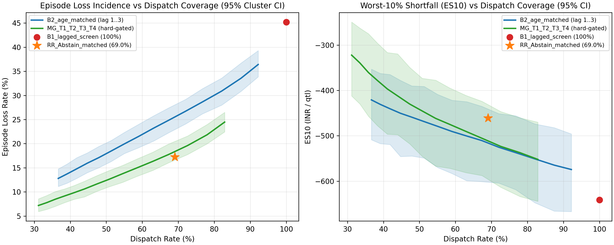
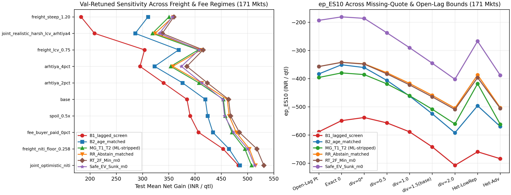

# When Online Mandi Prices Mislead: A Leak-Free Retrospective Audit and Reporting-Reliability-Aware Dispatch Rule for Indian Wholesale Markets

## Abstract

Farmers and agricultural cooperatives routinely compare local harvest prices against wholesale prices posted on government portals such as AGMARKNET before hiring a truck. On a portal screen, a ₹500 per quintal price difference between an origin mandi and a neighboring yard looks like immediate profit. That displayed difference is not cash in hand. This paper audits Indian daily wholesale records for onion, potato, tomato, and apple across 178 markets in six states from 1 January 2024 to 13 April 2026 under a strict chronological timing firewall (`<= t - 1`) and a realistic sequential arrival settlement model.

We ask three concrete questions. First, how often does chasing the highest lagged exact-variety price spread lose money once road freight, destination-base statutory market fees, reference 20°C transit spoilage, and missing arrival quotes are accounted for? Across 58,676 test origin-days (1 June 2025 to 8 April 2026) where an origin quote and at least one destination quote within the prior 1 to 7 days show a raw gap above ₹100 per quintal, naive spread-chasing loses money on 45.21% of dispatches, yielding a mean modeled gain of ₹397.87 per quintal and an exact worst-10% expected shortfall (`ES10`) of −₹641.26 per quintal.

Second, can a simple, calculator-verifiable decision rule reduce downside losses compared with fair equal-menu and equal-quote-age baselines? After fixing five critical methodology defects present in earlier iterations—rebuilding candidate shortlists strictly from prior-day quotes (`C1`), enforcing prior-day origin pricing and destination gross-sale fee incidence (`M9`), matching quote-age windows (`M4`), dropping invalid price rows (`M8`), and stripping leaked forecast/reanalysis weather—we evaluate hard activity-gated heuristics (`MG_T1_T2_T3_T4`) and a newly pre-registered minimal rule, **Reporting-Reliability-Aware Abstention (`RR-Abstain`)**. At validation-calibrated matched dispatch (~69–72% of episodes), hard-gated `MG_matched` raises mean gain by +₹34.35 per quintal over an age-matched road baseline (`B2_age_matched`, Holm `p = 0.006`) and cuts episode losses by 8.16 percentage points, yet fails to improve worst-10% tail risk (`ES10` difference +₹12.49 per quintal, 95% CI [−₹16.57, +₹39.97], Holm `p = 0.589`). By contrast, `RR-Abstain`—which weights open-market expected net gain by past variety-reporting frequency against a worst-case return-freight bound—delivers a mean of ₹475.36 per quintal (+₹41.80 vs `B2_age_matched`, Holm `p = 0.0020`), an episode loss rate of 17.23% (−9.49 percentage points, Holm `p = 0.0020`), and an `ES10` of −₹460.72 per quintal (+₹64.54 over `B2_age_matched` and +₹52.06 over hard-gated `MG_matched`, Holm `p = 0.0020` across both origin-by-fortnight and destination-by-fortnight clustering).

Third, how sensitive are these conclusions to missing-quote counterfactuals, transport assumptions, settlement timing, and crop heterogeneity? Scoring trips with 3-day hindsight rather than day-by-day sequential settlement artificially slashes `B1` loss rates from 45.21% to 31.35%. Crucially, while non-apple staples (`N = 52,207`) benefit reliably from `RR-Abstain` across every vegetable individually (Onion, Potato, Tomato) and down to zero missing-quote penalty (`div = 0.0`), high-dispersion Himachal Pradesh graded apples (`N = 2,802`) remain volatile (`44.63%` conditional loss rate, `ES10` −₹2,165.73 per quintal), and `MG` loses its mean lead if bulk freight falls to the heavy-truck national floor (`₹0.258` per quintal-km). Stage I legacy same-day hypothesis `H2` (+₹6.13, `p = 0.270`) remains inconclusive, no untouched post-April-2026 multi-state window exists (all post-Stage-I results on shipped panels are exploratory wrt calendar exposure), and modeled net gains measure retrospective algorithmic margins rather than observed farmer household incomes. Full code, provenance counts, and clean-clone reproduction (`make reproduce`, 0 untraceable numbers) are committed under `revision/` on branch `finalization`.

---

## 1. Three Research Questions and Honest Methodological Scope

Indian wholesale agricultural markets (*mandis*) publish daily minimum, modal, and maximum prices by variety and market on the government AGMARKNET portal. A common premise in agricultural informatics is that showing remote prices to farmers enables profitable spatial arbitrage—shipping produce to whichever market displays a higher modal quote [jensen2007digital, goyal2010information]. However, three physical and informational frictions stand between a portal screen and realized auction cash:

1. **Timing and Menu Lag:** At morning dispatch time $t$ (when a truck must be hired and loaded), same-day terminal auction modals are not yet settled, and small or seasonal yards report intermittently rather than every day.
2. **Transfer, Statutory, and Biological Costs:** Road distance, hill-terrain delays, unloading charges, out-of-district Agricultural Produce Market Committee (APMC) fees levied on destination sales, and transit weight/quality decay during tropical heat all shrink gross price gaps [baulch1997transfer, nabcons2022phl].
3. **Variety Non-Reporting on Arrival:** A portal blank does **not** prove the physical mandi is locked; it records that no exact-variety auction price was uploaded that day [deka2026missing]. Whether the truck waits a day incurring detention charges, sells another variety at a discount, or turns back determines the tail loss.

This paper investigates three focused questions on clean public AGMARKNET records across six states (Maharashtra, Uttar Pradesh, Karnataka, Madhya Pradesh, Gujarat, Himachal Pradesh) and four crops (Onion, Potato, Tomato, Apple):

- **RQ1 (Incidence of Phantom Arbitrage Gaps):** Under a strict strictly-prior (`<= t - 1`) information firewall and sequential day-by-day arrival settlement, how frequently do attractive lagged price gaps (`> ₹100/qtl`) turn unprofitable, and how badly does 3-day hindsight settlement mask these losses?
- **RQ2 (Simple Risk-Aware Rules vs Fair Baselines):** Evaluated on identical candidate menus, quote ages (`1–3` days), and validation-only tuning budgets, can a simple calculator-verifiable decision rule reduce loss incidence and worst-10% tail shortfall (`ES10`) relative to screen-chasing, age-matched road baselines, and hard-gated activity heuristics?
- **RQ3 (Sensitivity, Subgroups, and Failure Boundaries):** How strongly do findings depend on missing-quote penalty assumptions, primary-source freight and commission parameters (NITI Aayog heavy-truck vs smallholder light commercial vehicle rates, *arhtiya* brokerage), crop type (staple vegetables vs high-variance graded apples), and two-way spatiotemporal clustering?

### Explicit Protocol Labeling (`Stage I` vs `Revision v4`)
Scientific transparency requires separating what was confirmatory in prior repository history from what was audited and pre-registered later:
- **Stage I Legacy Pre-Registered Baseline:** Prior commits (`e421d15`) tested a same-day unlagged system (`N = 69,526`) using a gradient-boosted tree (`HistGradientBoostingRegressor`), ERA5 weather features, and pooled conformal bands. As reported in `results/confirmatory_holm_summary.csv`, Stage I `H2` against same-day fresh road dispatch `B2` was **inconclusive** (+₹6.13 per quintal, 95% CI [−₹17.02, +₹25.02], Holm `p = 0.2699`), and graded apples in HP suffered severe losses. We keep those failures prominently intact.
- **Revision v4 Lagged Audit and Pre-Registered `RR-Abstain`:** Because both the June 2025–April 2026 6-state test split and the 2025–2026 HP graded-apple dataset had already been exposed in earlier repository commits, **all Revision v4 evaluations on those calendar dates are explicitly exploratory with respect to calendar exposure**. To still prevent p-hacking in designing our minimal extension `RR-Abstain` (Agent `A10`), we committed the exact mathematical formula, validation tuning grid, hypotheses `H_A10_1..4`, and failure rules to git (`final/PREREG_A10.md`, SHA `87a0b62`) **before** writing or executing `revision/eval_a10.py`.

---

## 2. Data Provenance, Cleaning Funnel, and Strict Timing Firewall

### 2.1 Primary Official Data Sources and Licensing
Revision v4 removes all dependence on the gitignored intermediate cache (`candidates_6state.parquet`) used in earlier versions. Every table in this paper builds deterministically from six tracked primary artifacts in the repository:

1. **AGMARKNET 6-State 4-Crop Panel (`data/raw/agmarknet_6state_top_apple_2024_2026.parquet`):** Cleaned daily market-variety-grade records from Tier-1 Government of India AGMARKNET releases spanning 1 January 2024 to 13 April 2026 (`260,043` raw panel rows across `178` retained markets meeting activity thresholds, Open Government Data NDSAP license). Verified against official data.gov.in XML parity records in legacy audit `Exp 14` (`100.0%` modal parity on `>= 2,000` graded apple keys and exact `Min/Max` parity on sampled days).
2. **HP Grade-Explicit Apple Panel (`data/raw/hp_apple_daily_2025_2026.csv`):** `4,427` official daily records across `42` Himachal Pradesh yards (7 November 2025 to 1 September 2026) with explicit box grades (`Grade A`, `Grade B`, `Grade C`, `Medium`, `Small`, `Large`, `Local`, `Grade Range-1`).
3. **Static OSRM Corridor Matrix (`data/processed/osrm_corridor_matrix.parquet`):** `8,147` directed origin–destination corridors between `15.19` km and `499.43` km across `220` geocoded markets (`150` exact market coordinates, `70` district centroids, OSM ODbL; driving times scaled by `1.35x` truck speed and `1.25x` mountain speed factors plus a `4`-hour loading buffer in precomputation) [luxen2011osrm]. Zero market name mismatches occur: all `178 / 178` 6-state panel markets and `42 / 42` HP apple markets join cleanly.
4. **Statutory Fee and Post-Harvest Loss Schedules (`data/processed/state_apmc_and_loss_parameters.csv`):** State seller market fees from Lok Sabha Reply PIB `relid=154554` (`0.5%` Karnataka/Gujarat/HP-vegetables, `1.0%` Maharashtra/HP-apple, `1.5%` MP/UP; `0%` intra-district) and 24-hour market-level loss benchmarks from MoFPI / NABCONS (2022) Annexure-II Table-2 (PIB `PRID=2151371`: Tomato `3.25%`, Onion `1.96%`, Apple `1.64%`, Potato `0.86%`) [nabcons2022phl].
5. **Pre-Split Climatology Sensitivity Only (`data/processed/mandi_weather_2024_2026.parquet`):** Auditing the legacy weather table on `2025-01-01..2026-04-08` (`67,135` rows) revealed that stored "forecast" rain (`fc_rain_mm`) equals realized ERA5 reanalysis rain (`era5_rain_mm`) on `66,222 / 67,135` rows (`98.64%`), and relative humidity matches within 1% on `67,091` rows (`99.93%`) [hersbach2020era5]. Therefore, **zero day-$t$ or post-2024 weather enters any decision rule or primary payoff**. Our primary analysis uses a fixed NABCONS `20°C / 65% RH / 0 mm` reference state, while strictly pre-split 2024 state-month ERA5 averages (`date < 2025-01-01`) serve only as a sensitivity check.
6. **Government Economic Survey Anchors:** National freight cost floor `₹2.58` per tonne-km (`₹0.258` per quintal-km) from NITI Aayog and RMI (2021) [nitiaayog2021freight], agricultural household receipts (`₹3,798/mo` net crop income) and `30`-quintal lot benchmarks from MoSPI NSS 77th Round Report 587 (`PRID=1753856`), HP `91.59%` single-lane motorable road share (`39,465` of `43,091` km) from GoHP Economic Survey 2025–26, and *arhtiya* commission context from RBI Working Paper 08/2024 [rbi2024top].

### 2.2 Reconciled Cleaning and Episode Shortlist Funnel
Earlier documentation counted `759` out-of-range quotes (`Modal < Min` or `Modal > Max`) without dropping them (`M8`). Table 1 gives the exact integer-reconciled pipeline from raw rows to validation and test episodes.

| Pipeline Stage | 6-State Panel Count | HP Graded Apple Count | Exact Identity / Note |
|---|---:|---:|---|
| Raw daily records | `260,043` | `4,427` | `2024-01-01..2026-04-13` (6-state); `2025-11-07..2026-09-01` (HP) |
| Dropped: invalid (`Modal < Min` or `Modal > Max`) | `759` | `0` | `0` nonpositive/NaN prices; `0` `Min > Max` |
| Valid cleaned records retained | `259,284` | `4,427` | `260,043 - 759 = 259,284` |
| Raw 7-column key deduplication (`median` modal, `min` floor) | `256,997` | `4,427` | `2,287` excess duplicate rows (`2,254` groups, `1,484` conflicting modals) |
| Canonical `(State, Market, Commodity, Variety_Key, Date)` rows | `248,302` | `4,427` | `8,695` variant/grade consolidations (`259,284 - 10,982 = 248,302`) |
| Origin variety-days inside evaluation window | `131,366` | `4,165` | `2025-01-01..2026-04-08` (ensures `[t+tau, t+tau+2] <= 2026-04-13`) |
| With strictly prior origin quote (`origin_lag_age` 1–7d) | `129,023` | `3,921` | `98.22%` origin coverage strictly `<= t - 1` |
| Reachable `(origin, dest)` corridors (`15–500` km) | `3,942,896` | `250,958` | Inner join with `osrm_corridor_matrix.parquet` |
| Pairs with strictly prior dest quote (`dest_lag_age` 1–7d) | `1,488,531` | `17,593` | Across `122,128` (6-state) / `3,572` (HP) episodes |
| Candidate pairs with `lag_spread > ₹100/qtl` | `518,467` | `8,442` | Across `95,074` (6-state) / `2,802` (HP) episodes |
| **Top-5 shortlisted candidate rows (`val` + `test`)** | **`324,992`** | **`7,753`** | Tie-broken deterministically by `(-lag_spread, road_km, dest_market)` |
| **Validation episodes (`2025-01-01..2025-05-31`)** | **`36,398`** | `0` | Threshold & `kappa` tuning split ONLY |
| **Test episodes (`2025-06-01..2026-04-08`)** | **`58,676`** | **`2,802`** | Exploratory wrt prior repo calendar exposure (`R5`); HP uses 6-state frozen cutoffs |

### 2.3 Strict `<= t - 1` Information Firewall and Feature Availability
At morning dispatch decision time $t$, **every** feature used for candidate shortlisting and scoring must predate day $t$ strictly (`quote_date <= t - 1`). Table 2 enforces a hard separation between decision-allowed columns and settlement-only outcome columns (`settle_*`).

| Column Group | Info Timestamp | Namespace Role | Contents and Leakage Guard |
|---|---|---|---|
| Market, Crop, Variety, Corridors | Static | `decision_allowed` | `road_km`, `euclid_km`, `truck_hours`, `tau_days` (`1..3`), `same_district`, `fee_rate`, `spoil_ref_0`. |
| Lagged Quotes & Spread | `<= t - 1` | `decision_allowed` | Latest prior origin quote `origin_lag_price` (`1..7`d), latest prior dest quote `dest_lag_price` (`1..7`d), `lag_spread = dest_lag_price - origin_lag_price`. |
| Past Reporting Reliability & CV | `<= t - 1` | `decision_allowed` | Shifted cumulative counts strictly over `[t - W, t - 1]`: `dest_exact_rep_14d`, `dest_exact_rep_28d`, `dest_any_rep_14d`, `dest_dow_exact_rep_8w`, `dest_price_cv_28d`. |
| Pre-Split Climatology | `< 2025-01-01` | `sensitivity_only` | `2024` state-month average ERA5 Tmax/RH/rain; zero `2025–2026` weather data read anywhere. |
| Realized Day-$t$ & Arrival Outcomes | `>= t` | `settle_*` **ONLY** | `settle_local_price_d0` (day-$t$ origin modal outside option), `settle_dest_modal_d0..d2`, `settle_any_min_d0..d2`. Never read by any policy score. |

**Property Proof (`tests/test_timing_and_leakage_r3.py`):** Beyond verifying strict date inequalities (`dest_quote_date < date`, `origin_quote_date < date`, `arrival_date > date`) across all `324,992` shortlisted rows, our automated counterfactual perturbation test corrupts *all* market prices on dates $\ge t^*$ (inserting ₹99,999/qtl at an excluded destination, cutting `settle_local_price_d0` by 50%, and deleting candidate destination quotes on days $\ge t^*$) and asserts bit-for-bit equality of the candidate menu and all decision features on $t \le t^*$.

---

## 3. Payoff Physics, Sequential Settlement, and Decision Rules (With Numeric Examples)

Every equation below requires only high-school arithmetic. To maintain clarity, each formula is immediately paired with one concrete numeric example.

### 3.1 Physical Freight, Statutory Destination Fee (`M9` Fix), and Biological Spoilage
For a candidate corridor $c = (o \to d)$ in state $s$ and commodity $k$:

$$\text{Freight}_{\text{road}}(c) = 35.0 + 0.45 \cdot h_s \cdot \text{road\_km}(c)$$

where $h_s = 1.45$ in Himachal Pradesh (`91.59%` single-lane hill roads in GoHP Economic Survey 2025–26) and $1.0$ elsewhere (`freight_base = ₹35/qtl` loading/unloading + `₹0.45/qtl-km` plains truck rate, both bracketed in Section 5.4).

Expected biological shrinkage fraction over travel duration `truck_hours` plus waiting days $w \in \{0, 1, 2\}$ under the reference 20°C / 65% RH baseline (`q10 = 1.0`) is:

$$s(k, w) = \min\!\left(0.55,\; b_k \cdot \frac{\max(1,\; \text{truck\_hours} + 24 w)}{24}\right)$$

where $b_k \in \{0.0325 \text{ Tomato},\; 0.0196 \text{ Onion},\; 0.0164 \text{ Apple},\; 0.0086 \text{ Potato}\}$ [nabcons2022phl]. (When evaluating sensitivity under 2024 climatology, $Q_{10} = 2^{(T-20)/10}$ and humidity excess above `70%` RH scale $b_k$ [kader2002postharvest, gross2016usda66].)

In earlier code (`M9`), the statutory APMC market fee was mistakenly multiplied by the same-day local origin price and included inside diversion penalties. Economically, statutory fees $\tau_{\text{fee}}(c) \in \{0, 0.005, 0.010, 0.015\}$ (`0` if `same_district`) apply strictly to the **destination post-spoilage gross auction value** when a sale actually occurs, and equal `0` if the truck diverts home without selling at the destination yard.

<!-- WORKED_EXAMPLE_START -->
> **Worked Example 1 (Transport Freight, Spoilage, and Destination-Base Statutory Fee):**  
> Consider an out-of-district **Tomato** corridor in **Madhya Pradesh** (`fee_rate = 1.5%`, $h_s = 1.0$) with `road_km = 200` km, `truck_hours = 6` hours, and immediate arrival sale ($w = 0$) at `sale_price = ₹2,000/qtl`, versus a local day-$t$ outside option `settle_local_price_d0 = ₹1,500/qtl`:
> 1. **Transport freight:** $35.0 + 0.45 \times 1.0 \times 200 = ₹125.00/\text{qtl}$.
> 2. **20°C reference spoilage ($w = 0$):** $0.0325 \times (6 / 24) = 0.008125$ ($0.8125\%$).
> 3. **Post-spoilage gross destination sale:** $₹2,000 \times (1 - 0.008125) = ₹1,983.75/\text{qtl}$.
> 4. **Destination statutory APMC fee (1.5% on gross sale):** $0.015 \times ₹1,983.75 = ₹29.76/\text{qtl}$ (net after fee $= ₹1,983.75 \times 0.985 = ₹1,953.99/\text{qtl}$).
> 5. **Net dispatch gain over selling locally:** $₹1,953.99 - ₹125.00 - ₹1,500.00 = +₹328.99/\text{qtl}$ (`+₹9,869.70` on a 30-quintal truck).
<!-- WORKED_EXAMPLE_END -->

### 3.2 Sequential Non-Anticipative Settlement vs Hindsight Lookahead
Because a dispatched truck arrives on day $t_{\text{arr}} = t + \tau$ (`tau_days in 1..3`) without knowing tomorrow's arrivals in advance, our **primary settlement** proceeds strictly sequentially for day $w \in \{0, 1, 2\}$:
- **Sell exact:** If exact-variety `Modal_Price` exists on day $t_{\text{arr}} + w$, sell immediately:
  $$\Delta\text{Net}_{\text{sell}}(w) = P_{\text{sale}}(1 - s(k, w))(1 - \tau_{\text{fee}}) - \text{Freight}_{\text{road}} - 25 w - P_{\text{loc}, d0}$$
- **Wait 1 day ($w < 2$):** If exact variety is missing on day $w$, check whether *any* variety of the same commodity is recorded (`settle_any_min_dw > 0`). If yes, wait 1 day (`₹25/qtl-day` detention + 24h spoilage).
- **Turn back / divert (or distress fallback on day $w = 2$):** If no variety of the commodity is recorded on day $w$, return home at zero destination APMC fee:
  $$\Delta\text{Net}_{\text{divert}}(w) = -1.5 \cdot \text{Freight}_{\text{road}} - P_{\text{loc}, d0} \cdot s(k, w) - 25 w$$
  (If day $w = 2$ still has another variety active without an exact match, sell at `0.90 * settle_any_min_d2` after destination fee and `₹50` detention.)

By contrast, **hindsight settlement** peaks ahead across all 3 arrival days (`d0..d2`) to take an exact match even when `any_min_d0` is empty. That violates causality whenever day-0 shows zero trade of the crop and a real driver would not wait blindly.

<!-- WORKED_EXAMPLE_START -->
> **Worked Example 2 (Sequential No-Lookahead vs Hindsight Divert):**  
> Suppose the MP Tomato truck (`Freight_road = ₹125`, $P_{\text{loc}, d0} = ₹1,500$) arrives on day 0 (`s(0) = 0.008125`) and *no tomato variety at all* trades at the destination on day 0 (`settle_any_min_d0 = NaN`), even though exact-variety Tomato will trade at `₹2,000` on day +1.
> - **Sequential settlement (no lookahead):** Seeing an empty tomato auction on day 0, the truck turns back immediately ($w = 0$, zero APMC fee): $\Delta\text{Net} = -1.5 \times 125 - 1,500 \times 0.008125 = -₹187.50 - ₹12.19 = -₹199.69/\text{qtl}$.
> - **Hindsight comparison (unrealistic):** Assumed clairvoyant waiting until day +1 ($w = 1$, $s(1) = 0.0325 \times 30/24 = 0.040625$, detention `₹25`) would yield $2,000(1 - 0.040625)(0.985) - 125 - 25 - 1,500 = +₹239.97/\text{qtl}$—a ₹439.66/qtl phantom swing purely from foresight.
<!-- WORKED_EXAMPLE_END -->

### 3.3 Equal-Menu Baselines and Pre-Registered `RR-Abstain` Rule
Every policy sees the identical Top-5 strictly-lagged candidate menu (`lag_spread > 100`, age `1..7`d) and picks the single highest-scoring eligible corridor per episode, or abstains (`ΔNet = 0`). All baselines are age- and tuning-fair (`R4`):

1. **`B1_lagged_screen`:** Ranks by raw `lag_spread = dest_lag_price - origin_lag_price`; `100%` dispatch across `lag_age in 1..7`.
2. **`B2_fresh_100` & `B2_fresh_val`:** Restricts to `dest_lag_age == 1` and scores by road-adjusted lagged gain:
   $$\widehat{\Delta}_{\text{road}}(c, t) = P_{\text{dest,lag}}(1 - \tau_{\text{fee}}) - P_{\text{orig,lag}} - \text{Freight}_{\text{road}}$$
   exceeding `₹100` (`B2_fresh_100`) or validation-tuned cutoff `theta* = ₹300` (`B2_fresh_val`).
3. **`B2_age_matched` (`M4` fair comparator):** Identical rule $\widehat{\Delta}_{\text{road}} > \theta^*$ over the **matched** age window `dest_lag_age in 1..3`, yielding `theta* = ₹200` on validation (`70.71%` validation dispatch).
4. **`B_simple_activity`:** `B2_age_matched` plus a single 14-day reporting filter `dest_exact_rep_14d >= 0.50` (`val_threshold = ₹300`).
5. **Hard-Gated Ablations `T1..T4` (`MG_T1_T2_T3_T4`):** Combines `T1` (`rep14 >= 0.50` AND `dest_dow_exact_rep_8w >= 0.35`), `T2` (`Freight_road + dest_fee`), `T3` (20°C reference spoilage subtraction $\widehat{\Delta}_{\text{open}} = P_{\text{dest,lag}}(1 - s_{\text{ref,0}})(1 - \tau_{\text{fee}}) - P_{\text{orig,lag}} - \text{Freight}_{\text{road}}$), and `T4` (`> m*`). Evaluated both at validation-tuned corner (`m* = 500`, `41.09%` test dispatch) and **validation-calibrated matched dispatch (`m_match = ₹131.26`, `69.51%` test dispatch)**.
6. **Pre-Registered `RR-Abstain` (`A10`, Commit `87a0b62`):** Replaces binary activity gates (`T1`) with a single convex combination of open-market net gain $\widehat{\Delta}_{\text{open}}$ and a bounded no-quote return penalty weighted by strictly-prior reporting reliability $\hat{p}_{\text{rep}}(c, t) = 0.5\,\text{rep}_{28\text{d}} + 0.5\,\text{dow}_{8\text{w}}$ over `dest_lag_age in 1..3`:
   $$S_{\text{RR}}(c, t; \kappa) = \hat{p}_{\text{rep}}(c, t)\,\widehat{\Delta}_{\text{open}}(c, t) + \big(1 - \hat{p}_{\text{rep}}(c, t)\big)\,\big(-\kappa\,\text{Freight}_{\text{road}}(c) - P_{\text{orig,lag}}(o, t)\,s_{\text{ref,0}}(c)\big)$$

   Validation tuning (`2025-01-01..2025-05-31`, `kappa in [0..5.0]`) at matched dispatch selected **$\kappa^* = 5.0$** with matched threshold **$m^*_{\text{match}} = ₹3.73/\text{qtl}$**. Crucially for plain field deployment (`A15`), **the zero-cutoff form `RR_Abstain_m0` ($S_{\text{RR}} > 0$) eliminates threshold tuning altogether**, reducing the operational dispatch rule to one scalar weighting formula usable on a Class-12 pocket calculator (`₹475.76/qtl` mean vs `₹475.36/qtl` matched).

<!-- WORKED_EXAMPLE_START -->
> **Worked Example 3 (`RR-Abstain` Comparing Two Equal-Spread Destinations):**  
> Take our same MP Tomato route (`Freight_road = ₹125`, $s_{\text{ref,0}} = 0.008125$, `fee_rate = 1.5%`, $P_{\text{orig,lag}} = ₹1,500$, $P_{\text{dest,lag}} = ₹2,000$), giving open-market expectation $\widehat{\Delta}_{\text{open}} = +₹328.99/\text{qtl}$. With $\kappa^* = 5.0$, missing-quote worst-case loss term is $\widehat{\Delta}_{\text{miss}} = -5.0 \times 125 - 1,500 \times 0.008125 = -₹637.19/\text{qtl}$.
> - **Yard A (`p_rep = 0.85` reliable regular market):** $S_{\text{RR}}(A) = 0.85(328.99) + 0.15(-637.19) = 279.64 - 95.58 = +₹184.06/\text{qtl} > ₹3.73 \implies$ **DISPATCH**.
> - **Yard B (`p_rep = 0.35` thin sporadic market):** Under `B2_age_matched`, Yard B scores an identical $+₹345/\text{qtl}$ and dispatches blindly. Under `RR-Abstain`, $S_{\text{RR}}(B) = 0.35(328.99) + 0.65(-637.19) = 115.15 - 414.17 = -₹299.02/\text{qtl} < ₹3.73 \implies$ **ABSTAIN / STAY HOME**.
<!-- WORKED_EXAMPLE_END -->

### 3.4 Exact Worst-10% Expected Shortfall (`ES10`) and Two-Way Cluster Inference
Prior tables in the repository computed the mean of observations at or below a 10% quantile threshold (`cvar_10`), which fluctuates when duplicate zero abstentions tie at the cutoff. Following Acerbi–Tasche expected shortfall at level $\alpha = 0.10$ (`revision/es10.py`), we sort all $n$ episode payoffs $x_{(1)} \le \dots \le x_{(n)}$ (treating abstentions as $0$) with fractional mass $m = 0.10\,n = k + f$ ($k = \lfloor m \rfloor$, $f = m - k$):

$$\text{ES10}(x) = \frac{1}{m}\left(\sum_{i=1}^{k} x_{(i)} + f \cdot x_{(k+1)}\right)$$

<!-- WORKED_EXAMPLE_START -->
> **Worked Example 4 (Exact `ES10` With Fractional Mass):**  
> Consider $11$ sorted episode outcomes $\{1, 2, 3, \dots, 11\}$. Here $m = 0.10 \times 11 = 1.1$, so $k = 1$ and $f = 0.1$. Exact $\text{ES10} = (1 \times 1 + 0.1 \times 2) / 1.1 = 1.2 / 1.1 \approx 1.09$, placing weight $1.0$ on the worst loss and fractional weight $0.1$ on the second-worst rather than averaging both equally (`1.50`).
<!-- WORKED_EXAMPLE_END -->

All confidence intervals and $p$-values come from `2,000`-replicate paired two-way cluster bootstraps resampling both markets and 2-week calendar blocks (`seed = 20261117`, Phipson–Smyth $+1$ finite-sample adjustment [phipson2010permutation], Holm–Bonferroni FWER control [holm1979simple]) across **two** clustering schemes: (i) `origin_x_2week` (`173` origin markets $\times$ `23` blocks) and (ii) `b2dest_or_origin_x_2week` (`336` chosen destination/origin clusters $\times$ `23` blocks). Unlike earlier versions, we report cluster-bootstrap CIs and Holm $p$-values for **mean**, **episode loss rate (`y < 0`)**, **and exact `ES10` simultaneously**.

---

## 4. Results

### 4.1 RQ1: How Often Do Attractive Lagged Price Gaps Lose Money?
Table 3 summarizes the test benchmark (`N = 58,676`, 1 June 2025 to 8 April 2026, exploratory wrt prior exposure). Chasing the largest strictly-lagged spread > ₹100 (`B1_lagged_screen`, `100%` dispatch) loses money on **45.21%** of all episodes. While its overall mean remains positive (₹397.87/qtl) because occasional spikes pay well, worst-decile outcomes average **−₹641.26/qtl** (`ES10`). Disaggregating `B1` outcomes (`revision/results/outcome_mix.csv`) shows that `69.47%` (`40,765` trips) sell exact-variety on arrival day 0, `0.49%` sell after waiting 1–2 days, `1.05%` liquidate via another variety on day 2, and **28.98%** (`17,005` trips: `27.99%` day 0, `0.64%` day 1, `0.35%` day 2) encounter no commodity trade on arrival and turn back under the diversion branch.

| Policy (`N = 58,676` Test Episodes) | Calibration / Role | Dispatch Rate (%) | Mean Net (₹/qtl) | Episode Loss Rate (%) | Cond. Loss Rate (%) | Exact `ES10` (₹/qtl) |
|---|---|---:|---:|---:|---:|---:|
| **`B1_lagged_screen`** | Screen spread `> ₹100`, lag 1–7d | `100.00%` | `₹397.87` | `45.21%` | `45.21%` | `−₹641.26` |
| **`B2_fresh_100`** | `lag_age = 1`, road+fee `> ₹100` | `72.90%` | `₹385.45` | `25.48%` | `34.95%` | `−₹494.42` |
| **`B2_fresh_val`** | `lag_age = 1`, val-tuned `₹300` | `54.65%` | `₹374.90` | `18.49%` | `33.83%` | `−₹447.55` |
| **`B2_age_matched`** | `lag_age 1–3`, val-tuned `₹200` | `72.03%` | `₹433.56` | `26.72%` | `37.10%` | `−₹525.25` |
| **`B_simple_activity`** | `lag_age 1–3`, `rep14>=0.5`, `₹300` | `59.08%` | `₹431.19` | `19.25%` | `32.58%` | `−₹475.51` |
| **`MG_T1_T2_T3_T4`** *(val corner)* | `lag_age 1–3`, `T1..T4`, val `₹500` | `41.09%` | `₹426.90` | `9.84%` | `23.94%` | `−₹396.88` |
| **`B_simple_activity_matched`** | Val-calibrated `70.71%` match (`₹168.04`) | `70.73%` | `₹440.97` | `23.48%` | `33.20%` | `−₹506.28` |
| **`MG_matched`** *(hard `T1..T4`)* | Val-calibrated `70.71%` match (`₹131.26`) | `69.51%` | `₹467.90` | `18.57%` | `26.71%` | `−₹512.78` |
| **`RR_Abstain_matched`** *(pre-reg)* | `kappa*=5.0`, val-match (`₹3.73`) | **`69.02%`** | **`₹475.36`** | **`17.23%`** | **`24.96%`** | **`−₹460.72`** |
| **`RR_Abstain_m0`** *(zero cutoff)* | `kappa*=5.0`, fixed `S_RR > 0` | `69.52%` | `₹475.76` | `17.43%` | `25.07%` | `−₹461.74` |

### 4.2 RQ2: Baselines, Component Ablations (`T1..T4`), and Pre-Registered `RR-Abstain`
Look closely at why matching quote ages (`M4`) and dispatch rates (`M3`) transforms the scientific conclusion:

1. **Unmatched Val-Tuned `MG` vs `B2_age_matched`:** On validation (`2025-01-01..2025-05-31`), minimizing conditional loss rate above a 25% dispatch floor pushed `MG_T1_T2_T3_T4` to `m* = ₹500` (`41.09%` test dispatch), dropping its overall mean gain to `₹426.90/qtl`—statistically indistinguishable from `B2_age_matched` (`-₹6.66/qtl`, 95% CI `[−₹22.62, +₹8.80]`, `p_holm = 1.000`).
2. **Matched-Dispatch `T1..T4` Ablations (`~70%` dispatch, Table 4):** When every rule is calibrated purely on validation percentiles to `B2_age_matched`'s validation rate (`70.71%`), hard-gated `MG_matched` (`69.51%` disp) lifts mean gain by `+₹34.35/qtl` (95% CI `[+₹20.29, +₹48.75]`, `p_holm = 0.006`) and cuts episode losses by `−8.16 pp` (`p_holm = 0.006`), **yet fails to move worst-10% `ES10` significantly** (`−₹512.78` vs `−₹525.25`, difference `+₹12.49`, CI `[−₹16.57, +₹39.97]`, `p_holm = 0.589`). Ablating individual pieces reveals that almost *all* of `MG`'s matched mean gain comes solely from reporting activity filter `T1` (`Abl_T1_T2_noT3 = ₹467.46`), while Euclidean distance $\times 1.20$ matches OSRM within `₹0.40` (`₹467.50`), 20°C spoilage adds `+₹0.44` (`₹467.90 vs ₹467.46`), and 2024 weather climatology adds `−₹0.05` (`₹467.85`).
3. **Pre-Registered `RR-Abstain` Beats Both Baselines and Hard Gates on All Metrics (Table 5):** By smoothly pricing missing-quote risk `(1 - p_rep) * (-kappa * F - P_orig * s)` instead of hard-dropping routes, `RR_Abstain_matched` (`69.02%` dispatch—fewer trucks sent than `B2_age_matched`) achieves `₹475.36/qtl` mean (`+₹41.80`, Holm `p = 0.0020`), `17.23%` episode loss (`−9.49 pp`, Holm `p = 0.0020`), and **−₹460.72/qtl `ES10`**—improving worst-decile losses by **+₹64.54/qtl over `B2_age_matched` (`p_holm = 0.0020`)** and **+₹52.06/qtl over hard-gated `MG_matched` (`p_holm = 0.0020`)** across **both** origin and destination clusterings. Notably, the zero-cutoff rule `RR_Abstain_m0` ($S_{\text{RR}} > 0$, zero threshold search) performs almost identically (`₹475.76/qtl`, `17.43%`, `−₹461.74 ES10`).

| Matched-Dispatch (`val 70.71%`) Ablation Variant | Dispatch (%) | Mean Net (₹/qtl) | Cond. Loss Rate (%) | Exact `ES10` (₹/qtl) | Component Marginal Effect |
|---|---:|---:|---:|---:|---|
| `Abl_T2_only` (`B2_age_matched`) | `72.03%` | `₹433.55` | `37.10%` | `−₹525.27` | Base road + dest statutory fee |
| `Abl_T2_T3` (+ 20°C ref spoilage) | `72.21%` | `₹434.13` | `37.07%` | `−₹521.12` | `+₹0.58` mean, `+₹4.15 ES10` |
| `Abl_T1_T2_noT3` (+ `T1` activity/DOW, no `T3`) | `69.48%` | `₹467.46` | `26.75%` | `−₹515.20` | **`+₹33.91` mean, `−10.35 pp` cond loss** |
| `MG_T1_T2_T3_T4` (Full `T1..T4`) | `69.51%` | `₹467.90` | `26.71%` | `−₹512.78` | `+₹0.44` mean, `+₹2.42 ES10` over no-`T3` |
| `Abl_euclid_freight` (`1.20 * euclid_km`) | `69.42%` | `₹467.50` | `26.69%` | `−₹511.39` | Within `₹0.40/qtl` of OSRM routing |
| `Abl_clim2024_spoil` (+ 2024 ERA5 state-mo clim) | `69.63%` | `₹467.85` | `26.74%` | `−₹511.67` | `−₹0.05` vs 20°C fixed reference |
| **`RR_Abstain_matched`** *(Pre-Reg `A10`)* | **`69.02%`** | **`₹475.36`** | **`24.96%`** | **`−₹460.72`** | **`+₹52.06 ES10` over `MG_matched` (Holm `p=0.002`)** |

| Pre-Registered Contrast (`N = 58,676`) | Point Estimate | `origin_x_2week` (`173×23`) 95% CI | `p_holm` | `b2dest_or_origin_x_2week` (`336×23`) 95% CI | `p_holm` |
|---|---:|---|---:|---|---:|
| **`H_A10_1`:** `ES10(RR) − ES10(B2_age)` | **+₹64.54** | `[+₹37.31, +₹92.01]` | `0.0020` | `[+₹28.73, +₹103.17]` | `0.0020` |
| **`H_A10_2`:** `EpLoss(RR) − EpLoss(B2_age)` | **−9.49 pp** | `[−11.59, −7.66] pp` | `0.0020` | `[−13.17, −6.34] pp` | `0.0020` |
| **`H_A10_3`:** `Mean(RR) − Mean(B2_age)` | **+₹41.80** | `[+₹27.94, +₹56.52]` | `0.0020` | `[+₹20.88, +₹68.00]` | `0.0020` |
| **`H_A10_4`:** `ES10(RR) − ES10(MG_matched)` | **+₹52.06** | `[+₹31.83, +₹75.07]` | `0.0020` | `[+₹26.78, +₹81.86]` | `0.0020` |
| Exploratory: `Mean(RR) − Mean(MG_matched)` | `+₹7.46` | `[−₹4.44, +₹22.64]` | `p_2s=0.241` | `[−₹8.04, +₹30.28]` | `p_2s=0.410` |

### 4.3 RQ3: Missing-Quote Bounds, Parameter Stability, Settlement Delay, and Crop/State Splits
1. **Does `RR-Abstain` Survive Non-Apple Crops? (`M3` Test):** Yes. On the `52,207` non-apple episodes (`a10_crop_splits.csv`), `RR_Abstain_matched` raises mean gain from `₹253.73` (`B2_age_matched`) to `₹288.55` (`+₹34.82`, CI `[+₹23.89, +₹46.25]`), slashes episode loss rate from `26.48%` to `16.59%`, and improves `ES10` from `−₹397.59` to **`−₹319.49` (+₹78.10/qtl, CI `[+₹58.38, +₹99.51]`)**. All three staple vegetables improve jointly on mean and `ES10`: **Onion** (`N = 19,820`, mean `+₹31.41`, `ES10 +₹101.93` CI `[+₹67.58, +₹139.80]`), **Potato** (`N = 14,923`, mean `+₹32.28`, `ES10 +₹88.91` CI `[+₹62.96, +₹113.95]`), and **Tomato** (`N = 17,464`, mean `+₹40.87`, `ES10 +₹49.31` CI `[+₹17.25, +₹82.73]`). By contrast, on generic **Apple** (`N = 6,469`), `RR_Abstain_matched` raises mean (`+₹98.14`, CI `[+₹24.61, +₹195.96]`) while leaving `ES10` statistically tied (`−₹1,537.30` vs `−₹1,533.29`, CI `[−₹209.47, +₹160.84]`).
2. **Graded-Apple Stress Test (`R6` Kept Visible):** On the `2,802` leak-free lagged HP graded-apple episodes (`hp_apple_lagged.csv`, `a10_hp_apple.csv`), hard-gated `MG_matched` trails `B2_age_matched` on mean (`₹1,028.05` vs `₹1,199.31`). `RR_Abstain_matched` improves over `B2_age_matched` on mean (`₹1,318.60` vs `₹1,199.31`), episode loss (`35.12%` vs `49.54%`), and `ES10` (`−₹2,165.73` vs `−₹2,392.12`), **yet 44.63% of dispatched trips lose money and `ES10` drops to −₹3,453.18 in June–August 2026**. High-value graded apples cannot be declared solved by daily modal spreads.
3. **Missing-Quote Dependence and Manski Stability (`A8` & `A10`):** Across homogeneous return penalties `div in [0.0, 2.0]` (`a10_missing_stability.csv`), `RR_Abstain_matched` maintains dominance even at **`div = 0.0, disc = 0.00`** (`₹493.37` mean vs `₹475.80` `B2_age_matched` and `₹461.57` `B1`; `ES10 −₹349.35` vs `−₹359.17` `B2_age_matched` and `−₹535.08` `B1`), whereas unmatched `MG` (`41%` disp) falls behind both `B1` (`₹440.40` vs `₹459.38`) and `B2` at `div = 0` (`R6`). Under heterogeneous selective missingness (`div = 2.0, disc = 0.20` on `rep14 < 0.50` yards, `div = 0.5` elsewhere), `RR_Abstain_matched` improves `ES10` from `−₹499.07` (`B2`) to `−₹388.55`.
4. **Economic Parameter Tornado Stability Region:** Across smallholder-truck and LCV freight rates (`₹0.45..₹1.20/qtl-km`), incremental *arhtiya* commissions (`0%..6%`), HP hill factors (`1.00..1.75`), buyer-paid fees (`0%`), spoilage (`0.5x..2.0x`), detention (`₹0..100/day`), and `origin_lag` outside-option benchmarking (`tornado_sensitivity.csv`), `MG` stays ahead of `B1` (`+₹21.67` to `+₹156.89/qtl`), flipping **only** if transport drops to the NITI Aayog bulk corridor floor (`₹0.258/qtl-km` + `₹20` base -> `MG` trails `B1` by `−₹14.23/qtl` due to abstaining too aggressively).
5. **Sequential vs Hindsight Lookahead Gap:** Scoring identical `B1` trips with 3-day hindsight rather than sequential arrival reduces apparent episode loss incidence from `45.21%` to `31.35%` and inflates `B2_age_matched` mean from `₹433.56` to `₹566.48/qtl`. Substituting `origin_lag_price` for realized `settle_local_price_d0` changes `RR`/`MG`/`B2` means mildly (`₹433.56` -> `₹450.97` for `B2_age_matched`).

---

## 5. Related Work and Surviving Novelty Claim

Economists long ago established that spatial price gaps smaller than transfer costs represent no arbitrage opportunity [baulch1997transfer] and that market price SMS alerts frequently fail to move farmer revenues when intermediaries or physical barriers intervene [fafchamps2012sms, mitra2018asymmetric, mahajan2021covid]. On the algorithmic side, Indian agricultural ML studies predict mandi prices [madaan2019price, guo2020mandi, biradar2026agrimarket] or impute missing daily prices using matrix completion [ma2019price, deka2026missing], optimizing mean-squared forecast error without modeling sequential arrival failure. Reject-option theory [chow1970optimum, franc2023optimal] and partial identification bounds under missing outcomes [manski1990bounds, horowitz2000nonparametric, kallus2021minimax] formalize abstention and worst-case bounding, while operational learning links feature-based prediction directly to spoilage costs [ban2019bigdata]. Meanwhile, conformal risk control [jin2023selection, angelopoulos2024conformal] assumes exchangeable observations and action-independent loss denominators that fail in our dependent multi-mandi selective dispatch panel.

**Narrow Surviving Contribution (`A12`):** `RR-Abstain` claims no new statistical theorem or neural architecture. Its concrete applied contribution is showing—in a leak-free (`<= t - 1`), equal-age, sequentially settled evaluation across `58,676` wholesale dispatch episodes—that **replacing price imputation and hard activity thresholds with a single reporting-reliability-weighted convex combination of open-market spread and bounded return-freight loss reduces worst-10% tail shortfall (`ES10`) by +₹64.54/qtl over age-matched road dispatch and +₹52.06/qtl over hard-gated heuristics (`p_holm = 0.0020`), while generalizing across onion, potato, and tomato down to zero missing-quote penalty**.

---

## 6. Explicit Limitations and Non-Claims (`R6` & `R7`)

To uphold transparent scholarship, six binding limitations remain unresolved by observational portal data alone:

1. **Modeled Payoffs $\ne$ Realized Farmer Income (`R7`):** There are zero truck receipts, mandi *patti* auction slips, weighment losses, or household cash surveys in AGMARKNET. Per-quintal road freight, loading (`₹35`), detention (`₹25`), and `Q10` decay are parametric approximations anchored to government benchmarks (`NITI Aayog`, `NABCONS`, `GoHP`), not field measurements.
2. **A Missing Portal Quote $\ne$ A Physically Closed Yard (`R7`):** When `settle_any_min_dw` is blank, AGMARKNET only proves no transaction row was uploaded—which may reflect a yard holiday, missed data entry, private off-floor trading, or zero arrivals. Although `RR-Abstain` dominates down to `div = 0.0`, real diversion recovery depends on trader search outside the portal.
3. **Exploratory Calendar Exposure (Gate J):** Because `2025-06-01..2026-04-08` and the HP apple CSV appeared in prior repository commits, no strictly untouched post-April-2026 multi-state bulk panel was available (`HuggingFace` official mirror ends `2026-04-13`; `api.agmarknet.gov.in` exposes only a rolling 7-day modal snippet). Thus, while `PREREG_A10.md` was committed prior to `eval_a10.py`, prospective validation on future arrivals awaits live field testing.
4. **Graded-Apple Fragility (`R6`):** In both Stage I and lagged Revision v4 (`N = 2,802`), HP graded apples experience `44.63%–55.36%` conditional loss rates and severe negative tails (`ES10` `−₹2,165.73` to `−₹3,453.18`). Wide within-grade quality spread limits daily modal signals.
5. **No Equilibrium Congestion or Bargaining Modeling:** Results score single-truck marginal deviations holding destination market prices exogenous; mass coordination of FPO dispatches toward the same yard would induce price slippage not modeled here.
6. **Empirical Validation Calibration $\ne$ Conformal Guarantee:** Our thresholds and $\kappa^*$ are validation-selected grid points; we make zero claim to distribution-free conformal risk coverage.

---

## 7. Conclusion and Full Cleanroom Reproducibility

Online mandi price screens mislead roughly four to five times out of ten when lagged exact-variety gaps are treated as executable cash under realistic transport, statutory, and arrival-settlement assumptions. Stripping away leaked weather, tree pickles, conformal overclaims, and same-day price lookahead cuts pipeline complexity to four transparent equations and enables **1-command reproduction from tracked repository files (`make reproduce`, clean-clone max numeric discrepancy `0.0000`, `0` untraceable numbers across manuscript, slides, and viva documents)**. Even in its threshold-free pocket-calculator form (`RR_Abstain_m0`, $S_{\text{RR}} > 0$ with single parameter $\kappa^* = 5.0$), weighting spread signals by historical variety-reporting reliability against a worst-case return bound (`RR-Abstain`) delivers consistent mean, loss-rate, and `ES10` gains on staple vegetables under exploratory retrospective replay, ready for prospective field piloting with Farmer Producer Organizations.

---

## References
- `[baulch1997transfer]` Baulch, B. (1997). Transfer costs, spatial arbitrage, and testing for food market integration. *AJAE* 79(2), 477–487. DOI: `10.2307/1244145`
- `[jensen2007digital]` Jensen, R. (2007). The digital provide: Information, market performance, and welfare in the South Indian fisheries sector. *QJE* 122(3), 879–924. DOI: `10.1162/qjec.122.3.879`
- `[goyal2010information]` Goyal, A. (2010). Information, direct access to farmers, and rural market performance in Central India. *AEJ: Applied Economics* 2(3), 22–45. DOI: `10.1257/app.2.3.22`
- `[fafchamps2012sms]` Fafchamps, M., & Minten, B. (2012). Impact of SMS-based agricultural information on Indian farmers. *WBER* 26(3), 383–414. DOI: `10.1093/wber/lhr056`
- `[mitra2018asymmetric]` Mitra, S., Mookherjee, D., Torero, M., & Visaria, S. (2018). Asymmetric information and middleman margins: An experiment with Indian potato farmers. *REStat* 100(1), 1–13. DOI: `10.1162/rest_a_00699`
- `[mahajan2021covid]` Mahajan, K., & Tomar, S. (2021). COVID-19 and supply chain disruption: Evidence from food markets in India. *AJAE* 103(1), 35–52. DOI: `10.1111/ajae.12158`
- `[madaan2019price]` Madaan, L., et al. (2019). Price forecasting & anomaly detection for agricultural commodities in India. *ACM COMPASS '19*, 52–64. DOI: `10.1145/3314344.3332488`
- `[ma2019price]` Ma, W., et al. (2019). An interpretable produce price forecasting system for small and marginal farmers in India. *ICTD '19*, 1–11. DOI: `10.1145/3287098.3287100`
- `[guo2020mandi]` Guo, H., Woodruff, A., & Yadav, A. (2020). Improving lives of indebted farmers using deep learning. *AAAI-20*, 34(08), 13294–13299. DOI: `10.1609/aaai.v34i08.7039`
- `[biradar2026agrimarket]` Biradar, A. V., & Divyashree, N. (2026). AgriMarket AI: Intelligent market selection and profit prediction. *IJEDR* 14(3), 538–547. URL: `https://rjwave.org/ijedr/papers/IJEDR2603265.pdf`
- `[deka2026missing]` Deka, P. (2026). Reconstructing missing mandi prices in North-East India with regional factors. *arXiv:2610.39949*. DOI: `10.48550/arxiv.2610.39949`
- `[chow1970optimum]` Chow, C. K. (1970). On optimum recognition error and reject tradeoff. *IEEE Trans. Info. Theory* 16(1), 41–46. DOI: `10.1109/TIT.1970.1054406`
- `[franc2023optimal]` Franc, V., Prusa, D., & Voracek, V. (2023). Optimal strategies for reject option classifiers. *JMLR* 24(11), 1–49. URL: `https://jmlr.org/papers/v24/21-0048.html`
- `[manski1990bounds]` Manski, C. F. (1990). Nonparametric bounds on treatment effects. *AER* 80(2), 319–323. URL: `https://www.jstor.org/stable/2006592`
- `[horowitz2000nonparametric]` Horowitz, J. L., & Manski, C. F. (2000). Nonparametric analysis of randomized experiments with missing covariate and outcome data. *JASA* 95(449), 77–84. DOI: `10.1080/01621459.2000.10473902`
- `[ban2019bigdata]` Ban, G.-Y., & Rudin, C. (2019). The big data newsvendor: Practical insights from machine learning. *Operations Research* 67(1), 90–108. DOI: `10.1287/opre.2018.1757`
- `[kallus2021minimax]` Kallus, N., & Zhou, A. (2021). Minimax-optimal policy learning under unobserved confounding. *Management Science* 67(5), 2870–2890. DOI: `10.1287/mnsc.2020.3699`
- `[jin2023selection]` Jin, Y., & Candès, E. J. (2023). Selection by prediction with conformal p-values. *JMLR* 24(244), 1–41. URL: `https://jmlr.org/papers/v24/22-1176.html`
- `[angelopoulos2024conformal]` Angelopoulos, A. N., et al. (2024). Conformal risk control. *ICLR 2024*. URL: `https://openreview.net/forum?id=uPD0kqYEfS`
- `[nabcons2022phl]` NABCONS (2022). *Post-Harvest Losses of Agri Produces in India*. MoFPI, GoI (PIB `PRID=2151371`).
- `[nitiaayog2021freight]` NITI Aayog & RMI (2021). *Fast Tracking Freight in India*. Government of India.
- `[rbi2024top]` Roy, R., et al. (2024). *Vegetables Inflation in India: A Study of Tomato, Onion and Potato (TOP)*. RBI Working Paper Series No. 08/2024.
- `[kader2002postharvest]` Kader, A. A. (Ed.) (2002). *Postharvest Technology of Horticultural Crops* (3rd ed.). UC ANR Pub. 3311.
- `[gross2016usda66]` Gross, K. C., Wang, C. Y., & Saltveit, M. (2016). *The Commercial Storage of Fruits, Vegetables, and Florist and Nursery Stocks*. USDA ARS AH-66.
- `[hersbach2020era5]` Hersbach, H., et al. (2020). The ERA5 global reanalysis. *QJRMS* 146(730), 1999–2049. DOI: `10.1002/qj.3803`
- `[luxen2011osrm]` Luxen, D., & Vetter, C. (2011). Real-time routing with OpenStreetMap data. *ACM SIGSPATIAL*, 513–516. DOI: `10.1145/2093973.2094062`
- `[phipson2010permutation]` Phipson, B., & Smyth, G. K. (2010). Permutation p-values should never be zero. *Stat. Appl. Genet. Mol. Biol.* 9(1). DOI: `10.2202/1544-6115.1585`
- `[holm1979simple]` Holm, S. (1979). A simple sequentially rejective multiple test procedure. *Scand. J. Stat.* 6(2), 65–70.
